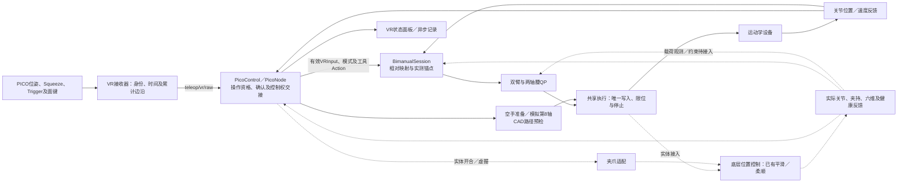

# bindu_teleoperation：遥操作输入与会话

[项目模块导航](../../../README.md#模块快速导航) · [编译与运行](#编译与运行) · [职责与边界](#职责与边界) · [扫雪输入与握持](#扫雪输入与握持) · [PICO 按键方案](#pico-按键方案) · [源码导航](#源码导航) · [接入与验证](#接入与验证) · [关联模块](#关联模块)

处理 VR 输入、坐标映射、位姿滤波、单臂／双臂工具会话与模式切换。ROS 节点由运行装配模块提供。

## 编译与运行

在仓库根目录执行；需要 ROS 2／colcon，Vuer／NumPy／Pillow 及运行装配的 Pinocchio、CasADi、ProxSuite 等依赖。先按 [依赖准备](../../integration/bindu_runtime/README.md#依赖准备) 安装并加载匹配环境；Humble 环境将 `jazzy` 换为 `humble`，数值依赖路径在 ROS 之后加载。

```bash
source /opt/ros/jazzy/setup.bash
# 在此加载上述数值依赖环境。
colcon build --base-paths src --packages-up-to bindu_teleoperation --executor sequential
source install/local_setup.bash
python3 -m tests unit test_one_euro
```

本包是输入／会话库，ROS 程序在 `bindu_runtime`。要运行完整 Snowbot PICO 模拟与电脑操作台，在同一依赖环境继续构建装配、准备查看器，再启动统一入口：

```bash
colcon build --base-paths src --packages-up-to bindu_runtime --executor sequential \
  --cmake-args -DCMAKE_BUILD_TYPE=Release \
  -DPython3_EXECUTABLE="$(command -v python3)" -DPYTHON_EXECUTABLE="$(command -v python3)"
source install/local_setup.bash
python3 -m pip install --target artifacts/snowbot-viewer-deps -r tools/requirements/requirements-snowbot-viewer.txt
export BINDU_VIEWER_DEPS="$PWD/artifacts/snowbot-viewer-deps"
# 指定当前工作区，复用本终端的数值依赖，避免加载本机历史 env.sh。
BINDU_VR_ENV="$PWD/install/local_setup.bash" bash tools/run_vr.sh \
  --config src/integration/bindu_runtime/config/deployments/snowbot_vr_sim.json --check
BINDU_VR_ENV="$PWD/install/local_setup.bash" bash tools/run_vr.sh \
  --config src/integration/bindu_runtime/config/deployments/snowbot_vr_sim.json
```

`--check` 只做配置／依赖／端口检查，第二条命令启动。电脑访问 `http://127.0.0.1:8013/`；默认头显输入只监听本机。连接真实 PICO 时需在两条命令中都增加 `--host 0.0.0.0 --cert-file /绝对路径/server.crt --key-file /绝对路径/server.key`，并确保头显信任证书、地址与主机一致。首次连通先按 [输入诊断步骤](#vr-首次连通检查) 检查；诊断和正式入口不能同时占用8012端口。

统一入口以待命开始，按键与接合步骤见本文 [PICO 按键方案](#pico-按键方案) 和 [运行流程](../../../运行与验证.md#vr-统一部署与启动)。收尾先松 Squeeze、确认保持，再 Ctrl+C。物理测试增加 `--physics` 并安装 Isaac Sim 6.2；真机改用已核实的现场配方，厂商消息、夹爪标定和反馈条件见 [现场部署](../../integration/bindu_runtime/README.md#snowbot-真机最小遥操作)。

## 职责与边界

- 把手柄位姿转为机器人坐标下的相对目标，维护握持、松握重接、暂停和重新对齐语义。
- 区分原始 VR 输入与已在机器人基座坐标系中的工具位姿输入，检查时间、序号与会话身份。
- 单臂委托 IK、双臂委托 QP；轨迹平滑和设备写入交给共享执行与设备层。
- 现场头显、网络与真实握持仍需联调；合成输入或本机 WebSocket 验证不代表现场 VR 已验收。

首次连接实体头显使用[独立连通检查](#vr-首次连通检查)：只采集双手柄并显示位姿、按键和断流，不启动机器人控制；通过后再进入仿真遥操作。

PICO头显采用[简短六态HUD](bindu_teleoperation/vr/hud.py)，正常跟随隐藏诊断，暂停／异常显示原因与下一步，停稳与换握结果均以反馈确认。电脑端Meshcat模型、按键及事件诊断和默认关闭的简化运动学流程见[浏览器操作台](../../../运行与验证.md#真实-pico-的简化仿真与浏览器操作台)。

## 扫雪输入与握持

统一Snowbot位置配方的虚拟工具采用直径36 mm、长54 cm的杆体：两握点间距34 cm，两端各伸出10 cm。`demo.geometry_kind=rod`与`shaft_from_left_grip_m=[-0.44,0.10]`由QP几何检查、电脑／头显显示和PhysX形状共用，铲头不参与此代理的碰撞或质量计算。握点标定、相对控制映射、1 cm／0.02 rad耦合容差及20 mm本体净空不变；实体工具须使用其标定几何。

输入链路为：**VR 手柄位姿 → 接合基准下的相对增量 → 机器人基座系工具目标 → QP**。真机手柄采用相对输入；基座系目标是映射结果。松握停止跟随，重接以当前实测工具和手柄重新建立基准，具体计算见[相对位姿映射](#相对位姿映射)。

当前扫雪装配默认 `tool_input_source=tool_pose`，在命名空间内订阅 `teleop/tool/input` 的 [ToolPoseInput](../../shared/bindu_interfaces/msg/ToolPoseInput.msg)。该接口接收已经映射好的目标 `pose` 与右手握持请求 `tight`；两轴腰部和双臂关节由 QP 自动分配。

| 输入 | 当前 Snowbot 约定 |
|---|---|
| `pose` / `frame_id` | 相对映射后的工具目标，以基座系 `car_base_link` 下的行优先 4×4 SE(3) 表示，平移单位米；也可由模拟输入生成器提供 |
| `tight=true` | 左右手均采用刚性握持约束 |
| `tight=false` | 左手持续紧握；右握点三维位置和杆轴方向保持约束，仅释放绕杆轴转动，不允许沿杆滑动 |
| `source_id` / `seq` / `stamp` / `runtime_mode` | 来源、顺序、时效与环境检查；`valid`、`stop` 表达输入有效性和停止 |

`tight`表达软件约束请求，实体夹爪指令及握持确认尚未接入；当前真实位置链收到`tight=false`会停止。换握先等待已接纳提交和实测停稳，再捕获当前握姿；绝对工具目标保持原坐标语义。

`tool_input_source=vr` 由 `BimanualSession` 消费成对 `VRInput` 并完成相对映射；`ToolPoseSession` 消费上游已映射的目标，两者不重复映射。PICO使用下表；旧`v34`保留[右Trigger虚握](#vr-手柄控制右手虚握2026-10-09)。现场头显、实体夹持及面向统一工具消息的VR转接仍待验收。

普通装配先用 `teleop/select_mode` 选择 `bimanual_tool`，再启动 `teleop/tool_session`；统一PICO配方由协调器管理这两步；[真机最小位置链](../../integration/bindu_runtime/README.md#snowbot-真机最小遥操作)仍需显式管理Action，仅支持位姿／Squeeze／Y。暂停／恢复用 `teleop/tool_pause`：响应只表示接纳，停稳由反馈确认，恢复需请求后的新输入。完整流程从[扫雪运行入口](../../integration/bindu_runtime/README.md#扫雪遥操作)进入。

## PICO 按键方案

**位置契约入口：** `snowbot_vr_sim/real.json`共用PICO协调器、模式Action、位置执行和夹爪服务。默认`independent_arms`普通双臂，B切换`bimanual_tool`扫雪；准备和跟随提交`joint_target`。A依赖现场准备位；X请求可调右爪位置虚握，真机须先完成开度标定，位置到位不代表实体防滑。旧四节点配方仍采用原映射。启动与能力边界见[统一入口](../../../运行与验证.md#vr-统一部署与启动)。

位置契约主流程为：连接并获得有效反馈 → 原位待命 → 对应侧Squeeze先松再握 → 捕获该臂当前末端与手柄基准 → 独立相对跟随，不检查固定工具握点。扫雪模式才要求双侧同时握合及工具握持几何。两种模式共用一个执行租约，普通模式腰部保持；逐侧离合变更先确认整组保持并隔离旧结果，再保留未变侧锚点、只重捕获变化侧。模式切换、A准备和独立装卸完成都只回待命。确认与故障边界见[执行契约6.1](../../../动作执行契约.md#61-snowbot-工具操作与握持切换)。

**PICO准备／装卸已接入位置契约；实体载荷／滑移确认及真实底层恢复仍待验收。** 本文维护按键和相对映射；操作条件与状态图见[执行契约6.1](../../../动作执行契约.md#61-snowbot-工具操作与握持切换)，启动与使用见[运行流程](../../../运行与验证.md#pico-扫雪操作流程)。统一称呼 **Squeeze（侧握键）**、**Trigger（食指扳机）**。

### 普通／扫雪按键（位置契约入口）

左右输入固定对应左右臂／爪，A始终回准备位，Y始终停止；B在待命单击切模式，在明确的装卸或锁定状态确认当前一步。没有长短按B的隐藏分支。两种模式的摇杆方向仍预留底盘，头部跟随未接入。

| 输入 | 普通双臂模式 | 扫雪模式 | 边界 |
|---|---|---|---|
| 左／右手柄位姿 | 分别控制对应臂相对末端目标 | 双手中点平移、左手姿态控制共同工具 | 基准来自当前实测，普通模式腰部保持 |
| 左／右Squeeze | 各侧先松再握，松开该侧保持；另一侧可继续 | 两侧先释放、再同时握住；松任一侧暂停工具 | 初始已握住不算新接合，暂停移手不积累目标 |
| 左／右Trigger | 停稳、松开双侧握后直接控制对应爪；按住开、有效释放合 | 相同；跟随中误扣先停，不排队开爪，停稳松握后重新扣下 | 独立租约、标定、写权限及实测到位／保持仍须通过；不要求先进入装卸，不推断夹持 |
| 左X | 保留，无运动动作 | 按住请求右爪到虚握开度，释放回闭合位；先停稳、等开度到位／保持、重建基准 | 统一位置入口已接，开度可配置；位置反馈不证明实体防滑 |
| 左Y | 任意状态软件停止并锁定，取消待处理操作，保持现有夹持 | 相同 | 已接停止；不是硬件急停，不自动回位／开合 |
| 右A | 停稳松握后，长按1秒并持续按住回准备位；松开停止 | 相同，允许从偏离的耦合姿态回位 | 两模式均忽略持物／原握持关系；保留本体路径、限位和停止检查；缺现场预设时明确拒绝 |
| 右B | 待命松握时单击请求切扫雪 | 同样条件下请求切普通；已确认持共同工具时拒绝 | 先检查目标模式，成功后仍待命；装卸中确认当前一步，锁定停稳后只恢复待命 |
| 两侧摇杆方向 | 预留底盘控制，本期无底盘动作 | 相同 | 未接；不映射到腰／头／模式选择 |
| 两侧摇杆点击 | 左侧单独请求装卸，右侧录制请求 | 相同 | 装卸需支撑确认；录制关闭时明确不可用 |
| 头显视角 | 后续跟随头部，本期只用于VR视图 | 相同 | 未接头部转动 |
| Home／Menu／Capture等系统键（如有） | 保留系统用途 | 相同 | 不依赖系统键送达应用来停止或准备 |

**A回装夹初始位。** 用户要求的init pose是任务预设姿态，用于把雪铲放到双手的装夹位置；首期建议A在两模式指向同一预设，避免切模式后改变回位含义。它不承担解锁或通用确认。A回位不判断持物状态，不要求保持原双手耦合；工具和夹持由操作者观察，机器人本体碰撞／限位仍检查。按A从新鲜实测状态平滑返回，到位并停稳后保持；松A、Y或输入失效停止。到位后再按对应Trigger开爪、放入雪铲、有效释放闭爪，返回初始位本身不改变夹爪。预设来源、控制范围及持铲返回边界见[init pose定义](../../../软件架构设计.md#832-snowbot-实机启动与准备)。

**B切模式与当前步骤确认。** 待命时只接受停稳、双侧松握后的新单击；跟随中按B只停止，不补执行切换，须松握后重新按。目标模式检查失败保留原模式；成功后保持姿态和夹爪、回待命并重新接合，不触发A。装卸中的B只确认支撑或完成，锁定后的B只恢复待命，同一次按键不跨状态连过。具体交接见[双模式实现](../../../软件架构设计.md#834-snowbot普通双臂与扫雪模式切换)。

### 误差、暂停与恢复边界

以下按 `PicoControl`、`BimanualToolNode`、双臂会话／QP、共享执行器和 Snowbot 会话适配的实际入口分类。错误码后缀保留具体关节、几何对或下游原因；配置／ABI／资源布局检查失败属于启动或预检拒绝，不是运动中可去抖的噪声。

| 条件与主要原因 | 当前处置 | 恢复条件 |
|---|---|---|
| 工具任务尚未跟到目标、正常反馈静差／小幅抖动；所有测量、参考、握持与几何保护仍通过 | 继续。适用执行协议下 `tracking_feedback=reference` 不追逐实测滞后；参考领先接近预算时统一缩步 | 无需重启。该模式不代替实测安全检查 |
| 仅候选路径碰到 `GRASP_PENETRATION/CLOSURE`、`SELF_COLLISION` 或杆／铲／箱体净空边界，当前实测到原参考路径安全 | 已有共同步长回退；可以零进展，保留原几何与限速，记录 `BIMANUAL_GEOMETRY_STEP` | 新目标可继续；当前实测或原参考也不安全时立即走拒绝／停止 |
| 原生 QP 最后一次达到迭代上限，零速度满足原关节盒约束及零恢复闭合等式；输出有限、实测到原参考路径重新检查通过、总耗时仍在原预算内 | `BIMANUAL_QP_DEFERRED` 丢弃本次候选，等待下一张新输入；不发命令、不续旧 TTL、不推进接纳参考或前馈历史。零步可行不等于执行器已停 | 输入、完整有限反馈、原意图和控制权有效、没有未结算提交才可延期；上一已接纳动作仍按原接口与期限执行。持续失败有下述单调时钟／次数边界 |
| 其他 QP 不可行、异常、非有限输入／输出、捕获失败、计算／worker／结果超时、积分间隔超界 | 结束当前会话并走既有停止；不归入上述窄类 | 先解决原因。普通操作错误停稳后可明确重入并重捕获；worker 致命故障锁存，须显式更换进程，当前没有自动重建入口 |
| 实测关节／姿态限位、实测与参考超差、实测握点超差、工具观测不一致、当前实测或原参考碰撞／闭合失败 | 保留独立拒绝／停止，不靠任务权重交换 | 现场核对反馈、握点、刚度和实体几何；未标定不能把超差解释为正常静差 |
| 松 Squeeze、暂停、换握、模式切换、取消／时长结束 | 停止／结算在途事务、确认同执行实例与租约代次停稳，再撤参考与重建锚点；旧候选／回执不得重启 | 重握需新的有效接合；移手不累计成恢复跳变。暂停恢复需请求后的新输入 |
| 单手或双手失效／陈旧、停止按键、NaN／布局错误、乱序、时钟回退、来源／连接变化、按键计数不一致、位姿原点跳变 | 活动意图停止／锁定；重复帧不续时效，不把新单手拼成旧另一手。静止待命的输入间断仅重新要求释放基准 | 新鲜完整输入、健康停稳反馈、双侧松握后，明确 B 只回待命；还需新接合。重连本身不续旧意图 |
| 执行实例／模式代次／profile 改变，租约撤销、续租失败或超时，revision 不可用，提交拒绝／未知／过期／超时 | 结束并停止；软件 Submit 接纳与硬件接纳分开，未知回执不推进参考 | 核对唯一控制权、停止证据后明确重入。重复／迟到确认不复用 |
| 执行 `CLOCK_RESET/EXECUTION_OVERRUN/COMMAND_TIMEOUT`、反馈陈旧／速度缺失、参考生成失败、设备反馈／写入拒绝（含部分写入）；单臂 PDO 缺失、WKC／序号／会话协议／驱动故障 | 沿共享执行器与适配器的既有故障／停止接口处理；不替换为通用零速或最后位置 | 故障消除且完整新反馈、停止确认后人工恢复；硬故障未解除时不能用 B 或连接恢复跨过 |
| `*_STOP_UNCONFIRMED`、停止回执／反馈失败或超时 | 保留停止屏障，不能当成任务未到位警告 | 需要同一次停止的可信证据；新实例 IDLE 不能证明旧实例已停 |
| 准备位到达超时、只读预检拒绝、录制器必需但不可用、服务不可用／超时 | 保留原因。准备位仅后端已确认停稳且反馈／输入有效时回待命；持续按 A 不重发，其他情况锁定 | 松 A／握键后可从当前位置明确接管；录制／服务条件恢复后重新操作，不要求正常操作重启全套 |

几何参考精度、准备到位精度、实测跟踪预算和停止确认是不同条件。现有准备容差与停止条件已分开；本轮不新增“宽松”数值档位。实测静差、握点平移／角度噪声、端到端延迟、设备速度与允许任务误差须按现场数据分别标定。当前握持 1 cm／0.02 rad、混合相对残差及参考跟踪预算仍是未完成实体标定的保护设置，不能据离线通过宣称适合实际工具；无力觉与刚度证据不能保证危险内力。

求解延后只保存连续事件计数及已有参考时效的单调时钟截止，不新增控制状态机或可调重试参数。截止是参考捕获／候选采样的单调时刻加现有 `integration_max_sample_gap`，不从首次失败重新续窗，软件接纳延迟也不续窗；首次失败时次数上限为剩余秒数除既有5 ms worker唤醒周期向上取整。达到次数或截止后第一个可运行回调即停止；这不是硬实时停止保证。控制时钟冻结不能无限延期，停止无法确认仍保留屏障。

首次 `BIMANUAL_SOLVE_DEFERRED` 保存输入、实测、原参考、目标、执行状态／命令身份、截止及次数上限，明确 `stop_confirmed=false`；`BIMANUAL_SOLVE_DEFERRED_END` 汇总连续失败数、单调时长及接纳／中断／结束结果。软件 Submit ACK 只确认执行服务接纳；等待时不假设电机已接纳或保持，更不发通用零速。位置接口原命令仍受共享执行器的动态限制和原期限约束；Snowbot SourceEnvelope 普通命令最多200 ms且同一Motion不续期。所有物理停止仍经原接口与反馈验收。QP C++ 与 Python 须来自同一选定版本；旧库的普通失败文本仍按停止处理。该策略不自动清除任何硬故障或 worker 致命故障。

PICO外层与工具内层共用 `bindu_runtime.stop_evidence.stop_feedback_matches`：同执行器实例、profile、环境，保持时原epoch且租约活动，释放时下一epoch且无租约；还须发令后的新鲜反馈、无停止失败／参考、完整有限的实测速度达到原停稳要求。夹爪的独立停止条件仍必须通过。服务／Action回执和新实例IDLE均不能替代这些证据。

工具节点在租约申请派发前固定原执行器实例，revision、保持与释放均沿用该身份；申请回执超时保留原Future，有界补收后清理，仍未知则锁存。工具进程的 `STOP_UNCONFIRMED` 同时阻断预检、检查和新Action；新实例IDLE、旧回执或重连不能清除。正常停止确认后仍可明确重新接合。诊断发布异常不能阻断停止／释放或忙状态清理；失败保留 `diagnostic_error`，正常控制阶段的诊断异常进入结束／停止流程。

正常松握使用既有固定带电保持；重复停止清理、确认后释放及空租约获取／释放不重发PAUSE或TAKEOVER。明确重握的新Motion才走接管，接管请求不等于电机重新使能。启动保持仍仅一次、失败不自动重试；实际使能／失能及PDO、Fault、周期保护由原设备后端负责，本轮没有放宽其保护或改变驱动。

外层以一份 `stop_request` 替代原来的裸截止时间，发令前固定实例／预期epoch及原6秒预算；保持、释放、取消和等待迟到接纳共用该截止，后续RPC不续窗。租约申请与工具Action保留各自原始Future及来源，申请超时不能按拒绝清掉；旧目标反馈不能更改新目标，旧完成不能清掉新句柄。停止失败同次只记一次 `PICO_STOP_UNCONFIRMED`，保留预期／观测身份及原因；超时或未知结果后保持未确认，晚回执与重连不自动解除。

| 操作状态（由现有phase／停止证据表达） | 用户下一步 |
|---|---|
| 未就绪 `checking` | 等待完整新鲜输入与反馈；不发起跟随 |
| 待命 `standby/tool_standby` | 先松Squeeze，再新握接合；A／B仍按上表，不自动回准备位 |
| 执行 `preparing/engaging/following/switching` | 允许原意图；窄类求解延期仍属跟随，不是“已停” |
| 停止确认中（`stop_request`、取消在途或工具 `pausing`） | 保持松握，等原请求的停止证据；不抢新控制权 |
| 已确认停止／普通锁定 | 排除原因；锁定时新按B仅回待命，再重新握。正常松握、重握、换模式无需重启进程 |
| 停止未确认／硬故障 | 禁止接合。先由现场完成可信停止核验与故障处理；不能用B、重连或重启后的IDLE当作旧停止证明。未知停止没有自动软件复位 |

最小流程是：核对选定版本与禁写配方 → 新鲜停稳反馈、松握建立基准 → 新握相对跟随 → 松握等待确认 → 明确重握。硬故障与停止未确认走最后一行，不能为了可用性跳过。切换工作区时须重新构建并显式加载该分支的 `install/local_setup.bash`，核对 `pico_control/teleop_tool` 的模块实际路径与代码哈希，避免终端仍加载旧工作区。wheel打包／独立前缀安装只能验证分发与代码可达性，不能代替完整ROS／DDS和实体停止验收。

**待现场验收。** 普通双臂、A配置化准备和B模式交接已共用位置契约；现场准备位、夹爪标定、实际保持／跟踪仍须实测。X按用户确认先采用右爪轻微张开的可调位置，参数与流程见[夹爪位置闭环](../../hardware/bindu_hardware/README.md#snowbot真实夹爪位置闭环)；当前`grasp_state=unknown`不证明夹稳或防滑。普通模式边移动边开合不在本次实现范围。

常态不持续扣Trigger，也不因切换模式自动开合。模拟量采用按下`>0.7`、释放`<0.3`的迟滞区间，现有模拟接合／准备的1秒为配置初值；实体阈值、开合速度与力限制须标定。首次接管、失联及操作仲裁统一见执行契约。

头部后续可跟随VR视角，当前不接入。Snowbot真实夹爪位置闭环通过独立的`gripper/lease`、`gripper/control`及`gripper/state`接入，命令由现有Snowbot执行节点下发。经现场标定且双臂已停止／释放控制权后，PICO在双侧松握时接受新Trigger输入，直接授权对应夹爪的标定开／闭端点；作业会话中的Trigger先停止，停稳后须重新扣下。直接开合不声明空载、支撑或夹持，已知持物开爪清为未知；显式装卸确认仍走左摇杆独立流程。旧四节点入口不启用PICO协调器；统一位置入口已通过协调器接入装卸、配置化A准备和X位置虚握。位置到位、软件开合状态与真实夹持分别判断，`grasp_state`当前始终为`unknown`；命令、底层保护与标定步骤见[真实夹爪位置闭环](../../hardware/bindu_hardware/README.md#snowbot真实夹爪位置闭环)。

### 相对位姿映射

Snowbot统一位置配方使用`vr_tool_mapping=hand_line_midpoint`，模拟与实机接口共用：双手柄中点增量控制双握点中点，手柄连线的相对转向与剥离连线转动后的双腕轴向转角合成整体旋转。平移与整体旋转共用固定基座方向，重接合仅重锁输入和工具基准，不重新旋转操作坐标系。刚握与虚握使用同一输入映射；杆轴改变不要求左手腕同时转动。旧配方未配置此字段时保留原腕姿映射。

WebXR位姿先由[robot_pose](bindu_teleoperation/vr/mapping.py)统一轴向，再以`operator_yaw_rad`同时校正平移和旋转方向。设手柄中点为`m`／`m0`，工具基准为`p0`／`R0`，标定握点中点在工具系中为`c`，固定方向标定为`C`、比例为`s`；由连线转向与双腕自转得到`R_target`后：

```text
R_target = C * R_pair * transpose(R_pair0) * transpose(C) * R0
midpoint_target = p0 + R0 * c + s * C * (m - m0)
p_target = midpoint_target - R_target * c
```

这使原地转动围绕双握点中点，保留真实铲体原点、尺寸与碰撞几何；不因远处铲头原点产生额外手部位移。普通双臂模式仍各自跟随对应手柄。

接合、换握或恢复后重建基准；松握期间的位移不累积，首个目标对齐当前工具。目标采用上表的基座系SE(3)表达；旧单臂`v34_anchor`组合语义保留。

**短棍简化仿真**：`pico_simulation_demo=true`通过[simulation_fixture.py](bindu_teleoperation/simulation_fixture.py)从同一握点配置生成长约0.56m、握点间距0.34m的短棍，工具原点移到双握点中点。QP、CAD碰撞、Vuer和Meshcat共用该变换；没有隐藏铲头或接雪箱碰撞。原长铲几何的坐标原点或长度改变，不改变短棍的握点与控制杠杆。

- 平移仍为上式，`s=0.5`，三个方向等比例；两手共同平移10cm产生5cm中点目标位移。间距变化不会拉长机器人短棍，绕轴角不乘平移比例。
- 棍轴方向取两手柄连线相对接合连线的转动。先剥离连线转向，再分别从两手柄相对各自接合姿态的旋转中提取轴向分量，连续展开角度后等权平均；同向等量转动产生等量自转，单侧转动贡献一半，反向等量抵消。不平均左右手柄的绝对姿态。
- 连线转向与共同拧腕合成完整的人手相对旋转，经固定方向标定施加到机器人短棍。初始人手连线与机器人杆轴不平行时，绕人手连线拧腕也绕该固定空间轴转动，可能同时改变机器人杆轴；若希望对应纯杆轴自转，应在接合时使两杆轴平行。初始腕姿不同、共同转动跨±π及任意接合方向的三轴转动由回归覆盖。
- 接合期间不发运动目标；异步实测工具捕获完成后，同步重锁最新双手输入基准，首目标等于实测工具。松握先停止并等待停稳，隔离旧工作结果；暂停移手不积累目标，再握重新锁存平移、连线和两侧转角基准。Y锁定后，输入恢复或持续握住均不能自动续跑；松握后B恢复待命。
- 采样间隔与积分步长分别配置：Snowbot统一位置入口允许250ms采样间隔，积分步长仍最多100ms，输入／反馈有效期仍为250／200ms；模拟与实机接口共用。超过边界或时间倒退停止，实际间隔与积分值写入事件。旧演示最多250ms；配置不得超过输入有效期。客户端、接收与求解诊断见[运行日志](../../../运行与验证.md#vr-统一部署与启动)。

轴向转换与[OpenTeleVision的基变换](https://github.com/OpenTeleVision/TeleVision/blob/main/teleop/constants_vuer.py)、[Unitree TeleVuer](https://github.com/unitreerobotics/televuer/blob/main/src/televuer/tv_wrapper.py)一致：XR右／上／前对应机器人右／上／前。Unitree另支持头部yaw参考；本相对工具会话使用固定基座方向，头部转动不改变已接合映射。重接合的位置与姿态重锁、仅缩放平移也与[NVIDIA Isaac Capture的clutch设计](https://nvidia.github.io/IsaacCapture/main/references/retargeting/so101.html)一致；其5自由度机械臂的姿态保持取舍不直接套用于本双臂工具。

### 协议字段与现有实现

| 物理输入／协议 | 代码字段与兼容边界 |
|---|---|
| Squeeze：`squeezeValue` | [receiver.py](bindu_teleoperation/vr/receiver.py)写入兼容字段`grip`，不用于夹爪开合 |
| Trigger：`triggerValue` | `trigger`控制左右独立夹爪；PICO的`virtual_grip`单独传入会话，避免旧右Trigger虚握双重触发 |
| 左X/Y、右A/B及摇杆点击 | Vuer面键别名为`aButton/bButton`；各侧`buttons`位0／1／2为主键／副键／摇杆，PICO固定`init=false` |
| 短按／释放 | `button_edges`为主键／副键／摇杆／Trigger按下和释放的8个累计计数；Squeeze另用`clutch_seq`。合并位姿不丢边沿，首次历史计数不执行 |

PICO实体布局参考[官方OpenXR定义](https://github.com/Pico-Developer/PICO-Unity-SDK/blob/main/XR/Runtime/Scripts/OpenXRFeatures/Interactions/PICO4UltraControllerProfile.cs)，标准WebXR索引见[PICO 4 profile](https://github.com/immersive-web/webxr-input-profiles/blob/main/packages/registry/profiles/pico/pico-4.json)：Trigger／Squeeze／摇杆点击／两面键为0／1／3／4、5，摇杆轴为2、3。仅在设备声明匹配profile／mapping时使用，并以只读面板逐键核对。2026-10-18已确认现场设备为PICO 4并收到真实双手柄位姿、面键、摇杆点击与扳机输入；PICO OS版本、完整逐键方向／侧握和机器人跟随仍需验证。

本机旧例位于`代码参考包/Bindu-历史代码精选-2026-09-16/03_遥操作与灵巧手/v3.4/`，独立v4尚未定位。`vr_main.py`实际为右B初始化左臂、右A初始化右臂、侧握跟随、左`bButton`退出，旧提示与分支不一致。PICO须显式启用，双臂会话继续拒绝旧`init`。

### 程序接入

[PicoControl](bindu_teleoperation/pico.py)维护操作状态与代次；[PicoNode](../../integration/bindu_runtime/bindu_runtime/pico_node.py)串接模式／工具Action和执行租约。[专用配置](../../integration/bindu_runtime/config/deployments/teleop_pico_snowbot_sim.json)显式启用`pico_enabled=true`、`tool_input_source=vr`；[第8轴参数](../../integration/bindu_runtime/config/robots/snowbot/pico_snowbot_sim.json)仅作模拟代理。状态面板、人工持物声明和验证命令统一见运行流程。

## 源码导航

| 入口 | 内容 |
|---|---|
| [pico.py](bindu_teleoperation/pico.py) | PICO按键边沿、资格、装卸／虚握／停止恢复状态机 |
| [session.py](bindu_teleoperation/session.py) | 单臂相对控制会话 |
| [independent_session.py](bindu_teleoperation/independent_session.py) | 普通双臂逐侧离合、相对目标与暂停侧重捕获 |
| [bimanual_session.py](bindu_teleoperation/bimanual_session.py) | BimanualSession（成对 VR 相对映射）、ToolPoseSession（映射后工具目标）、ToolPause 与 AcceptedReference |
| [modes.py](bindu_teleoperation/modes.py) | 手动模式选择与会话切换检查 |
| [config.py](bindu_teleoperation/config.py) | 输入映射与控制配置加载 |
| [vr/](bindu_teleoperation/vr) | VR 接收、坐标映射、One Euro 滤波和显示 |
| [feedback.py](bindu_teleoperation/feedback.py) | 供显示使用的只读反馈 |

## 接入与验证

ROS 入口：[单臂节点](../../integration/bindu_runtime/bindu_runtime/teleop_node.py)、[工具节点](../../integration/bindu_runtime/bindu_runtime/bimanual_tool_node.py)、[VR 输入节点](../../integration/bindu_runtime/bindu_runtime/vr_input_node.py)。装配与模式配置从 [bindu_runtime](../../integration/bindu_runtime/README.md) 进入。

- 输入与依赖：[VR 遥操作运行入口](#vr-遥操作运行入口)。
- 模式与自由度：[手动选择本体与自由度](../../integration/bindu_runtime/README.md#手动选择本体与自由度)。
- 单元检查：[会话](../../../tests/unit/test_teleoperation.py)、[模式](../../../tests/unit/test_teleop_modes.py)、[One Euro](../../../tests/unit/test_one_euro.py)。
- ROS 场景：[validate_teleop.py](../../../tests/integration/validate_teleop.py)、[validate_bimanual.py](../../../tests/integration/validate_bimanual.py)，依赖对应模拟装配。

## 关联模块

[运动学](../bindu_kinematics/README.md) · [公共输入契约](../../shared/bindu_contracts/README.md) · [共享执行](../../control/bindu_execution/README.md) · [运行装配](../../integration/bindu_runtime/README.md)

## 运行与专项验证

以下命令和项目路径均相对于仓库根目录。带日期内容仅代表当时的专项实验，现行控制规则以动作执行契约和统一部署为准。

### 遥操作专用装配与暂停

`teleop_only.launch.py` 复用现有机器人 launch 和同一套单臂、双臂、模式选择及共享执行节点，不启动任务编排、导航、VLA 或感知。默认配置 [teleop_robot_deployment.json](../../integration/bindu_runtime/config/deployments/teleop_robot_deployment.json) 集中选择本体配置、输入源及后端；本体配置再引用模型、执行profile和工具。旧schema 1文件仍兼容，具体选择方式见[手动选择本体与自由度](../../integration/bindu_runtime/README.md#手动选择本体与自由度)。`vr_enabled`、`description_enabled`、`tool_display_enabled`、`single_arm_enabled`控制可选节点。`recording_mode=off`保留记录器健康节点；同时设置`recorder_enabled=false`才完全省去记录节点及其健康依赖，此时必须`recording_mode=off`。包依赖尚未拆分，停用模块不等于移除安装依赖。

在已构建并加载匹配 ROS 发行版、工作区及运动学依赖的终端运行：

```bash
ros2 launch bindu_runtime teleop_only.launch.py
# 自定义配置路径；@runtime/ 前缀在配置内指向安装后的 bindu_runtime 目录。
# ros2 launch bindu_runtime teleop_only.launch.py config:=/absolute/path/deployment.json
ros2 topic echo /bindu_teleop/teleop/tool/display
# 以下服务作用于已显式启动的双臂工具会话。
ros2 service call /bindu_teleop/teleop/tool_pause std_srvs/srv/SetBool '{data: true}'
ros2 service call /bindu_teleop/teleop/tool_pause std_srvs/srv/SetBool '{data: false}'
```

默认输入为 `ToolPoseInput`，动作载荷仍只有工具位姿与右手 `tight`；启动不会选择工具模式、开启会话、运动到准备位置或注入演示握姿。模拟器从默认零位等待；工具模式仍需有效握姿、输入及显式模式选择/会话，不能直接将零位视为已经拿住工具。默认配方仍为仿真；真实后端须使用下节专用配套配置。schema 2不接受`initialize_tool_pose`覆盖；已有仿真验证器可继续显式设置测试夹具。

暂停服务的成功响应只表示请求接纳。节点等待已有提交完成，调用既有停止流程，依据新鲜关节反馈确认速度低于 0.005 rad/s 且参考已清除后，才发出 `BIMANUAL_PAUSED / STOP_CONFIRMED` 和 Action 的 `paused:*` 反馈。此时保留租约，允许输入暂时断流；取消、模式切换、反馈失效、记录器故障与会话到期仍按原规则结束。恢复需要在恢复请求之后产生的新序号、新时间戳输入，重捕获当前实测姿态，旧求解结果失效；等待超过 `input_max_age` 则结束。绝对工具输入恢复后继续跟随新绝对位姿，不暗中改写目标。暂停和取消是会话操作，不加入动作位姿载荷。

`teleop/tool/display` 是独立只读观察节点发布的 JSON，频率 10 Hz：`requested` 为新鲜原始工具请求，`target` 为最近一次 QP 处理的目标，`measured` 为关节反馈经 FK 得到的工具位姿，`error` 比较后两者；没有当前有效数据时用 `null`。`mode/reason` 显示跟随、暂停中、已停稳、等待恢复输入及拒绝/结束原因，几何拒绝、限位或输入过期沿用实际错误码。`grasp_requested/grasp_applied` 表示请求与已捕获的软件约束，`physical_gripper_confirmed` 当前始终为 `null`；这不代表实体夹爪已闭合。位姿为配置基座坐标系下行优先 4×4 矩阵。观察节点退出不影响控制，显示客户端应在 0.6 秒无更新后标为过期；不能把最后一帧视为仍在反馈。成对 VR 路径没有原始工具消息时，`requested` 为 `null`，`target` 仍来自 QP 事件。

**真机接入边界。** 用户已确认位置命令，不再将速度或整段轨迹作为待选控制类型。现场位置转接需要落实关节名/顺序/单位、实际反馈、既有插值与缓冲、停止/保持及接纳状态；不重复实现已有设备插值。初始执行参考缓存的零值不是实测位置或准备动作。准备及夹爪流程的已确认需求与待接入边界见[现场转接](../../integration/bindu_runtime/README.md#831-按需装配与现场转接)。`tight=false` 仅表示右手轴向虚握，绝不能映射成实体夹爪完全打开。

**Ubuntu 22.04 / Humble。** 这是用户确认的目标，属于 [ROS 2 官方支持平台](https://raw.githubusercontent.com/ros-infrastructure/rep/master/rep-2000.rst)，默认 Python 为 3.10。部署需在目标系统重新构建消息、原生执行器与 QP，不复制 Jazzy/Python 3.12 的 `build/install`，不混入其 `PYTHONPATH`、`LD_LIBRARY_PATH` 或旧工作区。Pinocchio/Coal/Boost/EigenPy 的 Python 与 C++ 库必须使用匹配版本；若落在 Orin，还需 ARM64 构建及性能实测。仅用一种 ROS 发行版进行现场链路验收，不将跨 Jazzy/Humble 互通作为前提。跨机发送时还需核对 DDS 域/QoS 与时钟同步：当前输入/反馈时效分别为250/200 ms，时间戳偏差会造成过期拒绝；本机模拟的 `ROS_LOCALHOST_ONLY=1` 不能照搬到需要跨机发现的链路。

原依赖固定 NumPy 2.3.5，而 [NumPy 2.3 要求 Python 3.11 起](https://numpy.org/doc/2.3/release/2.3.0-notes.html)。已按解释器分支：3.10 使用 2.2.6，3.11 及以上保留 2.3.5。10月9日的44项检查仅覆盖 Ubuntu 24 主机上的隔离 Python 3.10；10月10日进一步在官方 Ubuntu 22.04.5 / Humble / Python 3.10.12 的 x86_64 容器中构建遥操作依赖装配15包，86项Python与18项原生QP检查无跳过通过，实际ROS暂停、恢复后断流、握持切换、取消及切回单臂通过。证据见`artifacts/teleop-fixes-2026-10-10/verification.json`，不包含可选LIO构建、ARM64/Orin、现场VR或真实设备。

固定`pin==3.9.0`的同时固定`cmeel-urdfdom==4.0.1`与`cmeel-tinyxml2==10.0.0`：其宽泛的传递依赖会选中新SONAME，曾导致构建成功但加载时缺少`liburdfdom_sensor.so.4.0`。容器在`venv --system-site-packages`中安装wheel依赖，继承Humble系统包，不借用Jazzy的`rclpy`。SciPy 1.15.3供测试使用；CMake 3.31.6避免旧版依赖查找覆盖`PACKAGE_PREFIX_DIR`而使ProxSuite导出错误路径，相关行为见[CMake官方说明](https://cmake.org/cmake/help/latest/module/CMakePackageConfigHelpers.html)。只读源码挂载使用标准安装，`symlink-install`构建原生Python扩展会尝试写回源码，不能用于该挂载。

本机安装Docker后可运行以下脚本；它下载官方镜像和依赖，只读挂载源码，构建与测试产物写入指定目录。容器构建和模拟验收不启动真实设备，仍需在目标Orin环境重建与测量。

```bash
bash tools/deployment/validate_humble_teleop.sh artifacts/humble-teleop-check
```

本轮 Jazzy 模拟验证覆盖专用 launch 无启动动作、运动中暂停、0.8 秒输入断流保持、恢复、握持切换、暂停时取消及切回单臂，独立观察节点参与实测。原始结果在 `artifacts/teleop-deployment-2026-10-09/`。诊断重放仍出现几何检查包含在内的 30 ms 求解超时，保留失败且未放宽阈值；目标硬件需测分段耗时与停止延迟，100 Hz 配置不能作为实时性能保证。

```bash
python3 -m tests unit test_teleop_deployment
python3 -m tests unit test_teleop_modes
python3 -m tests.integration.validate_bimanual --snowbot --axial-grasp --tool-pose-input \
  --pause-resume --tool-display --output artifacts/teleop-pause-check
```


### 验证与未接入项

`VRInput`、`RecorderHealth`新增字段及`PicoContext`须与受影响节点同批重建，不能混用旧安装。以下验证自带模拟进程和已知夹具；每次选择新输出目录，不启动硬件：

```bash
python3 -m tests unit pico
python3 -m tests integration pico --output artifacts/pico-check
python3 -m tests integration pico --crash-coordinator --output artifacts/pico-crash-check
# 需工具配置已开启check_grasp_contacts：
python3 -m tests integration pico --reject-virtual --output artifacts/pico-invalid-grasp-check
```

完整铲雪可使用真实 Vuer 接收端的合成手柄输入，发送 MessagePack `CONTROLLER_MOVE`、OpenXR 列主序双手矩阵及原始按键；接收器自行生成来源、序号和按键边沿，后续经过 PICO 协调器、相对映射、联合 QP 和共享执行器。验证器不发布 `VRInput`、`ToolPoseInput` 或关节命令。加载上述工作区及 Vuer／WebSocket 依赖后运行：

```bash
export ROS_DOMAIN_ID=181 ROS_LOCALHOST_ONLY=1
export OPENBLAS_NUM_THREADS=1 OMP_NUM_THREADS=1
python3 -m tests integration pico --websocket-input --shovel-cycle \
  --operator-speed 1 --input-period .02 --output artifacts/pico-vr-shovel-check
```

`--operator-speed`只缩放模拟手柄移动速度，位姿在发包线程按当前时刻计算。X按下／释放分别等待模拟夹爪动作和QP重新捕获，期间手柄保持原位，配方时钟暂停；松Squeeze后核对停稳，再用Y锁定。每批保存原始WebSocket包、原始／投影VR帧、映射基准、目标及实际关节反馈；有界验证器暂停自身循环GC以免证据采集阻塞发送线程，运行节点的GC与时限不变。

为缩短X切换，PICO验证工作进程启动时预加载空手／持物CAD上下文，每次仍核对新鲜实测起点及完整路径；只复用几何模型，不缓存通过结果。模拟虚握小角度运动按同一速度／加速度／jerk限值缩短，缩短搜索以300 ms为下限，给120 ms参考段留出传输余量，实际选用0.356秒曲线；装卸大开合仍用配置的1.5秒。停止、到位、重捕获和初始Squeeze接合条件不变。

2026-10-15进一步优化连续X换握：符合[连续换握契约](../../../动作执行契约.md)时，将重复的1秒接合等待改为80 ms；实际夹爪动作、停稳、完整路径和新基准捕获仍执行。两轮真实Vuer原始输入整套铲雪为27.03／27.10秒，两次切换等待分别0.86／0.82秒、0.97／0.80秒；此前为1.85／1.76秒、全程28.98秒。最终批2,717个反馈姿态CAD零违规，刚握／虚握握点峰值0.783／0.637 mm；绝对工具跟踪峰值269.55 mm／0.37806 rad仍按report_only记录。35项PICO及23项模式检查、12项真实WebSocket按键／断流／持铲重启回归和两包重建通过。批次索引`artifacts/mode-switch-2026-10-15/verification.json`；Isaac窗口替换为最终27.14秒实际反馈的只读回放，实体夹持和真机未验收。

全程刚握对照沿用同一工具配方、模型、控制参数与保护，在上述完整铲雪命令中加`--rigid-only`，例如`--operator-speed .7 --input-period .02 --rigid-only`；只在验证器中不发送X，原始位姿／Squeeze及全部生产链路不变，不修改默认握持配置。2026-10-15本批虚握1倍档27.08秒通过；刚握1倍／0.85倍在配方13.22／12.69秒因候选杆—`body_link_2`净空19.07／19.55 mm触发20 mm保护，未完成整轮，实际已执行采样最小净空21.72／21.56 mm、CAD零违规。刚握0.7倍35.81秒完成，3,588姿态CAD零违规、握点峰值0.976 mm、最小本体净空27.30 mm，实际倒雪／回位通过；无X与虚握标志已独立核对。Isaac展示该成功档的35.86秒实际反馈、1,794个姿态，全程双手刚握。索引`artifacts/rigid-grasp-2026-10-15/verification.json`保留快档失败和慢档成功；该比较不能判断真实夹持内力。

2026-10-15用户明确本场景优先验证双臂耦合，工具绝对跟踪不再强制20 mm。扫雪配置的`demo.acceptance.tool_tracking_policy=report_only`保留20 mm／0.03 rad参考值及全部实测误差，但超出参考值不单独拒绝；缺省策略仍为`required`。运动学实测验收要求握点相对几何误差≤1 mm、杆轴偏差≤0.02 rad，刚握还检查每次确认捕获后的双臂相对转角≤0.02 rad；虚握允许绕杆转动，重新刚握捕获当时转角。回位和阶段工具角度同样按策略记录参考达标情况；关节动态限值、碰撞／地面／完整杆指爪穿透、停止／断流和实际抬升检查继续保留。这些是运动学协调指标，不能代替接触载荷或实体夹持判据。

此前耦合优先批采用`relative_gain=6`、`max_reference_error=0.06 rad`，工具增益为6；当时缩小参考超前预算以改善耦合，未提高关节速度／加速度／jerk限值。新批`artifacts/coupling-priority-2026-10-15/vr-fast/results.json`通过真实VR通信入口完成28.98秒周期，直接工具目标消息为0，较此前39.31秒缩短约26%；2,906个实际反馈姿态CAD零违规。刚握／虚握最大握点误差0.886／0.746 mm，刚握相对转角0.00244 rad；工具位置／旋转峰值290.99 mm／0.46115 rad，超出参考值且明确记录。实测铲入164.95 mm、抬升883.45 mm，倒雪箱口包络通过。0.9倍档31.68秒也通过，握点峰值0.656／0.568 mm、工具位置峰值241.93 mm。18项动作／策略检查及两包重建通过，详见本批索引；Isaac只读显示实际ROS反馈，控制闭环仍为ROS运动学仿真，现场头显、无线／TLS、实体夹持和接触动力学未验收。

当前已修复快动作末端滞后：`max_reference_error`恢复为0.15 rad，`relative_gain=6`及关节0.75 rad/s、9 rad/s²、162 rad/s³不变。该参数是已接纳关节参考相对实测的超前预算，不是工具误差评分门槛；此前0.06 rad与同步C2执行的暂态滞后不匹配，反复触发整组缩步。仍保留20%传输余量、参考超差停止、1 mm耦合门槛及原几何检查。两轮真实Vuer原始输入快档26.88／26.89秒完成；最终左右握点到目标峰值24.60／23.85 mm（旧批190.19／209.51 mm）、RMS 5.52／5.92 mm，耦合峰值0.875 mm，2,695个实测姿态CAD零违规，铲入／抬升／倒雪／回位通过。新增快配方行为回归独立检查4 cm跟踪和原耦合要求，不改变report_only任务策略；旧0.06 rad配置明确触发该测试失败。证据`artifacts/tracking-fix-2026-10-15/verification.json`。当前控制为ROS运动学仿真，未验证现场头显、接触载荷或真机。

此前严格工具跟踪批`artifacts/vr-shovel-interface-2026-10-15/run-20/results.json`为39.31秒、位置峰值16.97 mm，保留作为旧验收目标的对照；其他候选失败记录不改写。旧批29项PICO、36项QP、14项动作检查、12项WebSocket场景及错误虚握拒绝专项见其索引，100 Hz持载重启曾出现PICO_PAIR_INVALID，补诊断复测通过但偶发根因未确认。

2026-10-15完成116项相关检查、12项ROS场景及崩溃停止／错误虚握拒绝专项，证据为`artifacts/pico-controls-2026-10-15/verification.json`。现场PICO、Isaac端到端物理操作、实体夹爪／力与滑移、真实恢复及本批Humble／Orin未验收。实体接入顺序为底层待命改造 → 标定夹爪及六维反馈 → 只读逐键核对 → 物理启动／重启 → 实机有支撑装夹，重点补验：

- 按住键启动／重连、旧请求、同帧冲突、拒绝后不补执行、合并位姿中的短暂松握、追踪／坐标原点异常。
- 左右扳机独立及交叉释放、作业误扣只停止、失联不自动闭合、X与开爪互斥、单爪失败；虚握抖动／中断、迟到乱序确认、左手承载不足及沿杆滑移。
- 关节／夹爪／六维反馈冻结、停止未确认、新会话拒绝及底层持载重启；逐次保存操作请求、实际夹持、QP模式、停止证据和代次。


### VR 手柄控制右手虚握（2026-10-09）

当前位置契约通过X请求右爪虚握位／闭合位，实测到位并保持后才重新捕获。操作及停止规则见[执行契约](../../../动作执行契约.md#61-snowbot-工具操作与握持切换)，入口见[统一部署](../../../运行与验证.md#vr-统一部署与启动)。旧实验使用的装配、参数与批次结果已保留在本地`过程记录/2026-10-09.md`，不作为现行按键操作。


### VR 首次连通检查

排查输入间断时，统一入口可临时加 `--input-timing`（`x86_real start`透传该选项），底层launch对应`input_timing_enabled:=true`；默认关闭，不改变运动授权、源时间或TTL。保持默认诊断开启，保存完整`vr-health.jsonl`及分卷、`session.json`、原始/投影输入和运行事件。该标志只开启观测；实际启动仍按既有人工流程及禁写/停止条件执行。先用禁写配方、松握与静止反馈验证输入，不能为取证启用运动或自动恢复故障。

`PICO_INPUT_DELIVERY_GAP.interval_s`是协调器完整双手帧回调的ROS时间间隔，另记`monotonic_interval_s`，不代表设备采样或网络时延。源`VRInput.stamp`沿用服务端控制回调时刻，也不等于头显采样。分段摘要`input_pipeline`每秒记录轮询/回调最大耗时、Vuer解码后任务派发等待、控制回调处理、帧队列等待及出队到ROS轮询结束的耗时（含实际发布），带对应源/序号；无输入时仍记录轮询次数，以区分上游安静和本进程停顿。它不是硬实时性能证明；旧macOS/Python不能共享单调时钟时省略跨进程差值。浏览器`perf_ms`与服务端单调时钟只能比较间隔变化，不能相减当单向网络延迟；socket接收/解码之前的细分仍未知。归因须联合浏览器发送间隔、服务端事件循环摘要、队列/发布摘要和协调器记录，不能仅凭一条gap诊断通信故障。

首次接实体头显先运行独立输入诊断，再做机器人仿真跟随。该入口复用正式的 Vuer／`CONTROLLER_MOVE` 解码与 PICO 按键计数，但不加载 ROS、IK、执行器或驱动，也不发布运动命令。头显直接使用**自带 PICO 浏览器**，与电脑在可互通的局域网；不需要 XRoboToolkit 或 pico-ros2-bridge。

现场输入取证优先用这个独立入口，复用已有可信证书，不运行 `--make-cert`，不启动或恢复任何机器人作业。它不接受 `--config`／`--enable-commands`，`BINDU_VR_CONFIG`也不会切入控制；即使握住手柄或按下按钮，仍只有输入诊断。它能核对上游输入，不能单独证明ROS发布／协调器段的时序。

需要完整分段日志时，只能在现场人员已经核实的禁写装配中加 `--input-timing`。禁写不是“松握”约定，须同时核对：新实例使用布尔 `command_enabled=false`，没有 `--enable-commands`或launch覆写；执行节点该参数为只读且实际值为false；目标流／旧位置接口／腰头／夹爪硬件命令及心跳没有Bindu发布者，`startup_hold_state=disabled`。离线回归已验证写入返回 `SNOWBOT_COMMANDS_DISABLED`／`GRIPPER_COMMANDS_DISABLED`；现场只读查参数与图，不以试发运动命令检验闸门。配置、解释器与实际模块路径／哈希应记录。

这些闸门只限制该Bindu实例，不能阻止另一进程或旧底层自身的启动回位；不得为取证启动驱动，也不能用命令话题无发布者替代实体停稳核验。发现其他写者或现场状态不明时，先停留在独立输入诊断，不自行启停作业。完整禁写模式仍允许状态／诊断发布，它们不等于硬件运动输出。

下面以电脑地址 `192.168.1.116` 为例。选择已装有 Vuer、NumPy、Pillow 的 Python 环境（依赖见 `tools/requirements/requirements-teleop.txt`）；生成证书还需 `cryptography`。本机已存在的 `bindu` 环境可用，其他电脑须改为自己的 Python 路径。已有可信的服务器证书时直接跳过生成步骤，指定原证书和私钥。

```bash
cd /home/wxb/bindu
/home/wxb/miniforge3/envs/bindu/bin/python -m tools.teleop.vr_connectivity \
  --make-cert artifacts/vr-connectivity/tls --advertise-host 192.168.1.116
/home/wxb/miniforge3/envs/bindu/bin/python -m tools.teleop.vr_connectivity \
  --host 0.0.0.0 --advertise-host 192.168.1.116 \
  --cert-file artifacts/vr-connectivity/tls/server.crt \
  --key-file artifacts/vr-connectivity/tls/server.key --duration 1800
```

生成命令不会覆盖已有证书，不修改电脑或头显的信任设置。将生成目录中的**公开 `rootCA.crt`**导入头显信任设置；具体导入入口取决于 PICO OS。`rootCA.key`／`server.key` 留在电脑，不复制到头显。直接略过证书告警不等于 WebXR 已处于安全上下文；若头显不能导入该 CA，应使用头显已信任 CA 签发的服务证书，不能把降级 HTTP 当作通过。生成的证书只用于对应 IP，IP 改变后需重新准备证书。

头显输入完整地址：

```text
https://192.168.1.116:8012/?ws=wss%3A%2F%2F192.168.1.116%3A8012%2F
```

`https://`是页面，查询参数中的`wss://`是数据连接；不要填`localhost`或`0.0.0.0`。本地入口已为不带`ws`参数的短地址自动补上同主机、同端口的数据连接，避免 Vuer 0.0.60 的 HTTPS 默认地址漏掉8012端口；旧服务须重启后生效。页面和 WebSocket 都需通过证书验证。点击页面的 **Enter VR／VR** 并允许追踪，唤醒左右手柄，再完成下列检查：

1. 页面不再显示离线，出现 `BINDU | VR CONNECTIVITY | NO ROBOT` 面板。
2. 移动两个手柄，状态为 `INPUT_LIVE`，左右 XYZ 连续变化。数值为 WebXR 追踪空间，单位米，尚未映射到机器人基座系。
3. 分别按两侧侧握和扳机，`S`／`T`应变化；左 X／Y、右 A／B 及摇杆点击逐个变化，终端同时输出累计按下／释放计数。当前诊断不采集摇杆方向、头部或相机。
4. 退出 VR／关闭页面，应在约 0.5 秒后变为 `INPUT_STALE`，旧位姿和按键不再显示为有效；重新打开并进入 VR 后重新出现输入。完全断网时头显页面可能停在最后一帧，以电脑端输出为准。

状态含义：`INPUT_WAITING`尚未收到事件；`INPUT_PARTIAL`仅一侧有效；`INPUT_INVALID`收到事件但字段不符合现有协议；`INPUT_STALE`输入过期。`INPUT_LIVE`只表示收到符合协议的新输入，不是独立的追踪精度或机器人到达证明。`PC receive Hz`按电脑接收序号与时间估计，不能作端到端延迟。

遇到“已离线”按顺序检查：电脑进程是否仍运行、`ss -ltnp '( sport = :8012 )'`是否监听局域网地址、头显与电脑是否互通及被访客 Wi-Fi 隔离、证书是否被头显信任、地址中`ws`参数是否指向同一台电脑。连接正常却一直`INPUT_WAITING`，检查是否进入VR并授权追踪；`INPUT_INVALID`需核对实际浏览器事件字段，不靠改控制参数掩盖。诊断和正式VR输入服务不能同时占用8012端口；诊断按Ctrl+C收尾后，再使用下节或PICO仿真入口。


### VR 遥操作运行入口

核心代码位于 [`bindu_teleoperation`](bindu_teleoperation) 和 [`bindu_kinematics`](../bindu_kinematics/bindu_kinematics)。本批接入 v3.4 的 `CONTROLLER_MOVE` 输入、OpenXR 坐标转换和相对控制，使用独立进程进行 Pinocchio FK / CasADi 连续 IK，经公共执行服务驱动 **7 轴左臂模拟器**。输入端与机器人驱动分离，后续仍以 VR 为遥操作入口。

示例配置 `teleop_v34.json` 使用 `mapping_mode: "robot_base"`，重新握持时维持空间方向；`operator_yaw_rad` 用于启动前水平朝向校准。旧配置未提供模式时保留 `v34_anchor` 行为；需要旧操作习惯可显式选择该模式并将偏角设为0。坐标和旋转定义见[架构中的单臂映射规则](../../../软件架构设计.md#854-当前代码组织与替换边界)。

可选依赖在 Ubuntu 24.04 / Python 3.12 / x86_64 验证；Orin 尚未验证。先按[环境准备与构建](../../../运行与验证.md#环境准备与构建)构建并加载 ROS 与工作区，再在当前工作区隔离安装依赖。下面的库路径用于避免 ROS 自带 EigenPy 与 Pinocchio wheel 混用，仅影响当前终端：

```bash
python3 -m pip install --target artifacts/teleop-deps -r tools/requirements/requirements-teleop.txt
export BINDU_TELEOP_DEPS="$PWD/artifacts/teleop-deps"
export BINDU_PYTHON_VERSION="$(python3 -c 'import sys; print(f"{sys.version_info.major}.{sys.version_info.minor}")')"
export PYTHONPATH="$BINDU_TELEOP_DEPS:$BINDU_TELEOP_DEPS/cmeel.prefix/lib/python$BINDU_PYTHON_VERSION/site-packages:$PYTHONPATH"
export LD_LIBRARY_PATH="$BINDU_TELEOP_DEPS/cmeel.prefix/lib:$LD_LIBRARY_PATH"
export OPENBLAS_NUM_THREADS=1 OMP_NUM_THREADS=1
export ROS_DOMAIN_ID=119 ROS_LOCALHOST_ONLY=1
python3 -m tests.integration.validate_teleop --output artifacts/teleop-check
```

专项验证启动自己的模拟进程：覆盖启动入口、合成手柄事件经真实 Vuer WebSocket 服务接入、暂停/重接、取消、断流、追踪无效、连接身份改变、不可达目标和记录器退出，包含显示状态与显示进程退出隔离检查。2026-09-18 在 Ubuntu / bindu Conda 环境重建3包，85项模块及最终11个遥操作场景通过；首轮2项在故障注入前等待显示超时，补齐观察节点就绪前置检查后全组通过，保留首轮失败记录。真实头显的浏览器、TLS、跟踪质量与操控感受仍需现场联调。

连接头显时，使用本机有效的 TLS 证书和私钥路径，并让头显能访问输入服务地址。证书不随代码分发；默认仅监听 `127.0.0.1`，下面显式开启局域网输入：

```bash
ros2 launch bindu_runtime teleop.launch.py recording_mode:=normal vr_enabled:=true host:=0.0.0.0 \
  cert_file:=/绝对路径/cert.pem key_file:=/绝对路径/key.pem
```

`vr_enabled:=true` 同时启动只读 `teleop_display` 节点。页面新增：

- 青色线框为请求的末端目标，橙色球为模拟关节反馈经 FK 算出的末端；RGB 轴分别表示末端局部 XYZ。
- 状态面板显示请求的跟随/暂停模式、结束或拒绝原因，以及当前目标与反馈的位姿误差；误差不是 IK 求解残差，也不是实际到达确认。
- 目标、输入或反馈过期时不继续显示有效目标/误差；显示节点超过 0.6 秒未更新时清除两组姿态并显示 `DISPLAY_STALE`。整个 Vuer 服务或网络断开时页面可能停留在最后一帧，须检查连接状态。
- 图形为 `robot_base` 坐标示意，转到 Y 向上的查看坐标并向前平移 1 米；不是机器人与操作者房间的空间配准。模型未加入碰撞几何。

观察节点以约 10 Hz 独立计算反馈 FK，使用 best-effort 订阅和容量为 1 的非阻塞显示队列，不持有执行控制权。字体由服务本地提供，需安装依赖清单中的 Pillow 11.3.0；请使用输入主机的页面，不使用远端托管的 Vuer 页面。单独启动输入节点时，观察节点须使用相同 namespace、profile、run_id 和 teleop_config。

头显访问输入主机的 HTTPS 8012 端口并进入 VR。先确认页面显示 `WAITING` 且橙色反馈末端已出现，再在另一个已加载相同 ROS 域和工作区的终端查询就绪并开启会话。显示是可选观察者，`teleop/ready` 不等待它；观察者晚启动或重启时需新会话恢复完整模式信息：

```bash
ros2 service call /bindu_sim/teleop/ready std_srvs/srv/Trigger '{}'
ros2 action send_goal /bindu_sim/teleop/session bindu_interfaces/action/TeleopSession \
  "{task_id: vr_demo, resource_group: left_arm, duration: 60.0}" --feedback
```

- 每次会话先松开左握持键，再握持超过 1 秒进入跟随；松开暂停，重新握持后以当前实测关节 FK 和当前 VR 姿态重新建立基准。左 B 停止会话，接收端锁存此停止输入，重新连接浏览器后方可再次启动。
- `init` 按键目前明确返回 `VR_INIT_NOT_CONFIGURED`；尚未有核实过的初始姿态，不自动回零。扳机值会记录，尚未控制灵巧手。右臂、双臂/手部并发、图像显示及训练数据同步未接入本批。
- [遥操作配置](../../integration/bindu_runtime/config/robots/huawei_v34/teleop_v34.json)与[本体配置](../../integration/bindu_runtime/config/robots/huawei_v34/huawei_v34_left_sim.json)定义资源、具名关节、时间限制、比例和模型。旧入口使用统一资产包中的`huawei_v34_kinematic.urdf`，只保留运动学／惯性；带网格的显示模型另存于同一资产包。非活动关节固定在配置值，不能当作当前本体标定。
- VR 时间戳为输入服务收到事件的时刻，未提供头显采样时间或网络时延估计；轮询不会刷新旧帧时间。输入、模式、IK 残差/耗时、接受目标与实测反馈异步记录，示教图像和完整训练数据集尚未实现。
- 会话到时表示控制结束，不代表抓取成功。运行层继续拒绝真实设备模式；本批没有连接电机、部署真机服务或承诺 IK 达到 100 Hz。


### VR 输入频率与超时诊断

PICO的`MotionControllers`显式以60 Hz发送手柄输入，其他旧映射保持30 Hz。接收连接启用`TCP_NODELAY`，Linux逐帧重置一次性的`TCP_QUICKACK`，并关闭WebSocket压缩；不增加心跳位姿，不修改原始接收时间或250 ms输入有效期。`websocket_handler`健康日志记录发送频率、内核RTT／RTT变化和发送侧累计重传；它们与浏览器计时共同定位传输空档，不能当作单向延迟。无线丢包仍可能超过停止门限。

`PICO_STATE.last_input_timeout`在触发锁定时保存原始序号、源时间、各手时间、输入年龄、门限及当时阶段。迟到包恢复后，当前输入可以新鲜，但该故障证据不会被新帧覆盖。

### VR 位姿 One Euro 滤波

统一Snowbot位置配方在`bimanual_snowbot_real.json`启用`pose_filter`，真机与仿真共用：普通双臂在OpenXR转换后分别滤波每只手，再计算相对目标；扫雪先由原始双手合成握点中点、连线方向与共同绕杆转动，再对完整合成位姿滤波后映射工具目标。合成位姿的位置在手柄中点，不对工具远端原点滤波，旋转仍绕工具握点中点。G1／v3.4独立单臂保留已有滤波入口。实现复用[`one_euro.py`](bindu_teleoperation/vr/one_euro.py)；位置采用三维速度范数，旋转采用SO(3)最短弧扩展，不逐元素平滑旋转矩阵／欧拉角。

参数分别位于`pose_filter.position`和`pose_filter.rotation`：`min_cutoff_hz=4`、`derivative_cutoff_hz=1`；`beta`分别为8与2，输入单位分别为米和弧度。沿用已有参数初值，操控延迟和去抖效果仍需现场调整；`pose_filter.enabled=false`关闭，缺少该字段保留无滤波行为。原始位姿、按键、来源与时效先校验，按键不滤波，不改写源时间、原始消息或命令有效期。同一源时间戳的按键帧保持上次滤波位姿，仍处理离合／换握事件；时间回退拒绝。松握、离合计数变化、换握和输入异常会重置相应滤波历史；异步FK捕获完成时用最新原始位姿重新起步，丢弃捕获期间的运动和滤波拖尾。普通模式只重置重新接合的一侧，另一侧继续保留滤波状态与映射基准。

`BIMANUAL_STARTED`记录滤波参数与`pose_filter_space`；`BIMANUAL_CAPTURED`记录原始／映射基准位姿、双侧独立锚点和滤波内部状态，回放可恢复原状态并重新映射时钟。滤波不修复无线／接收长空档，原有断流、追踪、限位、碰撞和实测停止检查继续生效；关节插值／底层替换未在此启用。

2026-09-24：2包重建、9滤波＋23遥操作＋6 G1模块检查通过；左右ROS及Vuer合成输入共9项分批通过。90Hz合成静止输入的每轴位置RMS从3.02mm降至1.10mm，旋转RMS从0.52°降至0.18°；单次滤波计算中位0.059ms／P95 0.098ms。0.5m/s和0.5rad/s匀速测试的等效滞后分别19.9ms、31.8ms（稳态偏差÷速度），不是实际网络／执行延迟。首轮WebSocket验证器未收到执行状态即读取基准，补首帧等待后两个WebSocket入口通过。Isaac两轮都在VR运动前的准备动作失败，分别为动态限幅拒绝及停稳超时，该早期批次未完成物理滤波链路验收；后续同日已修正并通过[联合物理验证](../../hardware/bindu_hardware/README.md#isaac-sim-图形物理仿真)，早期失败未覆盖或删除。数据、配置、成功与失败均见`artifacts/one-euro-2026-09-24/verification.json`，真实头显仍未联调。

本机历史源码核对：旧v3.4的`VRTargetSmoother`是三帧均值＋突变限幅，本次没有将它叠加到One Euro后。直接编译历史`dexbot_interpolation_sim_main.cpp`的标量One Euro，2,000个不等间隔单轴样本与当前位置滤波最大差异5.6e-17；三维速度范数和SO(3)是本次扩展，不能把标量一致性当成全部位姿等价。审查删除了FK改用完整模型后闲置的降维模型，并修正会话碰撞元数据；日志明确保护范围为IK代理几何及离散关节路径。审查后3包重建、48项模块检查通过；G1正常及旧入口通过。接管首轮在动作前出现316ms输入间隔并触发超时，原参数连续三次复测通过；失败保留，尚未确认其根因。


### 8.3.3 PICO 扫雪控制关系

PICO操作链已接入ROS运动学仿真；下图实线为当前链路，虚线为实体接入目标。职责入口：[按键与相对映射](#pico-按键方案) · [操作契约与状态图](../../../动作执行契约.md#61-snowbot-工具操作与握持切换) · [配置、步骤及验证](../../../运行与验证.md#pico-扫雪操作流程)。



统一位置契约按配置选择运动学设备、Isaac物理设备或Snowbot真机接口，上层PICO、QP和夹爪状态机共用。轻量FK显示常驻并只读选定后端的关节反馈；Isaac作为独立设备进程通过既有仿真消息接收目标、返回物理关节状态，工具真值用于显示，不进入上层运动求解。独立Isaac私有实验的载荷观测仍为研究路径；统一VR的双腕六维、实体夹持确认与物理内力限值优化尚未接通。共同抵抗力矩范围及模型参数须标定，不在按键层增加控制环；启动与反馈语义见[统一入口](../../../运行与验证.md#vr-统一部署与启动)。
