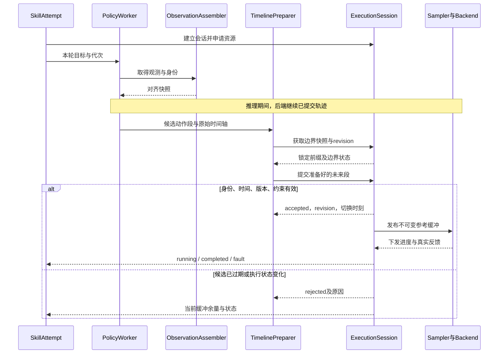
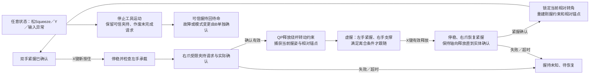
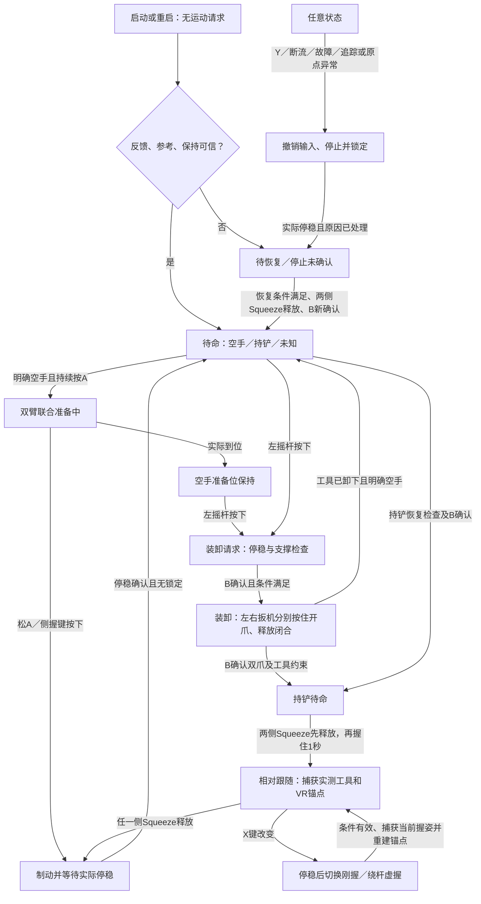

# 动作执行契约 v0.2

更新：2026-10-14。配套架构 v0.3 的建议草案；本文是执行语义的唯一维护处。v0.2 修正正常终点与断流、重定时权限、持物期间臂资源移交及停止包络。当前已生成 ROS 消息子集并完成模拟验证，多资源联合关节命令按下述 schema 2 接入；完整契约尚未全部实现，硬件周期和阈值未实测。实现差异见[架构8.5.4](软件架构设计.md#854-当前代码组织与替换边界)。设计依据见 Galbot 对照（本地参考：`Galbot设计对照.md`，不随 Git 分发）与[总体架构](软件架构设计.md)。

## 1. 所有权与两个更新周期

**一个 ExecutionSession 只有一份权威动作时间轴，最终提交权属于本地执行端。** Policy worker、MoveIt、Servo 和遥操作生成候选，不能自行认定某个 chunk 已开始执行。动作预处理可以在独立线程/进程计算，最终提交时仍要核对执行端的真实时间轴版本。

角色：

- SkillAttempt：持有本轮技能目标、推理/感知请求、控制租约和取消状态。
- ActionAdapter：模型/规划动作的单位、坐标、维度与绝对/增量解码。
- TimelinePreparer：生成带 100 Hz 逻辑采样或可采样曲线的候选段，不直接写已执行历史。
- ExecutionSession：唯一提交者；校验租约和候选基线，返回 accepted/rejected/需重新准备。
- ReferenceSampler：按已提交时间映射读取参考，在后端周期推进；不自行更改轨迹时间，不做网络推理、路径搜索或写盘。
- CommandRouter：将已授权命令路由至具名设备组，不负责插值或设备协议。
- DeviceDriver：关节、灵巧手与底盘分别对接已有控制器，声明命令接纳、设备状态和停止能力。
- FeedbackCollector：汇总各驱动的独立采样时间和实测；不能把新鲜设备的时间戳覆盖失联设备。具体拆分见[架构8.5.5](软件架构设计.md#855-设备接入拆分与历史代码落点)。

HeldObjectSession 是执行会话的一种持续保持用途：抓取后经确认接管灵巧手/必要资源，跨越导航和任务终态存在，直到显式释放/移交。其保持授权不随普通策略租约退出被误撤销；Supervisor/后端持续监督反馈，实际故障时返回明确未知或失败。任意模型不能借此持续控制其他资源。

保持责任与资源写权限分开：手可持续由持物会话控制；手臂需要抬升、转运输姿态、放下时，由该会话受控执行或显式移交给新的操作会话，同时保留持物监测。移交原子更新本地 Owner 表且有确认，不产生两个手臂写入者。持物会话是长寿命状态对象，首期不要求独立进程。

100 Hz 为逻辑参考时间间隔 10 ms，不强制每点一条消息。有限规划轨迹可保留原时间戳及有效导数，由单一插值负责人采样，不先降为只有位置的 100 Hz 点列再重复拟合。实际驱动周期通过 BackendCapabilities 返回；能力不足时显式报告缺口。

## 2. 输入模式必须显式选择

| 模式 | 含义 | 替换与缺失规则 |
|---|---|---|
| FiniteTrajectory | 已知完整路径及结束条件 | 一次接受；按合同完成或取消；不可把缺段当作正常完成 |
| JointReferenceSegment | 带绝对时间或锚点的一段未来关节参考 | 替换允许变化的未来后缀或追加；重传去重；不能改已经执行/锁定部分 |
| JointTargetUpdate | 持续到来的关节即时目标 | 执行层按限值生成过渡；丢包可用下一有效目标覆盖；不保证逐点经过每个输入 |
| BaseVelocityUpdate | 本体允许的移动速度目标 | 独立速度合同、短有效期和超时动作；不转换为手臂位置向量 |

当前模拟执行链使用 `bindu_execution/native/` 的统一 C++ 数值内核，`interpolation.py` 为薄接口，Python 执行器保留控制权、revision、反馈与时间轴选择。具体行为如下（不是全部目标架构或真机验收声明）：

2026-10-13新增的Snowbot独立底层位置入口选择`DelegatedPositionExecutor`：沿用控制权、revision、具名组、限位和有效期校验，只接纳非定时`joint_target`，将位置目标直接交原控制器平滑。该入口不生成上述原生曲线，不承诺参考导数／动态上限或到达时间；状态中的零参考导数不是实测静止依据。停止由设备保持请求与新鲜位置／速度确认，成功PDO进度和底层健康须同时有效，失败明确报告未确认；底层补丁在独立EtherCAT线程锁存断流保持，接管须绑定本适配器实例且实际源为topic；接口和验证边界见[运行与验证](运行与验证.md#snowbot-位置控制适配层)。其他入口仍采用原执行策略。

- **底盘 `base_velocity`**：仅接受机体坐标linear.x（m/s）和angular.z（rad/s）；`execution.base_limits` 分别配置 `linear_velocity`、`angular_velocity`、`linear_acceleration`（m/s²）、`angular_acceleration`（rad/s²），旧配置缺省为0.4、0.4、1.0、2.0。正常更新由执行器按实际tick间隔限制速度参考变化率，连续替换延续当前参考；duration结束时参考向零收敛，参考和反馈均为零才结束速度段。有效期、控制周期故障、取消/租约撤销仍可直接请求设备停止，不承诺故障停止的加速度或jerk连续性；短速度段完成不表示导航到站。上游不再叠加历史EMA，真实驱动若已负责平滑应在接入前明确唯一负责人。
- **导航输入与结束**：N1导航适配要求源端提供实际Action目标UUID、来源实例、序号、源时间、frame，沿用已有执行租约/epoch，并在提交时检查revision；旧目标、过期/乱序输入不得刷新有效期，来源变化终止本次导航。停止前关闭提交入口，`ControlExecution` 更新revision以隔离晚到提交；取消/异常后任务释放租约。导航成功还需要新鲜全局位姿满足站点容差，并在停止请求后取得持续的底盘零速反馈；Action成功、速度段成功或零速已发布均不能单独作为到站证明。当前验证来源为协议替身，未修改Nav2的裸速度接入尚未实现。
- **在线 `joint_target`**：目标时间戳及有效期沿用来源；目标时间到达后，从当前参考 q/dq/ddq 生成多轴自适应参考。各轴按自身限值跟随，不保证同时到达；需要同步到达应使用有限定时轨迹。相同目标仅延续有效期，不反复重新起步；每步保留可制动余量，目标附近用短五次曲线收敛。内核缓存原始曲线片段，使未来预览、重复与乱序采样不改变既定参考；在线目标不承诺逐点到达。VR 与 Pi 共用此入口，IK 连续性代价仍保留在求解器中。
- **双臂QP的位置参考**：运动学、工具误差和双手闭合约束使用实测关节位置；速度解从上次执行层已接纳的位置目标积分，首次基准为本次捕获的实测位置。每次候选携带节点控制时钟的求解请求采样时刻，`dt`是本次与上次已接纳候选采样时刻之差，首步相对于捕获采样时刻；包含输入等待、worker及服务往返对更新间隔的影响，不等于VR事件间隔、QP计算耗时或硬件执行周期。只有提交服务确认接纳后才推进基准及采样时刻；丢弃/拒绝/超时结果不推进。命令时间戳/TTL仍使用原输入时间。松握、模式切换及会话结束清除基准，重新捕获从新鲜反馈开始；非正间隔、时钟回退、超过`max_integration_interval`或参考与实测任一受控关节偏差超过`max_reference_error`时结束会话并经既有停止流程等待反馈，不在运动中跳回实测或补算长时间积分。`sample_period`仅供离线理想跟踪采样，运行节点不据此宣称100Hz。QP使用profile与URDF的交集限位，软margin内允许零速、禁止继续向外运动；硬越界仍失败。零速满足闭合等式需要恢复增益降到零，握姿误差安全阈值仍独立生效；参考积分不证明持物力或真实保持能力。
- **有限 `finite_trajectory`**：`stamp + offsets` 固定执行时间；位置、速度和加速度共同定义分段五次 Hermite 路径。未提供的速度/加速度按零端点导数解释，因此位置点列默认逐点停稳；不能把需要连续通过的 100 Hz 点列丢掉导数后发送。终点必须静止，时间过短或整段约束不通过则拒绝，不暗中重定时。从正在运动的参考接入时，首个未来结点前可加入受约束制动连接；结点的时间、位置和导数保持不变，后续段不重定时。任意其他规划曲线需要先显式转换为该表示，不能声称保留未传递的路径信息。
- **动作块 `joint_reference_segment`**：必须提交当前 `expected_revision`；过期前缀删除，第一未来结点从提交时的当前参考状态接续，后续结点时间和导数保持。首个未来结点前同样允许受约束制动连接；仍无法满足约束则整体拒绝，原时间轴不受影响。接受后返回 `revision` 和 `switch_stamp`；当前串行模拟后端没有不可撤销硬件队列前缀，切换边界为执行线程处理时刻与未来 `stamp` 的较晚者。不是完整异步 proposal/prepare/commit 协议。
- **未来接续的保留范围**：周期执行时释放已过期的时间轴分支，保留当前及未来有效区段；相同切换时刻的新命令覆盖尚未执行的旧后缀，避免随运行时长积累。裁剪不改变保留区段的采样、原定到达时间或已持有的不可变快照；租约/命令到期先按准确到期时刻衔接制动，再处理历史释放。历史回放使用记录数据，不依赖执行器保留全部旧时间轴。
- **块末尾**：提交前验证内部减速尾段，即使末点速度非零也不依赖下一块必定到达。没有新块接续时进入 `STOPPING / BUFFER_EXHAUSTED`，停稳后失败结束，不能把末点发布误报为正常任务完成。正常有限轨迹仍以实测位置达到容差后成功。
- **约束与周期**：q、dq、ddq、jerk 来自同一多项式；五次曲线用 Bernstein 控制点凸包及有界细分检查整个时间区间；恒定 jerk 段用解析极值检查，避免速度饱和处的凸包误拒绝。允许约 1e-9 的浮点容差，五次曲线认证仍可能保守拒绝。profile 的 `execution` 配置给出加速度、jerk、采样周期、周期超时、停止确认时限和在线过渡最长时间；`joint_dynamics` 可覆盖各关节速度/加速度/jerk。旧模拟 profile 缺失字段时兼容默认 20 rad/s²、400 rad/s³、10 ms、100 ms、5 s、30 s；这些都是仿真值，不是硬件标定。速度仍以 `max_speed` 为默认。驱动只接受参考，模拟跟踪速度限制不代替执行层约束。
- **停止与换控制源**：取消、正常租约到期、目标断流生成受约束减速；到期落在两个采样周期之间时，从实际到期时刻衔接制动，不延长旧目标权限；`STOPPING` 禁止新普通命令。释放立即撤销旧租约，停止由执行器内部继续负责；参考终点及新鲜反馈确认后才清除参考并允许新租约。当前采用停稳后切换控制源，同一租约内同组命令可连续接续；schema 2 允许同一租约内多个互斥关节组在同一时间轴上联合运动，跨租约仍需停稳。运动中的租约移交和不同命令的多组并发未实现。`hold` 不发送开手目标，完整持物授权仍待实现。
- **异常**：反馈失效、驱动拒绝、时钟回退、调度间隔超过 `max_tick_gap`，或减速曲线无法认证时调用设备停止并明确报告原因；不承诺这种故障下仍平滑。不能在长调度空档后直接跳到最新轨迹采样。停止服务回执只表示请求已受理，客户端必须继续等待 `STOPPING` 结束和新鲜静止反馈。
- **状态可观测性**：`ExecutionState.reference` 提供位置/速度，平行的 `reference_accelerations`、`reference_jerks` 与 `reference.name` 同序，`revision` 标识已提交时间轴。它们是执行参考，不是实测动力学量；实测位置与参考分开记录。

原始历史 C++ 保留只读；原单轴实验现作为 `native/AdaptiveStream` 基础部件，与多轴曲线、时序构建、制动及 Python 绑定共同组成当前执行模块。C++ 的 `fit_target` 提供非定时同步 P2P，`fit_timed` 提供定时 P2P/导数轨迹/动作块及尾段，`Online` 提供在线多轴跟随。标量部件的 TTL 仍不表示到达时刻，标量 `stopped()` 也不表示机器人真实到达；组级时间与完成语义由相应输入模式及执行器负责。底盘速度仍走独立速度接口。

原生后端已完成本地 C++ 和执行器测试，旧 Python 曲线数学已移除，测试不能静默切换后端。9月18日 Ubuntu 已完成原生后端 ROS/Pi/VR 模拟回归，Pi 首轮一次就绪服务回复超时后，原用例及全组复测通过；硬件周期、Orin、碰撞保护和真实反馈仍须单独验收，当前不宣称硬实时。复现命令与验证状态见 README。

规划/VLA 输出“应逐点跟随的未来轨迹”不能误标为覆盖式即时目标。SDK 只有位置接口并不决定上层输入模式，适配层负责补齐获准参考到即时硬件目标的采样。

## 3. 最小字段与不变量

通用字段：schema_version、runtime_mode、run_id、attempt_id、producer_instance_id、lease_id、epoch、command_id、sequence、resource_group、robot_profile_hash、config_generation。

段模式字段：observation_id/request_id（适用时）、clock_domain、anchor_time、sample_offsets 或曲线时间、joint_names、positions、可选 velocities/accelerations、valid_until、source_semantics、base_timeline_revision、replace_from、path_constraint_id、retime_policy。

结束与容差字段：end_of_stream/final_segment、terminal_state、goal_tolerance、goal_time_tolerance；字段应用于明确的输入模式。测量速度/加速度不可得时，使用带估计来源与误差界的状态或拒绝依赖该状态的行为，不能默认填零。

即时目标字段：source_time、valid_until、joint_names/命名移动分量、目标值、允许过渡时间/误差。两种模式不共用含糊的“timestamp”解释。

必须检查：

1. 向量维度与关节名一致，值有限、单位明确、时间单调、采样间隔为正、所控资源在租约内。
2. 绝对/增量动作在解码阶段统一；保留来源语义，不在下层猜测。
3. 版本、代次、producer 和配置匹配；新的 command_id 不掩盖旧观测或旧 timeline revision。
4. 已过期、时钟未知或需要未来外推却未获准的候选拒绝。
5. 未控关节不补零；仅对已拥有资源指定 `hold_at_acquire` 等明确保持策略，其余资源保留其现有 Owner。
6. joint_names 相同不等于约束相同；几何/工具/标定变更使相关路径验证失效。

### 3.1 灵巧手与臂手协同补充（2026-09-15）

- 手部动作的 `source_semantics` 区分关节位置、驱动量、手型/协同参数。解码引用 hand_profile_hash 与 mapping_version，记录耦合展开结果；不可控/被动关节不伪装成独立目标。
- 状态显式标记测量、估计、不可用及各自时间；不能以命令回显构造实际手指位置，电流也不能直接当作接触力。
- 臂手联合候选包含命名资源集、共同执行时间、各后端能力和阶段依赖。100 Hz 是统一逻辑参考；手部下发/插值按声明能力处理，记录时间偏差。不能把超出手部硬件带宽的目标静默丢弃后报告逐点执行完成。
- 联合命令有各后端的接纳/下发/实测状态。软件统一接纳不承诺跨设备事务原子性；部分接纳需触发预先定义的中止/保持，不能将整组报告为成功。
- 手指接触闭合阶段不得沿用自由空间任意平滑/重定时；阶段合同须约束行程、速率、允许过渡、反馈条件与超时。模板/模型给出的“抓住”只是提议，HeldObjectSession 由技能验收后移交。

### 3.2 已实现的多资源关节命令（2026-10-07）

- `MotionCommand.schema_version=1`仍使用一个`resource_group`；`schema_version=2`使用有序`resource_groups`，要求至少两个互不重复、在profile中存在且同一租约拥有的关节组。`joint_names`必须严格等于这些组在profile中声明的关节顺序拼接，不接受部分组、重排或重复关节；底盘速度仍走单资源合同。
- 一次schema 2命令只有一个`stamp`、`valid_for`、`command_id`与关节时间轴；执行层对整个命名向量生成参考，各组驱动按同一执行采样依次接收。软件接纳不表示硬件原子写入或真实同时到达。任一后端写入失败会请求所有设备停止、撤销租约并保留部分写入诊断；即使停止请求成功仍须等待新鲜反馈确认停稳。
- `ExecutionState.lease_active/lease_epoch/lease_resources`公开当前控制权快照，模式选择同时检查旧租约释放、停止状态、全部相关关节速度和来源时间。`reference`为空表示执行器不再持有目标，不单独证明真实静止。当前只在模拟驱动验证了联合路径，真实设备的接纳顺序、超时、停止和反馈需另行适配。

### 3.3 已实现的仿真与真实环境选择（2026-10-14）

`runtime_mode`只有`simulation`和`real`，表示本次运行选择的设备环境；它与动作类型`mode`、单／双臂遥操作模式和业务模式分开。启动配置是唯一来源，派生旧`simulation`布尔参数；两者冲突拒绝启动，解析后锁为只读。更换环境必须先结束会话、确认停止并退出原实例，再修改配置重启；不支持运行中热切换。真实环境的`command_enabled`写权限独立，默认关闭且只在启动时设定；profile、本体配置指纹、run_id、后端和底层路由参数也锁为只读，不能让参数服务显示已更改而设备仍按旧值运行。环境选择不启动底层驱动、不使能电机，也不构成真机动作授权。

`MotionCommand`及纯逻辑`Motion`携带`runtime_mode`。执行入口在推进现有时间轴或调用设备之前校验，跨环境返回`RUNTIME_MODE_MISMATCH`；空标识仅为旧仿真调用兼容，真实指令必须显式标记`real`。模拟驱动只能用于仿真，Snowbot底层接口只能用于真实环境；配置与后端冲突拒绝启动，未实现的真实能力不能借该开关启用。

真实执行要求系统时间，拒绝`use_sim_time=true`，并锁定该参数，防止真实指令有效期与反馈年龄转由仿真时钟控制。普通执行器和Snowbot委托执行器均使用第6节的固定ROS／单调停止预算；超过任一预算之后到达的零速反馈不能将超时改报为已确认取消。

`ExecutionState`携带`runtime_mode`、派生的`simulated`和实际`device_backend`，实测有效性仍由源时间／健康／错误码判断。事件、记录器健康、遥操作输入和模式状态也携带环境标识；消费者拒绝错环境，状态缓存清空而非继续复用旧值。执行器收到错误环境反馈时保留最后正确快照并停止／撤权。记录manifest使用所选环境，异模式消息不落盘且健康报告不就绪。布尔标识与字符串必须一致，旧无环境消息仅在仿真侧兼容。

上述ROS消息定义已变化，发布者、订阅者和工具须一起重建并加载同版`bindu_interfaces`；空字段兼容不代表旧编译消息类型可以直接互通。

## 4. Chunk 时间处理与原子提交

### 4.1 时间语义

模型返回的第 i 个动作对应 `t_i = anchor_time + offset_i`。anchor 来自模型契约：图像时刻、请求时刻或明确指定执行起点，不默认“收到响应时”。观测年龄限制与轨迹有效期是两个参数；一段正常未来动作不因原始图像随后变老就自动无效，执行中仍需新鲜硬件反馈和技能约定的环境有效性。

候选接入时读取后端的 `now`、执行轨迹版本和锁定边界。确定切换时间 `t_switch`，晚于后端已不可撤销的前缀以及必要的过渡准备时间。`t_switch` 之前仍使用已接受旧轨迹；候选过期前段裁掉，剩余段不足以接续/收敛则拒绝。

不要将所有晚到动作简单整体右移为“从现在开始”。只有允许重定时且环境/动作语义仍有效时才可移动时间轴，同时记录偏移。

### 4.2 单次提交过程

1. 获取执行快照：revision、锁定前缀结束时刻、预测边界状态 q/dq/ddq、当前真实反馈及其年龄。
2. 工作线程完成候选衔接、限值/路径检查和必要的停止尾段；标注使用的快照版本。
3. 执行端在有界的提交步骤中复核 lease/epoch、revision、时限和所依赖的约束/场景版本；若准备期间状态已失配，拒绝或要求重新准备，不无限阻塞周期线程。只核对本段依赖的对象/碰撞配置，不能因无关对象更新而无限拒绝；相关动态障碍失效由环境检查触发停止或重规划。
4. 用不可变缓冲替换允许修改的未来后缀，原子发布新 revision，返回准确的接入时间和接纳范围。
5. 采样器在 `t_switch` 前继续旧段，此后读取已提交段；记录实际下发与真实反馈。

缓冲交换的内存分配/回收在非周期路径管理。实时线程不等待推理、碰撞规划或动态内存释放。

### 4.3 重定时与插值的权限

自适应过渡/变速若改变已接纳目标的执行时刻或几何路径，必须由 ExecutionSession 接纳新 revision、更新未来时间映射，并反馈实际生效边界。旧 revision 的在途 VLA chunk 按新边界重验或拒绝；规划 Action 的允许时长和阶段超时同样需要协调，不能只延长底层时钟。ReferenceSampler 仅按已批准曲线插值，不能暗中减慢推进速度。

停止管理可因局部故障立即触发预授权的停止/保持，不等待网络提交；触发时使旧普通轨迹失效并生成新的执行状态/版本，不能继续向策略报告原动作仍按原时刻执行。硬件控制器若有不可观测的内部平滑/排队，则其锁定前缀和边界状态只能按实测能力描述，不能承诺精确在线拼接或 RTC。

### 4.4 RTC 的边界（后续可选能力）

只有模型服务端声明支持相应 RTC 契约时才启用。传给模型的前缀必须对应执行端已接受/锁定的轨迹，附 revision、时间和状态来源；不能使用未被接受的上一次模型输出充当前缀。响应回来后仍要检查当前 revision/epoch。RTC 不取代控制端的取消、超时和连续性校验。

## 5. 执行与推理异步时序

## 6. 执行状态与停止

**2026-10-14公共执行实现修正。** 接管先检查新鲜反馈、完整已知速度和静止条件。有限轨迹完成需要终点时刻及之后的位置／速度反馈，底盘正常完成需要零速参考下发之后的反馈。缺速度按未知处理，ROS `JointState.velocity`为空而非填零／无来源差分；运行中速度字段丢失触发停止并撤权。模拟驱动提供自身积分步的速度，不能据此宣称真实速度传感器已接通。

取消、撤权和故障停止先保持`STOPPING`，普通关节策略可先完成原有受约束制动，再向全部后端请求一次停止。设备请求成功后仍须取得晚于请求和此前快照的新鲜、完整零速反馈，才发布停止终态；`reference`为空和服务返回`STOP_REQUESTED`都不表示已停稳。停止期间拒绝普通提交与新租约；上层任务、Pi、单臂和双臂会话不得在`RUNNING/STOPPING`或速度缺失时确认暂停／停止。

首次停止固定ROS时间及单调墙钟两份预算，任一到期即失败；连续故障、时钟冻结／回退和重发停止不刷新期限，也不反复覆盖设备保持请求。停止发送失败或超过反馈期限会锁存`stop_failures`并撤权，本实例返回`STOP_UNCONFIRMED`拒绝接管，后续成功的停止调用不清除故障。恢复必须按现场流程检查后重启，新的实例仍检查新鲜、完整、静止反馈；底层锁存恢复不由Bindu自动执行。Snowbot还受底层看门狗会话绑定约束，新适配器实例不能仅凭新鲜反馈接管；持铲状态下需要重新启动底层的恢复顺序见[实机启动方案](软件架构设计.md#832-snowbot-实机启动与准备建议流程)。

通用执行与Snowbot入口在SIGINT／SIGTERM到来时封锁新请求，保留ROS通信完成有界停止握手，未确认时返回非零退出码。以上为已实现的软件判定，硬件急停、带载保持和实体停机效果仍须单独验收。

| 状态 | 进入条件 | 处理/退出 |
|---|---|---|
| IDLE | 没有活动轨迹 | 获准会话进入 ARMED |
| ARMED | 配置、资源、反馈等前提成立 | 接受首段后进入 RUNNING；仅准备不产生动作 |
| RUNNING | 存在有效且可执行的参考 | 正常采样/补段；正常终点经容差验收后报告 completed 并进入 HELD；错误触发停止/故障 |
| STOPPING | 取消、有效轨迹不足或可恢复错误 | 禁用普通动作提议，执行已验证的停止轨迹或硬件规定行为 |
| HELD | 已确认停止并保持必要资源 | 可按合同结束、移交或进入单独 recovery；不等于自动释放灵巧手 |
| FAULT | 反馈/驱动/停止结果异常或未知 | 禁止自动恢复动作，明确 physical state unknown 等结果 |

**正常结束和断流分别处理：**

- FiniteTrajectory 或带明确结束标记的最后一段：允许执行已经验证的终端减速段；到达终点后按位置/速度容差和允许完成时间验收，再保持。不能仅因剩余时间变短就提前把正常轨迹截断。
- 尚期待后续输入的流：`buffer_remaining <= required_stop_horizon + guard` 时进入停止准备。所需时间包含当前状态制动、SDK 不可撤销前缀、通信/调度余量；阈值待实测。
- 即时关节目标与底盘速度：按命令有效期及模式 watchdog 收敛；它们没有可直接套用的有限轨迹完成语义。

**停止轨迹也有几何约束：** 限速/限 jerk 不自动保证避障、保持接触或不掉物。自由空间运动需验证允许制动包络；接触闭合、持物和受限撤离使用各阶段合同。若可达停距/停止尾段无法满足环境约束，应在接纳或推进前拒绝/限制动作。设备故障可能只能执行硬件停止，不能承诺始终平滑或永不掉物。

停止意图区分：

- `drain`：不接收新任务，当前技能在约定阶段边界结束，仍遵守最大时长。
- `cancel`：撤销普通生产者输入权限，执行器保留受监督的停止权限；已持物按已核实的后端能力保持，不自动张手。
- `shutdown`：先取消并确认物理收敛，再停止依赖服务；停止失败记录异常，不能仅关进程后报告已停止。
- 硬件急停/故障：保留其独立机制与真实结果，不以软件命令代替硬件状态。

若技能取消后需要撤离等动作，必须申请限于资源、动作范围和截止时间的 RecoveryPermit，由当前 SkillAttempt 负责并明确记录。普通模型/VLA 输入仍无权继续；无法证明前提时不启动恢复。新任务只有在旧资源已收敛或被明确移交后才能接管。

### 6.1 Snowbot 工具操作与握持切换（目标契约）

**实现状态：PICO协调器已在运动学仿真接入本节操作顺序；实体夹爪、载荷／滑移及底层恢复仍待接入。** 状态机位于遥操作能力和运行协调节点，公共Executor继续只负责执行、控制权与停止。按键与相对位姿映射以[遥操作模块](src/capabilities/bindu_teleoperation/README.md#pico-按键方案)为维护源，操作顺序见[PICO扫雪流程](运行与验证.md#pico-扫雪操作流程目标方案)，底层默认待命和受控重新绑定见[实机启动方案](软件架构设计.md#832-snowbot-实机启动与准备建议流程)。

准备、装卸、确认、停止和记录走操作接口，连续运动输入仍为`pose+tight`。`tight`是握持请求；实体已确认模式、QP已生效模式及各自代次分别反馈。夹爪指令接纳、实际闭合、物体夹持成立和工具到位必须分别判断，不能用软件捕获成功替代实体确认。操作绑定来源、启动实例、状态代次、时间和有效期；同一资源保留唯一写入方，切换先处理已接纳提交，再依据新鲜实测反馈停稳，作废旧求解和旧锚点。

**装卸与握持。** 左摇杆按下仅提出请求；停稳并显示“确认支架承载／装夹区域就绪”后，B的新按下才允许进入装卸。已持铲且没有外部承载时，装卸被阻断；操作确认是人工声明，不能伪装成传感器证明。进入装卸不自动开闭爪，两侧扳机分别需要新的释放—按下过程。可一侧先装入、释放对应扳机闭合，再操作另一侧；需要同时打开时同时按住两扳机。左右爪逐侧报告实际结果，单侧闭合／通信异常不标记“双手已握持”。B完成装夹还需工具存在、夹持成立、握点／标定有效、共同工具约束与载荷检查通过；不能只凭按钮或力近零推断成功。完成后进入持铲待命，后续接合离合才逐步转移支撑载荷。

每侧扳机的“释放闭合”仅接受有效连接中的新鲜物理释放事件；断连、无效追踪或缺省零值不等于释放。输入丢失时保持最近已接纳夹爪参考，不继续推进未完成开合，不自动开爪或闭合，保持失败进入待恢复；实体驱动需验证该停止／保持语义。装卸中Y也按此语义冻结爪参考，不强行夹紧。完全开爪后不得跳到跟随；须在支撑下完成闭合和夹持确认，或明确确认已经卸下工具后回空手待命。

**开合的有效范围。** 常态为已确认闭合并持续保持，无需扣扳机；这不意味着启动／重连读到扳机零值便自动闭合。首次接管先核对现有夹爪状态，只有有效授权装卸中的新操作才改变开合参考。跟随中按扳机先停止工具运动；没有停稳和支撑许可则不完全开爪，拒绝的按下不排队，进入装卸后须重新按住。装卸中的开合与X虚握互斥，开爪不自动结束为“已握持”，释放闭合仍需实际确认。

**虚握子状态与实体确认。** 虚握是独立于运动离合的握持状态；分别维护请求模式、实体已确认模式和QP已生效模式，不能用单个`tight`布尔值同时表示三者。连续输入中的`tight`继续只表达请求，确认／失败／超时通过状态反馈表达。以下实体判据为目标要求；当前PICO运动学代理使用模拟第8轴位置和原生QP确认操作链，`physical_gripper_confirmed=null`，不能把位置代理当作夹持力或滑移证据。

| 子状态 | 进入与退出条件 | 控制行为 |
|---|---|---|
| 双手紧握已确认 | 左右夹持与工具约束均有效，QP刚握已捕获 | 双手刚握；跟随仍受双侧Squeeze离合控制 |
| 进入虚握中 | 跟随中X先有效释放再新按住；左手承载余量、右手虚握能力及相关反馈已验证 | 暂停新目标、完成已接纳提交并确认实测停稳，作废旧求解结果；左手持续紧握，右爪请求已标定的受限夹持模式。过渡期间禁止继续工具运动 |
| 右手虚握已确认 | 右爪模式／接触反馈满足虚握判据，左手承载有效；QP按当前实测状态完成轴向握持捕获 | 保持右握点三维位置与杆轴方向，仅放开绕杆轴转动；重建VR工具锚点后才允许跟随。工具平移取双手柄中点增量，姿态取左手柄增量，右手柄转腕不额外驱动铲子翻转 |
| 恢复紧握中 | 虚握跟随时X有效释放 | 先停稳；在右爪紧握确认前保留轴向释放模型，按标定过程恢复右爪夹持；然后捕获当前实际相对转角，建立刚握约束并重建锚点。不能锁回进入虚握前的旧转角 |
| 握持未知／切换中断 | 实体确认超时、左右状态冲突、载荷／滑移异常，或在过渡阶段失联／停止 | 撤销新运动及未完成模式请求，停止推进开合并核对实际状态；未获得可信确认不得标为虚握／紧握成功，保持无法确认则进入待恢复 |

实体虚握是右爪经标定后仍与杆接触的受限夹持；具体采用位置／力限制或其他方式由实际夹爪能力决定，不能擅自把虚握换算成固定开度。当前模型的“能绕杆转、握点不沿杆滑”需实体单独验证；只降低夹持力不能作为这些条件已满足的证据。六维腕载荷不是夹爪指面夹紧力，虚握判据需结合实际夹爪状态及可用工具／滑移观测；观测不足或右爪无法实现该模式时，实体虚握功能标为不可用，不能只放开QP后宣称实现。左手承载及允许内力／力矩按标定范围检查，底层已有柔顺不替代虚握模式确认。

**中断与重新接合。** 任一Squeeze释放、Y停止、追踪异常或断流，优先停止工具运动；保持最近已确认的实体夹持参考，不把X键缺省释放当成紧握请求，不自动开爪、夹紧或清零。已稳定虚握与切换中断分别报告，过渡中断不能回退为“已紧握”。恢复时先核对真实握持模式；B只确认显示的当前恢复步骤。恢复到虚握待命后，继续虚握须X键重新完成释放—按住、双侧Squeeze重新接合；如要改为紧握，则先在待命中用新的X键操作提出请求，经B单独确认后完成上述紧握切换，最后再接合Squeeze。B一次不能同时完成恢复、握持切换和开始跟随。重启后不从上一进程的`tight`缓存推断实体状态。

**启动和按键仲裁。**

- 启动／重启不产生动作。底层参考／保持不可信时留在待恢复；只有可信保持才进入待命。持铲原位恢复核对实际夹持、工具标定、工作范围和会话后，B确认只回持铲待命；不要求按A。
- 所有操作键先观察释放再接受新按下，离合须观察两侧各自释放。按住A、X、侧握键或扳机启动／重连均不得运动；拒绝的按下不排队，条件改善后须重按。
- 同一控制周期内，故障／无效输入及Y停止优先；随后处理松键／离合退出，最后才处理有资格的操作。停止同时压下A/B/X一律不转运动；确认事件只消费一次，不能跨状态连续通过多个步骤。
- A准备与VR跟随互斥。任一侧握键按下时不接受准备；准备期间侧握键被按下则取消准备并停稳，本次按住A失效。装卸期间离合和X键不启动跟随／换握。Y可锁定所有状态，但实际停稳无法确认时显示“停止未确认”。
- 追踪丢失、WebXR会话／焦点丢失、坐标原点重定位或异常位姿跳变立即撤销新输入，进入停止与锚点失效处理；坐标变换或检测阈值不可确认时不继续跟随。恢复到待命后，重新释放并接合侧握键，从当前实测工具姿态建立新锚点。
- 任一受控故障后恢复只到待命，不自动续跑；总线／驱动／保持／看门狗锁存按[底层恢复流程](软件架构设计.md#832-snowbot-实机启动与准备建议流程)处理，B不绕过这些条件。持铲时禁止切到独立单臂模式或用摇杆直接动腰。

**状态关系图。** 下图显示目标流程；停止确认由实际反馈提供，图中“保持”均以底层保持可验证为前提。

原位持铲恢复沿`HOLD → TOOL → TELEOP`，与空手准备`HOLD → PREP → EMPTY`分开。STOP无停稳确认则转REC并保留“停止未确认”；准备／装卸完成或恢复确认均不隐含跟随。X键换握只有原跟随条件仍有效时继续，离合释放或故障则中止并返回停止流程。外部支撑不明的持铲状态不能经过装卸检查进入完全开爪。

## 7. 反馈和幂等性

- received：本地收到，不代表校验通过。
- accepted：本地执行端已接纳时间轴，不等于驱动器接受。
- dispatched：指令已交给 SDK/传输，记录返回证据。
- controller_accepted：仅在下层有明确确认时报告，否则为 unknown/not_available。
- running/completed/stopped：依据真实状态及合同判定；仅有下发计数不能报告物理到位。

同一 command_id 的重传返回已有结果，不再次执行。命令序号/来源覆盖范围按会话记录。driver restart、ROS time reset、attempt cancel 都使相关生产者代次失效；恢复通信不自动恢复执行。

### 当前物理设备反馈适配

Isaac设备桥保留源采样时间与实际位置/速度，暂停物理步进时不刷新样本。当前执行链使用系统时钟，物理累计时间另存`simulation_time`；不启用`use_sim_time`，不把两种时间混用。模拟器重启须同时重启执行器；同一仿真实例不接受更换发送者或重放序号。设备命令有效期最多250ms，超时后仿真端将关节目标设为实测位置、轮速目标置零，实际停稳仍需新鲜反馈确认。

可选profile字段`execution.feedback_tolerances`包含`joint_position`（rad）、`joint_velocity`（rad/s）、`base_linear_velocity`（m/s）、`base_angular_velocity`（rad/s），值须有限且为正。有限关节动作完成与关节停止收敛同时检查可用的实测速度；有限底盘动作完成要求参考归零且实测速度在容差内。旧profile维持原到达/停止位置阈值及底盘精确零速条件；无实测关节速度的旧适配器不因此获得物理停稳证据。`request_stop`返回仍只说明停止请求已交给适配器，不单独证明已停稳。

## 8. 验证样例与预期结果

| 输入事件 | 必须满足的结果 |
|---|---|
| 正常 chunk 到达且旧轨迹仍在执行 | 旧前缀不变，在确定边界接续，返回实际接入范围 |
| 新 chunk 全部过期 | 拒绝；依旧缓冲决定继续或停止，不整体偷移时间轴 |
| 准备期间执行版本改变 | 拒绝陈旧候选并有限重试；不污染当前缓冲 |
| 取消后模型迟到 | 拒绝旧 epoch；停止/保持执行仍有合法内部权限 |
| 持物证据缺失或实际停止未确认 | 结果标未知；不报告已安全收敛，也不启动下个普通任务 |
| 同一动作重传 | 返回原结果，不触发第二次物理动作 |
| 反馈超时但指令仍在发 | 进入定义的停止/故障路径，反馈与下发健康分开 |
| 磁盘记录失败 | 上报 Evidence 不完整；不重新执行已经完成的抓取 |
| 有限轨迹进入最后的正常减速段 | 不误判断流；按终点容差和完成时限验收 |
| 自适应重定时后旧 revision 的 chunk 到达 | 按新边界重验或拒绝；反馈包含新的生效时间 |
| 已持物后请求手臂运输运动 | 有确认地移交臂写权限，手部保持与持物监测不中断 |
| 减速曲线满足导数约束但超出允许空间 | 不把它当作合格停止路径；执行阶段约定的处置 |

本表是设计走查，不是已通过的测试。下一步需用模拟后端实现故障注入，并按真实硬件补齐周期、缓存及停止能力。
