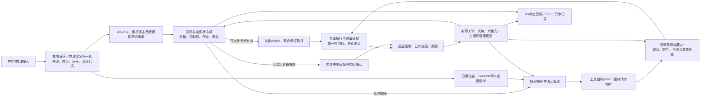

# Bindu 软件架构设计 v0.3

更新：2026-10-14。状态：完整架构为建议草案，已实现子集及边界见8.5.4，真机与完整架构尚未验收。本文维护模块职责、所有权和首期装配；执行字段与时序以[动作执行契约 v0.2](动作执行契约.md)为准，建设顺序与开源依据以一期计划（本地参考：`一期建设计划与开源选型.md`，不随 Git 分发）为准。已确认需求与条件见项目上下文（本地参考：`项目上下文.md`，不随 Git 分发），实现及验证证据见当前进度（本地参考：`当前进度.md`，不随 Git 分发）。

v0.3：收敛首期实现，明确单一执行后端的选取，修正下层变速与权威时间轴的关系。六层总体图与七类职责图是不同粒度的视图，不是两套架构。来源取舍见Galbot 对照（本地参考：`Galbot设计对照.md`，不随 Git 分发），审查依据见2026-09-16 审查记录（本地参考：`过程记录/2026-09-16.md#审查详情`，不随 Git 分发）。

## 1. 定位与设计目标

建立支持长程移动操作的可复用机器人软件系统。首期在轮式机器人上完成语音指定饮料、导航、感知、抓取与持物返回；未来支持双足。已知条件和未知输入以项目上下文（本地参考：`项目上下文.md`，不随 Git 分发）为准，候选开源版本见建设计划（本地参考：`一期建设计划与开源选型.md`，不随 Git 分发）。

架构先明确职责、数据语义、控制权、状态机和时序，再细化 ROS 2 包与部署。`参考资料/Galbot/` 文档中的闭源组件、关节数量或控制频率不直接移植为本项目约束。既有底层控制继续复用；历史源码与归档资产（本地参考：`历史代码盘点与复用评估.md`，不随 Git 分发）已有插值、cuRobo/OCS2、任务、臂手与采集基础，应按本架构边界提取。历史源码、当前模拟实现和完整目标架构分别核验；已实现子集及缺口见8.5.4，完整旧 MoveIt 工程仍未找到。

设计验收目标：换模型集中修改策略适配；换本体集中修改机器人描述、能力配置及后端；新增采集不修改高频循环；失败可以从观测追踪到命令、实测和验收证据。跨本体可能需要替换技能内部实现，不承诺仅换 URDF 即可运行。

### 1.1 沿用、适配与新增

- 沿用 Galbot 文档中的异步观测/推理/执行分工、任务输入与 Attempt 资源分离、感知会话和配置快照思想。
- 为本项目适配 ROS 2、命名关节/能力描述、100 Hz 参考和现有位置接口；不固定 HPU/XCU 物理部署或 Galbot 维度。
- 新增可追溯的执行提交 revision、跨层身份和明确的客户端/后端合同。`control架构.md` 是参考设计建议，不能说其中每项都已在 Galbot 落地。

## 2. 总体结构

完整分层、模块关系、灵巧手执行链及各层职责展开（本地参考：`系统架构图.md#4-各层职责展开`，不随 Git 分发）集中在系统架构图册（本地参考：`系统架构图.md`，不随 Git 分发）。代码组织与替换边界见8.5.4。

图示只解释关系，不重复定义合同。逻辑角色不要求各自独立成包/节点，传感器大数据直接供消费者使用。

### 2.1 三个闭环与两类公共服务

| 部分 | 闭环或职责 | 状态的唯一负责人 |
|---|---|---|
| 任务闭环 | 任务 → 技能 → 物理验收 → 任务事实/恢复 | TaskRuntime / 当前 SkillAttempt |
| 策略闭环 | 观测 → 推理/规划 → 候选 → 接纳/执行反馈 → 下一观测 | PolicySession 或规划请求 Owner |
| 执行闭环 | 已接纳参考 → 周期下发 → 实测 → 推进/收敛 | ExecutionSession 与选定后端 |
| 运行管理 | 模式、能力就绪、配置快照、资源生命周期 | RuntimeSupervisor / ConfigStore |
| 数据记录 | 事件、时序、示教、证据与离线处理 | Recorder / DatasetPipeline；不改变物理事实 |

“统一执行”是统一规则和最终运动入口，不意味着所有图像、规划请求和状态都经过一个中心 RPC。感知、规划和数据通道独立，高频后端本地执行。

## 3. 各模块的职责与边界

| 模块 | 负责什么 | 对外结果/边界 |
|---|---|---|
| 交互与指令 | 录音、ASR、饮料别名、意图和歧义处理 | 结构化 TaskGoal；不直接发送运动指令 |
| 任务编排 | 任务阶段、依赖、总超时、恢复预算、结果汇总 | 调用技能；保存任务事实和恢复进度，不处理模型向量 |
| 技能运行时 | 准备、资源申请、策略选择、执行、验收、取消与有限重试 | NavigateTo、LocateObject、GraspObject、PrepareTransport、Return 等能力；生命周期一致，输入保持强类型 |
| 结果评估 | 结合实测、视觉、灵巧手/力反馈评估是否到位、抓住、持物 | 成功/失败/证据不足及证据；技能运行时拥有最终状态变更权 |
| 导航适配 | 已有地图定位/导航接入、目标站位、取消、到站复核 | 路径进度和移动动作提议；Nav2 速度输出重映射到受控入口 |
| 视觉感知 | 检测/分割、对象身份、6D 位姿、跟踪、结果有效性 | 带拍摄时间、坐标、来源和质量的对象结果，不决定抓取已成功 |
| 场景与几何 | 静态站点、对象目录、抓取模板、动态物体/持物状态、碰撞场景投影 | 按来源维护几何事实；不把不同时间/坐标来源静默合并 |
| 操作规划 | FK/IK、全局绕障路径、笛卡尔路径、连续局部跟踪 | 路径或关节目标提议；提供规划约束与验证范围，不直接持有硬件接口 |
| VLA 客户端 | 观测构造、网络请求、动作解码，调用公共动作处理 | 提供来源明确的候选；不自行认定 chunk 已执行或改变任务结果 |
| 动作处理 | 单位/坐标转换、必要 IK、时间参数化、100 Hz 候选与过渡准备 | 基于执行快照生成候选，不改写执行端权威时间轴 |
| 执行管理 | 控制权、有效期、代次、候选复核、轨迹原子提交和停止反馈 | 每会话唯一时间轴；按资源协调本地后端，提交结果可追踪 |
| 参考采样与速度处理 | 关节参考采样/过渡、移动速度约束 | 属于执行层；设备驱动不自行改写权威时间轴 |
| 设备接入 | 命令路由、分设备驱动、反馈汇总 | 各驱动独立替换；具名/单位/协议转换留在适配器，见8.5.5 |
| 观测服务 | 状态历史、时间对齐、有效性、按需观测快照 | 供策略、感知转换、验收、录制复用；独立于硬件读取和 FK 库 |
| 运行监督 | 依赖就绪、健康、故障、模式、执行许可撤销 | 进程在线、业务就绪、执行有效进展分别报告 |
| 数据与日志 | 事件关联、原始采集、控制诊断、离线数据转换 | 异步记录；录制失败可上报，但不在控制回调中同步写盘 |

### 3.1 对象和资源生命周期

对应 YDH §5–§6 的分工：

| 对象 | 生命周期 | 可以持有什么 |
|---|---|---|
| TaskRequest | 一次不可变任务输入 | 对象、目标、约束；不含网络句柄 |
| TaskContext | 一次任务运行 | 已完成阶段、持物事实、预算、配置 ID；不存活跃 future/线程/驱动 |
| SkillAttempt | 一次技能尝试 | 本轮感知/规划请求、租约、执行会话、取消标志、恢复资源和实际停止事实 |
| HeldObjectSession | 从持物确认到明确释放/移交 | 执行端持续保持会话、灵巧手/运输资源、持物证据；生命周期可跨技能和任务终态 |
| SessionView | 只读进度投影 | 给任务/UI 的身份、阶段和结果摘要；不能修改 Owner 内部状态 |
| RobotRuntime | 进程装配范围 | 驱动、模型查询、观测、算法入口和通信对象的生命周期，不拥有所有技能业务状态 |

任务状态机推进或行为树 tick 只触发/查询技能，不能重复创建同一物理动作。SkillRegistry 负责注册、忙时拒绝、取消转发和错误适配；SkillAttempt 负责动作与局部恢复收敛。取消或重试新建 attempt，任务事实按验收更新，不能丢掉真实已发生的持物/释放信息。

抓取验收后，将保持责任和必要资源移交给执行端的 HeldObjectSession。后续抬升/转运输姿态需按执行契约移交臂写权限，手部保持与监督继续；不能把持物会话理解为永久锁住全部臂资源。它可跨任务终态存在，但不承诺进程/硬件故障下永不掉物。

### 3.2 查询、长规划和感知会话分开

- KinematicsProvider 提供明确 RobotState 上的 FK/坐标/短查询；查询超时有边界，不经过高频驱动线程。
- PlannerSession 负责长规划、句柄、取消和版本核对；LocalMotionSession 负责连续 IK/Servo 的局部目标更新。
- PerceptionSession 绑定图像身份、attempt、request 和模型实例；停止后隔离迟到结果，模型释放与请求结束分别记录。
- 感知、VLA 与日志引用实际消费的同一观测快照；Recorder 不能通过重新读取相机“补造”当时的决策证据。

### 3.3 场景事实的写入权

标定/静态站点来自固定配置，动态物体位置来自有效感知，持物/释放来自技能验收。SceneStore 按对象维护来源、版本和有效性；MoveIt 碰撞场景、导航运输包络是它的投影。持物变化先提交带证据的对象版本，再等待相关投影确认后允许下一段依赖该事实的运动；普通无关对象更新不阻塞全部轨迹；持物丢失时先收敛运动。不会把多个节点各自的布尔 `holding` 当作同一事实。

试抬所需的临时附着/接触模型属于有来源和作用阶段的操作假设，与已验证持物事实分字段保存；由当前 SkillAttempt 申请并负责退出清理。即使尚未确认抓稳，也不能在碰撞检查中忽略物体可能随手运动的几何。

## 4. 机器人无关的边界

### 4.1 RobotProfile 与 CapabilitySet

机器人描述包含：模型与标定版本、命名关节及运动组、TCP/工具、传感器角色、关节位置/速度/加速度/jerk 限制、实际命令/反馈模式、控制周期和资源冲突关系。

能力按语义声明，例如命名运动组的位置执行、灵巧手控制、移动到点、移动速度、真实力反馈、全身协调。不存在的能力明确返回不支持，不用零值伪装。关节顺序只在模型/设备/VLA 适配边界映射；公共协议不固定 20/23/26 维。

### 4.1.1 灵巧手补充（2026-09-15）

用户确认末端均使用灵巧手。HandProfile 属于 RobotProfile，描述命名关节、独立驱动/耦合映射、掌心/指尖坐标、限制、SDK 模式、实际周期与可用反馈；手部能力不自动继承手臂 CSP 周期。缺失的实测关节、触觉等字段保留不可用状态，不能用目标值补成反馈。

首期先以单臂单手构建抓取：操作规划生成掌心路径，手部策略生成预形与闭合目标；上层手型或协同参数由版本化适配器展开为后端支持的控制量。公共执行契约保留具名动作维度，不固定某型号自由度，也不压缩为唯一开合量。手臂 IK 不自动解决多指接触分配，联合求解作为可替换策略后续评估。

臂、手通过统一时间、资源租约、阶段屏障和反馈协调，按各自能力采样；软件提交原子性不代表两个硬件同时执行。手形未准备好不能接近，持物未确认不能运输；部分后端拒绝/失联时进入明确的停止与保持流程。指定指物接触仅在对应阶段放行，其余碰撞检查继续生效。临时接触许可应有对象、link 对和退出清理规则；不能全局关闭手部碰撞。

HeldObjectSession 管理手部和必要手臂保持资源；持物证据来自真实可用的视觉/位置/力等反馈。位置命令成功不能替代抓稳，读电流/力矩也不等于已有力控。遥操作、记录和 VLA 都携带手部映射/标定版本，保留原始输入、展开目标、实际下发与实测，不丢失来源语义。

### 4.2 轮式与双足

首期实现轮式移动后端、CSP 关节位置后端和工具适配。公共导航技能表达地图目标和约束，不暴露轮速。

后续双足需新增行走、接触/支撑状态、稳定停止和全身协调能力；原始关节命令是否可用由双足后端判定。平衡控制与腿部资源可能使双足必须整体占用身体控制权，不能复用轮式的“底盘与手臂任意独立”假设。地图目标和技能结果可复用，局部可通行性、步态与身体协调算法可替换。首期只保留这些接口边界，不实现占位步态算法。

## 5. 核心数据契约

先确定语义，再写 `.msg/.srv/.action`。复用标准 ROS 消息承载图像、点云、关节状态、位姿和轨迹；增加薄的项目元数据，避免另建不兼容的全套消息。

| 对象 | 必须明确的内容 |
|---|---|
| TaskGoal | task_id、指令、对象身份、位置约束、返回/交付语义、截止时间 |
| Observation | observation_id、采样时间/接收时间、时钟来源、图像和状态身份、对齐偏差、坐标/模型版本、缺失与过期项 |
| ObjectEstimate | 对象 ID/类别、位姿、frame_id、采样时刻、检测/跟踪来源、质量和有效期；无协方差时不虚构协方差 |
| 动作候选、ControlLease、ExecutionCommand / Feedback | 来源、资源、时间、有效期、版本和执行状态详见[执行契约](动作执行契约.md)，此处不复制字段定义 |
| SkillResult | Operation、PhysicalState、Evidence、DeliveryStatus 四维结果；错误类型、持物事实、恢复建议、执行轮次；任务接受策略另行判定 |
| RunManifest | run_id、本体/模型/标定/地图/配置/软件版本、部署身份、数据 schema、有效参数快照 |

不能将网络请求成功、命令接受、机器人到位、物体抓取成功压成一个布尔值。项目元数据与标准轨迹/action goal 身份通过明确映射关联；一对多的规划点到重采样命令关系保留时间范围和来源序号。

### 坐标和时间

- 移动链路使用 map/odom/base 等约定，模型指定 body/arm/TCP/camera 的实际 link；每条动态 TF 明确唯一发布者，地图和标定版本随运行记录。
- 腕相机物体位姿变换使用拍摄时刻的关节历史；不能用推理返回时的当前姿态代替。
- 传感器/轨迹统一到明确的 ROS 时间域；跨机时钟偏差有健康监测。执行端将获准轨迹映射到本地单调时钟调度，超时预算不随系统校时跳变。
- 仿真时间与真机时间明确分开；检测到时钟跳变/重置时使相关缓存与执行代次失效，按模式停止或重建，不继续消费旧目标。
- 对齐窗口、观测最大年龄、外推上限由策略声明；缺失数据拒绝或显式降级，不能无限等待。

## 6. 控制权、生命周期与恢复

### 6.1 所有权与异常处置

所有动作源进入同一授权边界；每个资源只有一个写入者。首期使用本地固定资源表和代次即可实现 ControlLease，不建设分布式锁服务。执行契约统一规定接纳、时间轴、取消、内部停止/保持、有限恢复与移交；本节仅规定任务层责任。

- 传输只重试可识别请求；物理动作的重做由当前技能依据真实状态决定。
- 技能负责局部重新观察/抓取，任务负责换站位/策略；Nav2 内部恢复计入总预算。
- 导航重启后必须确认新会话与有效来源，旧裸速度消息不能仅在接收时盖新时间就获得新租约。
- 故障/停止未确认时禁止依赖相关状态的新动作；重启先重建真实状态，不从日志自动续动。

### 6.2 技能生命周期

```text
IDLE → PREPARING → READY → EXECUTING → VERIFYING → SUCCEEDED / FAILED / INDETERMINATE
任意活动状态 → STOPPING → CANCELED（以实际停止反馈为依据）
```

取消请求的接收不等于机器人已停止。停止超时进入 fault/stop-unconfirmed，保留占用或禁止新动作，不能直接释放资源。进程重启生成新实例与 epoch；不得从磁盘任务进度自动恢复运动，先核对实际姿态、持物和环境事实。

需要 recovery 时，技能终态须等恢复完成或明确失败/未知后再发布；普通运动已停止可先作为进度反馈。保持会话移交有确认记录，不以任务终态释放所有物理资源。

部分执行后的恢复从实测状态出发，释放物体等不可重复操作需先核对事实。

### 6.3 多维结果

- Operation：成功、失败、取消、证据不足；表达任务行为结果。
- PhysicalState：已停稳、仍持物、已释放、已恢复、未知等有证据的事实；不将软件枚举当成物理安全认证。
- Evidence：完整、部分、不可用；表达日志/数据质量。
- DeliveryStatus：已送达、待重试、失败；表达结果通知状态，不进入物理重试逻辑。

例如抓取并返回已成功，但最后报告发送失败：重试报告，不能再去抓一次。任务可按实验合同拒收不完整数据，但不改写已经发生的物理结果。

退出意图区分 drain/cancel/shutdown，具体规则统一见执行契约第 6 节。

## 7. 动作路径与首期执行实现

### 7.1 按需求选择动作路径

| 输入 | 建议路径 | 避免的误用 |
|---|---|---|
| 已知目标 / 完整路径 | MoveIt 规划与时间参数化 → 有限轨迹适配 | 不以 100 Hz 重复全局规划，不丢弃有效导数后重复平滑 |
| 执行中更新末端目标 | Servo / 连续 IK → 局部关节候选 | 依赖真实及时反馈；局部避碰不等于全局绕障 |
| VLA / 示教 | 解码 / 重定向 → 带来源时间的候选 | 已是关节目标不重复 IK；不把迟到动作自动改成现在开始 |
| 底盘移动 | Nav2 速度 → 独立速度门控 | 不把速度塞进关节位置向量 |

VLA 在机器人本地仅部署客户端，模型推理在远端服务。VLA 请求、观测和解码归 PolicyWorker；动作处理为公共库，最终提交归 ExecutionSession。策略计算、轨迹准备与周期采样异步。100 Hz 是关节参考语义，完整轨迹可批量保留；即时目标、未来段与有限轨迹的结束规则详见执行契约。

### 7.2 先核实硬件，再选一个插值/下发负责人

| 已有接口能力 | 首选验证方式 | 升级触发条件 |
|---|---|---|
| 能接带时间轨迹，且有状态/取消/队列边界 | 薄的轨迹 Action 适配，复用控制器插值 | 队列不可撤销前缀或动作块替换能力不足时，再定义独立流模式 |
| 只有周期位置写入，但反馈/停止已明确 | 原型比较 SDK 本地循环与 ros2_control HardwareInterface；有限轨迹可用 JTC | 若需未来动作块拼接而基线不支持，再实现本地流执行组件 |
| SDK 阻塞、低频、无可靠反馈或停止未知 | 先补能力与时序证据 | 不以软件插值承诺下层高频闭环已经具备 |

每个资源在一个运行配置中只选择一个实际执行后端。兼容 MoveIt 可提供 FollowJointTrajectory 入口，映射到内部会话/权限；未来流式入口也使用同一资源管理。JTC、设备队列和流式控制器不能同时写同一资源。切换后端前停止、确认和重建代次。

ros2_control 不是 MoveIt 的强制依赖；选型及官方依据见计划 3.5（本地参考：`一期建设计划与开源选型.md`，不随 Git 分发）。Ruckig 是候选运动生成库，不是默认串接的滤波器、避碰器或力控制器。

### 7.3 自适应与实时边界

目标：依据输入间隔、缓冲与跟踪情况，在已配置路径/时间/导数约束内调整接续。正常采样不修改已提交时间；会改变时刻/几何的修正必须提交新版本，反馈新的接入边界。预授权停止可本地立即触发，并使旧普通轨迹失效。不能一边让下层暗中变速，一边让 VLA 使用旧的未来前缀。

既有控制器内部队列、速度缩放与滤波必须计入合同。若不可观测，先验收有限运动与保守切换；不宣称精确在线拼接。实时是目标硬件上含驱动和并发负载的测量结果，C++ / ROS 框架本身不保证。

部署到PREEMPT_RT内核不要求任务、VR、IK、导航和记录模块整体改写。当前Python ROS定时器与C++插值内核仍是非硬实时执行实现；真正承担设备周期的适配层后续须核对调度优先级／CPU亲和、内存预分配／锁页、有界设备读写及独立看门狗，将DDS回调、求解和写盘移出周期线程。不得简单把整个Python进程设为高优先级来代替这些适配。跨机消息保留源时间和时效检查，设备侧周期／超时使用本地单调时钟；当前原型仍使用ROS时钟并检测回退／超时，迁移时需明确时间域映射。验收应在目标控制器、实际驱动和并发负载下测周期间隔P95／P99／最大值、错过期限次数及失联停止时间。原理依据：[Linux PREEMPT_RT](https://www.kernel.org/doc/html/next/core-api/real-time/theory.html)、[ROS 2实时示例](https://docs.ros.org/en/jazzy/p/pendulum_control/__README.html)。

碰撞计算按几何覆盖和实测耗时共同取舍：当前维持模型配置中的link7／躯干代理与独立IK工作进程，不把完整碰撞规划塞入设备周期。扩展时对同一输入比较求解P95／P99、超时率和实际执行路径最小间距；超时或缺少有效结果应保持既有拒绝／停止语义，不能为追求更新率静默跳过已启用的检查。当前离散采样与代理几何的覆盖限制见README。

### 7.4 首期做什么，后续再做什么

- 首期：固定资源集、一个活动操作会话、显式模式切换、有限轨迹与一种在线输入模式、过期拒绝、真实反馈、停止/保持、异步日志。多个语义角色可以是同一进程内的小对象。
- 首期 VLA：客户端骨架和固定/回放 chunk 验证提前；真实模型策略按数据与技能验收逐步接入，仍在一期范围。
- 按需求增加：多生产者并发、复杂场景版本协议、RTC、通用插件注册、双足全身协调；不作为第一条单臂单手链路的前置条件。

## 8. ROS 2 通信与进程部署

### 8.1 通信选择

以下为拟定接口名，尚未生成消息代码。

| 场景 | 接口形式 | 示例/规则 |
|---|---|---|
| 完整任务 | Action | `RunTask`，提供进度、取消和终态 |
| 长耗时技能/感知 | Action | `NavigateTo`、`LocateObject`、`GraspObject`；加载模型/等待观测不放进阻塞的短查询 |
| 有限轨迹执行 | Action | 适配 `FollowJointTrajectory` 或项目执行入口，明确 goal 与 lease/epoch 映射 |
| 短查询/管理请求 | Service | 查询能力、申请资源、查询当前状态；受限时长，重试按 request_id 去重 |
| 传感器和状态 | Topic | Image/CameraInfo、PointCloud2、JointState、Odometry、TF；元数据补充有效性 |
| 连续动作输入 | Topic/本地有界缓冲 | 带时间戳、序号、epoch、有效期的短轨迹/移动命令；按模式拒绝旧包 |
| 执行状态/日志事件 | Topic＋本地持久记录 | 状态随时可查询；关键终态写入事件记录，不能靠订阅者恰好在线获取 |

运行级命令/状态放在机器人 namespace 下。内部适配话题与最终硬件入口分开；第三方包输出重映射到适配节点，实际硬件只由已选定后端持有。

### 8.2 QoS 与积压

明确每条关键 topic 的 QoS、队列上限、有效期与丢失处理。建议图像/点云使用小队列、优先新鲜数据；连续目标使用有界队列、volatile，不保留可被重启订阅者重放的运动命令。可靠性根据“覆盖式目标”与“不可缺失轨迹段”分别验证：前者可按合同丢弃旧更新，后者需要确认、序号和重传/终止规则，不能只靠 keep-last 覆盖。

配置/地图等静态数据可选择保留给后加入者的策略。监测 deadline/liveliness 等事件，但真正的命令超时和停止由本地执行器负责。传感器 publisher 与 recorder/subscriber QoS 必须兼容，可靠订阅不能凭空补回上游已丢失数据。[ROS 2 QoS 官方说明](https://github.com/ros2/ros2_documentation/blob/humble/source/Concepts/Intermediate/About-Quality-of-Service-Settings.rst)

### 8.3 部署边界

| 部署单元 | 组织建议 | 原因 |
|---|---|---|
| 本地执行进程 | C++ 执行管理、实时缓冲、轨迹后端和硬件适配；管理回调与周期线程分离 | 持有运动边界，避免 Python/GPU/写盘阻塞 |
| 任务运行时 | 任务编排、技能状态机、结果评估；可在一个进程中模块化 | 首期规模有限，状态所有权容易追踪 |
| 导航进程组 | Nav2 及定位/传感器适配 | 复用上游部署并隔离故障；输出仍经过执行许可 |
| 规划/局部运动 | MoveIt、Servo 或自有局部求解器，按已有实现组织 | 与高频驱动循环分开；求解超时不能拖住硬件控制 |
| 观测与传感器 | 驱动组件、状态历史和图像通道，可按吞吐选择组合 | 大数据尽量少复制；不把所有数据封进单一巨型 RPC |
| 本地模型进程 | 语音、YOLO/FoundationPose 分环境或按资源组合；本地 VLA 仅客户端 | 感知模型依赖和 GPU 竞争隔离；VLA 权重/推理运行时留在远端 |
| 记录与离线处理 | 独立录制；转换/训练在工作站或离线运行 | 保证磁盘与编码负载不直接进入控制线程 |

这不是要求新增七个自研服务框架。先复用 ROS 2 launch、现有包和简单进程监督；明确进程退出后的租约撤销、缓存失效和禁止自动恢复动作。

系统启动建议：配置/能力校验 → 驱动与反馈 → 模型/TF/时间检查 → 执行器可用 → 算法就绪 → 技能就绪 → 接受任务。关闭时先禁止新任务与动作，确认运动停止，再释放驱动和记录。超时进入明确故障状态，不能无反馈地报告正常关闭。

#### 8.3.1 按需装配与现场转接

用户于2026-10-09明确：现场不一定能部署全部代码或直接适配现有动作接口，可能需要增加转接层，部分模块也不会启动。上面的部署单元是职责划分；实际部署按所需能力和已有平台选取，功能链路不要求每个环节都使用 Bindu 的节点。

| 接入范围 | 部署方式与职责 |
|---|---|
| 沿用 Bindu 执行链 | 部署所需输入、求解和执行模块，在设备边界适配实际命令、停止及反馈接口 |
| 复用现场执行系统 | 按接口能力选取 Bindu 输入映射、运动学等模块，在目标或关节输出边界增加转接；由现场控制器承担其已有的执行职责 |
| 只验证部分能力 | 启动对应测试或离线工具；无关的任务、导航、感知、VLA、可视化等模块可不部署或不启动 |

转接层按实际差异实现，不预先要求增加统一网关。需要核对的内容包括关节命名与单位、坐标系、命令类型、时间与有效期、接纳与完成状态、取消/停止及故障反馈。现场缺失的动作能力标为未接入或不支持，不为满足接口形式伪造成功或实测反馈；该能力暂不可用不要求无关能力同时停止建设。接口字段与执行时序仍以[动作执行契约](动作执行契约.md)为准，现场接入需明确能实现的子集及差异。

每条实际运动链路应明确控制权、插值、限幅、设备周期和停止的负责人；这些职责可以由现场系统承担，不要求重复部署 Bindu 对应节点。既有控制器已完成的插值或队列处理不再重复串接，同一资源保留唯一运动写入方。更换执行边界后，须基于实际反馈重新验证跟踪、取消和断流，原仿真结果只覆盖原装配。

2026-10-09 用户确认真机为 Ubuntu 22.04 / ROS 2 Humble，设备接收关节位置命令，具体 SDK 暂未明确。准备流程要求：显式请求后从实测姿态使双臂到达经验证的准备位置；停稳后允许人工放入工具；开爪采用按住按钮请求，释放或开始时请求闭合，确认实体夹持后再捕获工具并进入跟随。操作中请求完全开爪应先暂停并停稳；释放按钮闭合不自动恢复双臂运动，失联不自动开爪。完全开爪与右手轴向虚握为不同操作，不能复用 `tight=false` 表示完全打开。这是现场适配的流程约定，准备轨迹、开合命令/确认、夹持力和按钮失联处理尚无实体驱动实现，不能用示例初始关节角或软件握持状态代替。本轮先落地遥操作专用装配、显式暂停和状态反馈，操作命令与连续工具位姿载荷分开，见[运行入口](运行与验证.md#遥操作专用装配与暂停)。

**当前实现边界：** `teleop_only.launch.py` 已通过配置复用 Snowbot 模拟装配；`g1_sim.launch.py` 已有遥操作、双臂、VR、Pi、导航等部分开关，各示例 launch 的开关并不一致；`bindu_runtime` 的包依赖仍集中声明，不启动节点不等于已移除安装依赖。当前遥操作会话依赖执行服务和记录器健康状态，`RuntimeNode` 仍拒绝真实设备模式。按需部署是装配原则，任意模块裁剪、最小依赖打包和现场转接均需结合具体部署实现，不能靠关闭节点或修改模拟标志视为完成。

#### 8.3.2 Snowbot 实机启动与准备（建议流程）

**目标与状态。** 2026-10-15按用户“启动不自动回准备位，按键后才准备”的要求更新。目标改为“启动／重启先待命 → 显式准备或原位恢复 → 相对VR接合”；前一轮“默认先空手回位”的顺序不再作为目标启动流程。以下为详细设计，尚未修改底层实现或完成实机验收。装夹按钮等既有约定见上节。

**当前源码限制。** 原控制包`rosLoop.cpp`检测偏离零位后会执行启动回位，随后默认请求六维传感器清零；清零条件不要求严格回位成功。ROS主循环在该启动段之后运行，跟踪补丁也在启动完成后才启用Bindu看门狗。因此仅在GUI／Bindu加“准备”按钮或保持只读，无法阻止既有底层启动动作。位置适配器每次启动产生新会话ID，现有看门狗拒绝更换已绑定会话且故障保持锁存，目前没有受控原位重新绑定接口。

**启动默认行为与保持前提。** Snowbot扫雪配置应选择待命启动，启动过程不自动回位、到准备位、清零力传感器、开合夹爪或回放旧动作；历史回位和标定能力改为显式维护操作。具体落点如下：

- 通信与可信反馈先就绪：核对关节命名／单位、编码器参考、位置／速度、驱动模式、总线和源时间。无反馈、默认零缓存或位置参考不可信时进入“待恢复”，不初始化运动参考或开放准备。
- 底层已使能且具备经验证的保持能力时，确认停稳后一次捕获实测位置为保持参考，持续保持该目标；不每周期追随实测位置重写保持点，不复用旧队列／默认零值。不突然重置已有夹持、柔顺增益或重力／力矩补偿；继续复用底层平滑和柔顺。
- 未使能、抱闸／力矩支撑未确认或保持未验证时显示“待使能／待恢复”，不显示“已原位保持”。初始化通信不能隐含松闸、使能或改变夹爪状态，原有本体使能流程仍须明确落实。
- 待命与心跳监督在到准备位之前即可工作；“通信可用”“参考可信”“保持已确认”“标定有效”“准备完成”和“允许遥操作”分别表达，不能沿用“回位完成才接收心跳”的循环依赖或用单个ready表示全部完成。
- 装夹／载荷状态至少区分空手、持铲、有外部承载和未知，结合明确人工确认与实际夹持／传感器证据；小载荷不等于空手，支架承载时也可能仍夹着杆。状态未知默认保持，不能凭力近零自动开放回位／清零。

**最小交互。** 主操作保留“准备到位”按钮与已有VR接合操作，维护菜单单独提供空手回位／零偏标定。准备按钮初期建议按住运行、松开停止，按键位置可配置为GUI或独立实体键；PICO建议映射与状态关系见[8.3.3](#833-pico-扫雪按键与状态关系设计)。不得复用已有取消、虚握按钮。每次启动先识别释放状态，之后的新按下才有效，防止开机时按键已按住、旧ROS包或长按连发直接触发运动。

| 操作 | 允许条件 | 行为与结束语义 |
|---|---|---|
| 准备到位：空手 | 参考可信、驱动可用、实际停稳、明确空手、控制源唯一且路径在验证范围内 | 从实测姿态低速走到装夹／准备位，校验整段路径和腰臂同步；松键、取消或输入失效先制动并等待实际停稳，到位后保持，不自动开启VR |
| VR原位接合：已持铲 | 当前保持、夹持、工具标定／握点及工作范围有效，控制权／看门狗恢复已完成 | 从当前位置捕获共同工具约束和手柄基准，首个工具目标对齐实际姿态，再应用新的相对增量；无需先走回固定准备姿态 |
| 准备到位：已持铲 | 除保持条件外，需共同工具约束有效、载荷可接受及已验证的受载准备路径 | 作为后续阶段能力，以工具空间的联合运动带动腰臂；禁止把左右臂分别送回一组固定角度。捕获／路径或几何检查不通过则保持，不能强行修正握姿 |
| 空手回位／零偏标定 | 明确空手且没有与工具耦合；回位需要路径／参考条件，清零需要实际停稳和有效传感器数据 | 两个独立维护请求；回位失败不继续执行清零或准备。零偏结果需确认／校核，不能用清零请求日志当完成；不得在持铲时自动抹去工具载荷或内力 |
| 恢复确认 | 原因已处理、实际停稳及保持可验证，满足受控恢复条件 | 只恢复到待命或完成会话重新绑定，不同时触发准备或VR跟随；运动仍需随后新的显式操作 |

“到准备位”和“底层回位／校准”使用不同目标与操作。`demo.initial_positions_rad`仅为已握铲仿真夹具，不是默认启动参考；装夹位／作业准备位需按真实腰臂构型、握点、净空、关节余量和载荷标定。初期让装夹位接近作业准备位以减少受载移动。持铲的“准备到位”尚未验证时，优先使用通过条件检查的原位接合，或支架辅助卸载后空手准备。

**启动与动作顺序。**

| 状态 | 进入条件与允许操作 |
|---|---|
| 连接／状态核对 | 读取反馈、检查模式和驱动；无回位、准备或自动清零。条件不足转“待恢复” |
| 原位保持待命 | 已确认实际保持，旧目标／会话失效，界面显示当前位置和阻断原因；等待新操作 |
| 空手准备中 | 按住准备键后才运动；松键／故障进入既有停止流程，未确认停稳时不得返回普通待命 |
| 装夹／已到位保持 | 空手到位并停稳，支架承载下装夹；确认夹持并捕获共同工具约束，再逐步转移载荷 |
| 持铲待命 | 夹持与载荷通过检查；可原位接合VR，或执行已验证的受载联合准备。不能自动开爪或清零 |
| 相对遥操作 | 新接合事件捕获实测工具和手柄锚点，旧输入不累积；退出后停稳保持，不自动回位 |
| 待恢复／停止未确认 | 保留明确原因；反馈／总线／驱动或保持无法确认时，不以“已停止／已保持”报告成功，不自动使能、解锁或续跑 |

准备动作采用可取消的Action并报告阶段、实际误差、停止／到位结果，沿用现有执行租约、epoch／revision、限位与停止接口。按键只发操作请求／持续使能状态，不进入高频控制环。请求绑定当前启动实例、状态代次和有效期，重复请求幂等、旧实例请求拒绝；持续按键需要时效监督。若一次按下没有通过条件，条件后来恢复也不能自动补执行，须重新释放再按。到位／完成必须来自新鲜实际反馈，首末点已发送不能冒充实际到达；松键后重新按下从当前状态重新准备，不恢复旧剩余轨迹。

**中途重启与会话交接。**

| 重启范围 | 目标方案与当前边界 |
|---|---|
| VR输入／QP／工具会话 | 保持底层和执行适配器独立运行，停稳后返回待命，重新捕获工具／VR锚点；不自动准备。仍需核验看门狗健康、旧租约撤销和实际反馈 |
| 位置执行适配器 | 保持由持续运行的底层承担。新增显式、无运动的重新绑定握手，核验新鲜停稳、唯一新控制源、旧实例失效、驱动状态及参考对齐，底层在自身控制周期内切换会话。当前看门狗没有该接口，不能直接允许新ID或清除所有故障绕过保护 |
| EtherCAT／伺服底层整进程 | 待命启动须避免回位／清零，但进程退出、总线重建、增益／补偿初始化、松闸使能仍可能影响承载；必须单独验证持载连续性。未验证前，持铲时先支架承载并按经验证流程卸载工具，不宣称可以无支撑重启底层 |
| 电源／总线失效或位置参考丢失 | 进入硬件恢复；原位保持不能替代支架、抱闸等实际承载。先落实外部支撑与可信位置参考，再显式恢复待命 |

会话交接区分可受控交接与真实驱动／总线故障；任何真实故障仍按本体恢复条件处理。恢复确认只回待命，新运动需要再次操作。部署时核对服务依赖与自动重启策略，避免VR／GUI／QP退出导致底层级联重启；当前源码包没有提供现场service单元，现场策略未知。

**底层改动落点。** 将同步启动回位及自动清零从默认路径移出，改为可显式请求、可取消且有独占执行权的状态阶段；启动即允许发布实际状态、处理保持／停止和操作请求。把看门狗监督及待命保持与“准备完成”解耦，参考／缓冲从可信实测状态建立；严格保留未使能、反馈失效和故障条件。受载清零默认禁止，标定单独请求。改动通过Snowbot独立适配／补丁维护，不在公共执行器散落本体规则，不重复底层插值／柔顺；启动状态上报与实际控制状态一致。

**验证和实施顺序。**

1. 先做底层待命启动：假PDO／源单元验证未按键无回位／准备／清零目标、反馈无效不捕获零值、旧按钮／旧命令不生效；验证保持参考只捕获一次，退出不自动回位或开爪。
2. 接准备Action与按钮：覆盖按住／松开、取消、持续使能断流、重复／过期请求、状态变化后再按、位置已到／实际未到、停止未确认及控制权冲突。
3. 串联持铲原位接合及受控会话交接：覆盖已绑定旧实例、新实例竞争、锁存／总线故障、按键按住时重启和恢复后首包对齐。
4. Isaac分别从多个空手姿态和已持铲姿态验证启动、准备、松键停稳、错握点、载荷变化与重启；真实夹持滑移和整底层进程重启承载另做实机验收，既有握持代理不代替这些证据。

验收阈值来自配置和实机标定，至少独立记录未请求的运动／清零、保持漂移、工具位姿变化、双腕载荷、内力峰值、停止状态和会话来源。当前仅完成实机方案，真实底层默认待命、准备动作、实体夹爪／六维接口及重新绑定尚未完成；独立PICO运动学按键已接入，入口见[遥操作模块](src/capabilities/bindu_teleoperation/README.md#pico-按键方案)，不能据文档直接使用旧底层程序带铲重启。

#### 8.3.3 PICO 扫雪按键与状态关系（设计）

**状态：独立PICO运动学仿真已接入映射、操作状态与执行／QP链；真实底层默认待命、实体开合／虚握确认及会话重新绑定尚未实现。** 用户确认使用PICO手柄，具体型号及独立v4源码位置尚待核对。各部分在对应模块／主文档维护：

| 内容 | 维护位置 |
|---|---|
| Squeeze／Trigger术语、实体按键表、协议别名、相对位姿计算与旧映射边界 | [遥操作模块：PICO按键方案](src/capabilities/bindu_teleoperation/README.md#pico-按键方案) |
| 装卸资格、夹爪开合、虚握子状态、停止／恢复优先级及状态图 | [动作执行契约6.1](动作执行契约.md#61-snowbot-工具操作与握持切换) |
| 空手装夹、持铲重接、作业／卸载顺序与待实施验证 | [运行与验证：PICO扫雪操作流程](运行与验证.md#pico-扫雪操作流程目标方案) |
| 底层待命启动、保持前提与受控会话交接 | [本节前述启动方案](#832-snowbot-实机启动与准备建议流程) |

GUI／手柄只提交操作与持续使能状态；遥操作模块负责输入归一化、相对映射和锚点，工具会话负责状态资格及请求／确认协调，QP负责工具与腰臂约束，执行与设备层负责唯一写入、底层接口和实测停止确认。实际夹持／六维反馈在设备边界接入，不在按键层实现新的柔顺控制环。准备／装卸操作与连续工具载荷分开，不能让同一次扳机按下同时打开实体爪并放宽QP。

**信号与控制关系。**



图中夹持、双腕六维和恢复反馈为目标接入范围。当前Isaac私有链路已有实际关节反馈及可选左腕载荷观测回QP，右腕用于记录分析；实体夹爪、完整双腕ROS反馈、物理内力限值约束和上述操作状态机尚未接入。应允许标定范围内的共同抵抗力矩，按握持模式评估载荷／内力；阈值须标定，不以“内力非零”直接停机。沿用现有底层柔顺，不在按键层增加柔顺控制环。准备／装卸／确认走操作接口，连续运动输入保持`pose+tight`，不把按钮或阶段角度塞进工具位姿。

#### 8.3.4 Snowbot普通双臂与扫雪模式切换（待实现建议）

**2026-10-19位置契约已接入：** 普通模式由双手柄分别控制左右末端，扫雪模式控制共同工具；两种模式共用一个Snowbot执行租约和联合QP。默认普通模式，按配置`initial_teleop_mode`可选择启动模式，启动不运动。摇杆方向和头部跟随仍未接入，实体夹持／载荷及真机跟踪尚未验收。本节标题保留原锚点供旧引用使用。

按键唯一映射维护于[遥操作模块](src/capabilities/bindu_teleoperation/README.md#pico-按键方案)：A持续按住回准备位，待命松握后B单击切模式，Y停止，左右Squeeze固定对应离合。B在明确的装卸／锁定状态只确认当前一步，无长短按隐藏分支；左摇杆仍单独请求装卸。普通模式的X不执行动作，实体轴向虚握尚未开放。

| 项目 | 普通双臂模式`independent_arms` | 扫雪模式`bimanual_tool` |
|---|---|---|
| 目标 | 左右手柄分别映射左右末端相对目标 | 双手映射同一工具目标 |
| 运动求解 | 同一有界QP的左右末端独立任务，腰与未接合侧速度固定0；完整候选统一检查CAD | 工具QP维持握点与刚握／虚握约束，分配腰臂关节 |
| 离合 | 两侧分别接合／暂停；变化时先整组保持确认、隔离旧结果，再重捕获变化侧，另一侧保留锚点继续 | 两侧Squeeze同时接合，松任一侧暂停工具跟随 |
| 腰／头／底盘 | 首版腰保持接管时实测姿态，头和底盘不主动控制 | 腰臂由工具QP分配，头和底盘不主动控制 |
| 夹爪 | 独立开合，沿用按住Trigger开、有效释放闭合的操作意图；实际能力、互锁和确认由实体适配落实 | 实体开合限于授权装卸，X只用于工具换握；实体能力仍待接入 |

**统一执行。** 两种模式共用VR接收、实测状态、模式管理及同一个Snowbot执行适配器；切换不重启底层或更换看门狗绑定实例。普通双臂由一个协调器汇总两侧求解及保持参考，统一取得双臂控制权、提交完整具名目标；不得启动两个各自取得单臂租约的节点。源码中Snowbot双臂指令是合包，执行器要求两臂共同所有权，普通模式也须遵守。两侧候选应使用可关联的实测上下文，合成后校验整机状态，不能以两次单臂IK各自成功代替组合候选安全。不得把非活动侧或腰部补成默认零位，也不在Bindu再叠加一套真机位置插值。

**切换流程。** 复用`SelectTeleopMode`的generation与失败SAFE机制。PICO只在停稳松握时发起B切换：确认旧控制权已释放 → 预检目标模式 → 请求模式服务并确认代次 → 回待命 → 新输入显式接合并捕获当前基准。预检拒绝保留原操作模式，无运动；若模式服务已进入SAFE，下次接合仍须重新选择并确认服务反馈。切换不准备、不回位、不自动开合、不续跑旧目标，电脑和HUD显示实际操作模式与拒绝原因。跟随中B只停止，不能把同一次按下延迟成停稳后的切换。

**持物资格。** 已确认共同夹持工具时，PICO拒绝普通模式接合或切入，须独立卸载后再操作；未知不强制人工空手声明，模式选择不报告实体夹持确认。扫雪预检仍检查配置的工具标定与当前双臂几何，不自动搬到握杆位。夹爪位置、失联缺省值或B确认不是传感器证明。普通逐侧暂停使用一次整组保持交接后继续未释放侧，存在短暂整体停顿；异常／Y则持续停止双臂并锁定，不混同两种结果。

**实现与边界。** `IndependentArmsSession`复用单侧相对映射和离合，`BimanualToolNode`共用会话循环／停止／命令有效期，工作进程选择普通双目标或工具QP；原生ABI仅增加普通模式捕获、双末端FK和求解接口，旧工具约束不放宽。普通模式使用全本体无工具CAD，扫雪仍含工具。`TeleopNode`旧单臂入口及`single_arm_enabled`限制不变，未通过开启两个单臂节点绕过Snowbot合包控制。现场工具／夹爪标定、实际载荷及真机仍待验收。

真实夹爪现增加独立位置闭环，由同一Snowbot执行节点提供独立夹爪控制权、装卸授权、实测到位和保持确认；不把第8轴并入双臂关节目标，也不启用模拟开度参数。夹爪操作与当前臂会话互锁，需先停止并释放手臂控制权；已有夹爪租约、停止中或故障会拒绝新的臂接管。底层保护入口复用现有插补器，具有独立目标有效期并拒绝旧夹爪通道，默认示例要求现场标定后才能写入。该位置闭环不确认持物、夹紧力或虚握；具体接口和限制集中在[运行说明](运行与验证.md#snowbot真实夹爪位置闭环)。

建议验证顺序为：普通双臂运动学跟随／单侧暂停 → 普通与工具的运动中切换、旧结果隔离和失败SAFE → 合成真实ROS合包接口／夹爪失败与停止确认 → 真机只读逐键核对 → 获准低速空手切换 → 实体装卸及持铲约束。记录器维持当前默认关闭，底盘不纳入此批范围；本方案不表示相关真机能力已验收。

### 8.4 单机首期的模式与配置

借鉴 Galbot 的管理、业务就绪和配置分层，但首期不自建多级 launcher。一个 RuntimeSupervisor 装配配置/依赖；本地执行器强制检查权限，Supervisor 不承担高频采样。

2026-10-14已实现配置级环境选择：`runtime_mode=simulation|real`由启动装配统一传给执行、记录和观察节点，与本体选择及下述业务模式分别表达。公共环境解析位于`bindu_contracts/runtime_mode.py`，具体设备路由仍由运行装配负责；Snowbot可选择运动学／外部仿真或底层接口，真实接口默认只读，未实现的真实遥操作、任务和VLA装配显式拒绝启动。命令、状态、事件和输入的环境一致性与兼容规则集中于[执行契约3.3](动作执行契约.md#33-已实现的仿真与真实环境选择2026-10-14)，配置入口见[运行说明](运行与验证.md#统一仿真与真实模式选择)。模式选择不代表设备已连接、反馈有效或真机已验收。

首期模式：OBSERVE（只读）、TELEOP（示教控制）、AUTO（自主任务）、REPLAY（离线消费，真机执行另经正常合同）。readiness 按当前技能所需能力求交集：单臂实验不等待 ASR/Nav2，传统抓取不等待 VLA，示教必须检查记录能力。模式切换先撤销新输入、完成现有资源收敛、装配依赖，再发布模式可用；模式名更新不是就绪证据。

配置顺序建议：defaults → robot → site → task profile → 显式运行覆盖。启动解析完整依赖并生成 ConfigSnapshot（来源、generation/hash、有效值）。同一任务/重试沿用固定快照；首期不实现任意热更新。URDF、标定、模型或控制拓扑修改，在停止后显式重建 Runtime，禁止后台 watcher 修改正在运行的控制合同。

### 8.5 Ubuntu 上的可扩展骨架：首期落地边界

2026-09-16 补充：用户强调骨架必须支持后续能力扩展。单独的“目标源→执行器→模拟机器人”只覆盖执行闭环；Ubuntu 第一版应同时建立可替换的任务、观测、能力和记录边界。以下保留职责目标；当前已实现的模拟子集及替换边界见8.5.4，实际验证见当前进度（本地参考：`当前进度.md`，不随 Git 分发），不把整张职责表视为全部验收。

#### 8.5.1 现在必须落地的职责

| 逻辑模块 | 第一版需要真实实现 | 可先模拟、后续替换的部分 |
|---|---|---|
| 公共接口与配置 | 复用标准 ROS 消息；补足具名目标、时间/坐标、版本、关联身份、能力声明和结果语义；消息/配置有唯一维护位置 | 当前未提供的设备参数显式标为未知，不能伪造实机配置 |
| 任务与技能运行时 | 一个取饮料阶段流程；技能注册/选择、状态、超时、取消传播、有限重试及明确结果 | 导航、定位物体、抓取、返回各技能接可控模拟实现 |
| 观测与场景 | 状态/观测身份、来源时间、有效性、坐标与模型版本；对象及持物事实按3.3的写入权管理 | 模拟关节、图像/对象消息和位姿；模拟持物证据不得标作真机结果 |
| 能力与策略适配 | 配置选择实现和依赖检查；按能力定义强类型入口：导航、感知、规划/IK、策略动作流分别适配 | v3.4、规划器、YOLO/FoundationPose、VLA 服务逐一替换相应实现 |
| 执行与资源管理 | 公共控制权和代次、接纳/拒绝、完成/取消/停止/保持；在线目标、定时轨迹、底盘速度走各自合同 | 独立插值器按输入与后端能力接入；不强制统一为一种位置插值 |
| 本体描述与后端 | RobotProfile/HandProfile、能力查询、命令/实测区分、设备不可用/部分失败处理；先实现有延迟与故障注入的模拟后端 | 当前轮式机器、手部驱动；后续双足步行/平衡/全身后端按实际能力补齐 |
| 日志与数据 | 同一 run/task/attempt/observation/command 关联、异步有界记录、配置快照、丢失统计；最小 episode 可保存/读取 | 实际多相机录制、训练格式转换、模型评估与大规模数据管线 |
| 启动与运行监督 | 一套配置装配、启动/关闭顺序、能力 readiness、模拟/真实来源标记与命名空间；失联撤销运动权限 | 单机 Ubuntu 先运行，Orin/远端 GPU 后续按相同协议拆部署 |

这些是逻辑边界，不要求八个独立进程或一开始为每个插件建 ROS 包。初期可以合并部署，但独立依赖和生命周期必须清楚；算法计算、周期执行和写盘仍须隔离。配置选择用显式注册表即可，动态热插拔和通用插件平台后置。

#### 8.5.2 扩展必须遵守的约束

- 任务只调用技能；技能依赖能力接口，不导入具体模型、v3.4 内部类型或设备 SDK。同一抓取技能可选择传统规划或 VLA 实现，前置条件、资源、取消和验收合同保持一致。遥操作可直接申请会话，不必伪装成自主任务。
- 感知提供观测/物体结果，规划提供运动提议，导航同时涉及定位和底盘控制；不把所有能力强塞进单一 `Policy.step()` 或任意 JSON/字符串消息。长操作与连续流分别按8.1选择通信入口，取消必须传播到下游并等待明确收敛状态。
- 未安装能力明确不可用；就绪条件按任务实际依赖计算。新增传感器、模型或手型优先扩展配置/适配器，不让核心层增长 `if robot == ...` 分支。联合臂手/底盘操作仍按资源冲突及部分失败规则执行。
- 公共接口需要版本和兼容性检查。关节名称/顺序、单位、源时间与接收时间、时钟域、坐标系、有效期以及动作含义在边界校验；未知来源/版本显式拒绝。模拟时钟重置或重启必须使旧动作失效。
- 控制、观测、记录分通道；图像不穿过任务管理器或执行器。记录器引用策略实际消费的观测及实际下发，不重新取样伪造对应关系。
- 算法服务可独立进程运行并通过 ROS 2/适配协议连接；业务不能依赖同一 Python 对象、进程内全局变量或绝对设备路径。部署地点可配置，不要求现在就实现多机自动发现。
- 后续双足需要步行、平衡和全身协调能力，不承诺只更换 URDF。任务可复用，缺失的移动/协调能力应拒绝或选择适用技能实现，不能用轮式底盘速度适配掩盖差异。

#### 8.5.3 第一版以替换实验验收扩展性

1. 用模拟能力串起结构化取饮料任务：到取物点→定位对象→抓取→确认模拟持物→返回；产生明确标记为模拟的结果与可读取 episode，过程可取消、失败和有限恢复。
2. 对同一个抓取技能，切换“模拟规划轨迹”和“模拟 VLA 动作块”两个实现；配置可改变，任务流程代码不改，二者经过相同控制权和验收边界。
3. 更换不同关节数量/命名与手部映射的模拟 RobotProfile，只改变配置/后端；新增能力不足时返回明确不支持。该试验验证接口泛化，不验证双足动力学。
4. 将一个模拟感知或策略实现移到独立进程，注入超时、迟到响应和退出；任务/执行协议保持不变，旧响应不能恢复被取消动作。
5. 单独停止记录器、使传感器过期或令某后端拒绝命令，验证有界队列、数据缺失标记和按运行模式收敛；执行周期不能等待写盘。

可扩展骨架达到以上边界后，以 v3.4 的 VR/连续 IK 作为首个真实能力接入，并用接入改动反查接口设计。真实算法、整机物理效果、Orin 资源与实时性能仍按后续阶段独立验收。


#### 8.5.4 当前代码组织与替换边界

2026-09-16：用户授权本地实现、复制至 Ubuntu 开发机验证，并确认工程名 `bindu`、模块核心分开维护。代码入口为 [src](src/)，具体测试结果只在当前进度（本地参考：`当前进度.md`，不随 Git 分发）维护。本轮为 Python 模拟合同原型，完整架构中的实时执行与真实算法仍未落地。

| 职责 | 核心代码（相对 `src/`） | 替换/装配边界 |
|---|---|---|
| 公共数据与能力接口 | `shared/bindu_contracts/bindu_contracts/{contracts,ports,devices,profile}.py` | 无 ROS 导入；具名关节、配置指纹、动作模式、有效期与控制权 |
| 取饮料任务流程 | `tasks/bindu_tasks/bindu_tasks/fetch_drink.py` | 调用异步导航、观测、关节执行及结果确认端口；ROS Action 状态转换留在运行层 |
| 规划 / 动作块策略 | `capabilities/bindu_planning/`、`capabilities/bindu_vla/` | 异步 `plan(...) → JointPlan`；通过 `planner_provider` / `chunk_provider` 选择类，不修改任务流程 |
| 导航核心与适配 | `capabilities/bindu_navigation/`、`integration/bindu_runtime/bindu_runtime/navigation.py` | 核心负责站点/时效/目标隔离/到点判据；ROS运行适配实现Nav2 Action客户端，默认仍为短速度段模拟。N1协议替身保留；独立nav2_session装配真实Nav2物理导航，支持理想基线或独立SLAM Toolbox/AMCL建图定位装配 |
| 导航ROS输入桥 | `capabilities/bindu_navigation/bindu_navigation/airy_scan.py` | 明确的ROS传感器适配模块，包清单声明rclpy等依赖；不归入无ROS导航核心，分层检查仍禁止核心文件导入ROS及反向依赖 |
| 感知算法 | `capabilities/bindu_perception/` | 当前为模拟物体定位；ROS 服务和故障注入留在运行适配层 |
| 场景事实与模拟持物 | `tasks/bindu_tasks/bindu_tasks/scene.py` | 验证观测身份、坐标系与年龄；当前持物证据仅为明确标记的模拟关节到位 |
| 执行管理 | `control/bindu_execution/bindu_execution/executor.py` | 仅依赖公共契约；通过 `ExecutionIO` 读反馈、发目标和停止，不导入设备实现 |
| 设备接入 | `hardware/bindu_hardware/bindu_hardware/{drivers,robot_io}/` | 驱动、路由和反馈分别维护；只依赖公共契约，不导入任务或执行器 |
| ROS 消息定义 | `shared/bindu_interfaces/` | 通信类型独立构建，不包含算法/驱动 |
| ROS 适配与装配 | `integration/bindu_runtime/` | 选择 provider、配置和运行节点；允许依赖各实现包 |
| 异步记录 | `data/bindu_recording/bindu_recording/recorder.py` | 有界队列与独立写盘线程；失败/溢出可见，控制线程不等待文件写入 |

[运行层](src/integration/bindu_runtime/bindu_runtime/)中的 `task_node.py`、`execution_node.py`、`perception_node.py`、`recorder_node.py` 分别承载 ROS 适配；`common.py` 仅共享节点基础配置。任务与执行采用独立进程，任务异步等待，执行串行访问内核；模拟感知可在工作回调中注入延迟。

[装配入口](src/integration/bindu_runtime/launch/skeleton.launch.py)集中选择 profile、策略与各设备驱动、运行标识及输出位置。关节/手/底盘分别通过 `joint_driver_provider`、`hand_driver_provider`、`base_driver_provider` 装配，旧 `backend_provider` 已移除。感知通过 `LocateObject.srv` 接入独立进程，可替换 `perception_package` / `perception_executable`。模型/设备依赖应留在新适配实现，不放进公共 contracts 或任务流程。provider 是显式信任的代码配置，不是任意远端插件加载服务。

**重新评估后的分包原则：** 旧 `bindu_core` 按文件区分职责，但包边界过宽，已取消；源码职责如下，构建入口见[运行与验证](运行与验证.md#环境准备与构建)。`shared/` 只保留数据和端口，`control/` 管运动执行，`hardware/` 管设备读写，`tasks/` 管流程与任务事实，`data/` 管记录，`capabilities/` 管可替换算法，`integration/` 管 ROS 适配与装配。分类目录不另外封装为包，也不自动代表独立进程。

依赖方向为“装配 → 各职责实现 → 公共契约”，公共契约不反向依赖实现；任务/记录中无公共类型导入的实现也不强行添加依赖。`ExecutionIO` 与关节/底盘驱动端口均在公共契约中，执行器不需要知道模拟还是设备 SDK。`profile.py` 仅为当前具名关节配置格式，不是全量机器人模型/标定管理器。包间依赖由 `package.xml` 声明，测试检查源码导入与分层边界。导航原生身份校验进程随`bindu_navigation`的ament_cmake_python安装，Python导航核心仍不导入ROS；运动学声明原生QP依赖，三维LIO装配按需构建，不进入默认遥操作链。

**独立程度：** 任务、执行、记录和硬件已可作为独立 Python/ROS 包维护；硬件包内部仍以 `drivers/` 和 `robot_io/` 子模块分开，关节/手/底盘可单独替换类。ROS 适配节点暂集中在运行包，复杂能力接入后可迁到各能力适配包；当前任务端口仍有动态调用，尚未完整类型化。没有把每个小类拆成包，也未新增尚不存在的硬件、模型或算法实现。

历史三维导航迁移（2026-09-22）：用户确认后续以本地FAST-LIO参考工程为主。`capabilities/bindu_lio`独立承载原滤波／ikd-Tree／去畸变内核、ROS 2输入和PCD地图两级ICP定位；第三方源码及GPL许可与公共执行包隔离，来源指纹随包保存。运行层`lio.launch.py`只负责装配，传感器时间／外参与算法参数分别配置，Nav2站点及执行契约沿用。三维链路独占odom→base与map→odom，定位匹配失效不能用轮式里程计续刷有效定位。迁移范围、输入格式、验证和Isaac三维射线/IMU入口、尚未接入的真实数据见[运行与验证](运行与验证.md#历史三维导航迁移入口)；二维基线保留，不能将其旧验证替代本链路验收。

当前只对已实现的模拟 provider 与两套 profile 做验证，不能据此承诺任意插件直接兼容。新增N1导航Action适配复用当前任务租约、提交服务和停止反馈，公共导航核心不导入ROS；源端目标身份、取消、时效和到点/停稳判据见[执行契约](动作执行契约.md#2-输入模式必须显式选择)。新增`nav2_session.py`与`navigation/native/`逐目标独立预热Nav2进程，入口绑定实际Action UUID与发布者GID，退休后不复用；TF保留测量时间。固定地图/理想里程计基线保留；可选轮式里程计使用实测转角与独立噪声配置，实际SLAM Toolbox建图与map_server/AMCL定位由localization.launch.py互斥装配，独占map→odom；模拟器此时不发布预制地图或该变换。扫描新鲜度门控防止断流时仅由里程计TF维持有效定位。算法参数、房间和机器人轮廓/姿态/传感器配置分别维护，公共核心没有G1关节或URDF依赖；复现见[运行与验证](运行与验证.md#真实-nav2-与-isaac-房间导航)。VLA 推理由远端服务承担，本地网络等待与动作处理须隔离于执行循环；IK 计算由独立服务或工作进程承担，异步函数本身不会自动隔离阻塞计算。

**Pi 客户端接入（用户确认本地仅客户端，ACT 暂不做）：**

- `capabilities/bindu_vla/bindu_vla/pi/` 分为 `protocol.py`（历史 JSON＋NumPy raw 分帧）、`transport.py`（非阻塞 ZMQ）、`adapter.py`（观测/具名动作映射与校验）。历史来源为 `zmq_niic/bridge.py`、`pi_inference.py`、`vla_infer_sync.py`；保留 wire 格式，未复制 ROS 1 的直接关节发布、缺失关节补零和默认手值。
- 两种配置模式：`pubsub` 中机器人 PUB 观测、SUB 动作；`pull` 中机器人 REP 回复模型端的观测请求、SUB 动作。状态发送端 `state_bind` 在机器人端绑定，动作端 `command_connect` 连接模型端；topic 可配置，示例沿用旧 `niic/pi/state`、`4090/pi/command`、`niic/pi/state/request`。两者都不在本地加载 Pi 权重；旧 `StateReplyServer` 只是观测回复端。
- 独立 ROS 节点 `pi_client` 接收 `PiObservation` 快照：三路已对齐的 224×224 RGB8 与具名实测关节，校验年龄、同步偏差和布局。当前测试输入为合成图像＋模拟设备反馈；真实相机/同步器尚未接入，本节点不隐式调整图像尺寸或伪造手部状态。`joint_map` 显式对应机器人名与 Pi 名；示例多指映射仅用于测试，不代表现有 Pi 模型支持该手。
- `/vla/pi/session` 的 `PiSession` Action 获取执行租约、续租、提交 `joint_target`，取消/异常/到时先停止输入、撤销控制权并检查停稳。网络和图像处理在客户端进程，执行循环保持独立。`/vla/pi/ready` 查询客户端实际观测/反馈/记录/执行服务就绪状态，目标接纳时再次检查并记录拒绝原因。会话只控制**一个关节组**，因为当前执行器仅有一条活动命令；它不是 `FetchDrink` 自动抓取策略，也不宣称已支持双臂与灵巧手同步控制。定时会话完成不等于抓取成功。
- 旧 Pi 已解码动作是具名**单步位置流**。本批按源时刻/有效期转为公共在线目标，不假定返回 action chunk，不增设另一套插值或滤波；共享执行层现已提供动作块入口和连续曲线生成；Pi 线协议仍保持单步流，未假定模型服务支持动作块。细节见[执行契约](动作执行契约.md)。新增会话、接收/丢弃原因、序号/年龄、接纳参考和执行反馈日志；图像训练数据记录仍属待建管线。
- 时序约束：序号与发送时间单调，拒绝早于会话、未来、过期、缺失关节、非有限值或超限目标；不将旧动作重盖为当前时间。跨机发送时间依赖已同步的系统时钟，当前未实现时钟偏差估计；服务重启导致序号归零时须重新开启会话。
- 旧协议没有可靠的观测/会话回显。默认 `require_correlation=false` 兼容旧动作，记录 `correlated=false`，公共动作的 `observation_id` 留空，不把最新观测冒充动作来源；这种模式无法识别“旧观测推理结果用新时间发出”。可选严格模式要求远端回显 `bindu.session_id` 与 `bindu.observation_id`，并校验观测年龄。`prompt` 为扩展字段，旧服务是否实际使用语言需联调确认。
- 运行示例和验证命令集中在 [运行与验证](运行与验证.md#pi-客户端运行入口)；真实服务地址、模型协议版本和机器人映射尚待核对。`simulated.py` 保留为原有动作块测试替身，不是 ACT 实现。本地不建设 VLA 模型加载、推理或训练服务。

**VR 接入首版（2026-09-17，单臂模拟执行）：**

- `bindu_teleoperation/vr/receiver.py` 提取 v3.4 `CONTROLLER_MOVE` 接收协议；`mapping.py` 保留 OpenXR 基变换，显式区分固定坐标与 v3.4 相对目标组合，规则见下段。Vuer 在显式启动的独立进程中运行，既不导入机器人模型也不写设备；每个连接有独立身份，事件接收时间不因轮询更新。停止输入锁存，释放计数跨最新帧队列保留。
- `session.py` 管单臂 idle/follow、释放后重新握持、基准重建与结果代次。共享 `teleoperation.py` 定义 VR 帧和 IK 请求/结果，核心通过契约交互；运行装配选择 `bindu_kinematics` 实现。`init` 因缺少核实过的姿态而显式拒绝，手部开合仅记录，尚未执行。
- `bindu_kinematics` 复用 v3.4 的连续种子、关节限位和平滑目标；使用 Pinocchio 数值 FK 与 CasADi 求解。所验证 Pinocchio wheel 没有 `pinocchio.casadi`，因此从同一 URDF 链生成符号 FK，并在初始化时与数值 FK 交叉校验。求解失败、残差、跳变和超时返回明确失败，不返回可执行的回退零值。
- 历史单臂模型由 `v3.4.zip!v3.4/ik_solver/huawei-urdf-body_hand/huawei_urdf_wheel.urdf` 派生；2026-10-10已与G1／Snowbot统一到`bindu_description`。运动学与显示模型共用关节结构，网格按本体分目录保存，来源与SHA256可核对；运动学能力只读取外部模型路径。旧单臂配置继续使用不含几何的运动学模型、显式固定非活动关节并沿用旧工具偏移；显示模型保留源碰撞几何，不表示已启用或验证该入口的碰撞保护。模型用途与重生成入口统一见[机器人模型与资产](运行与验证.md#机器人模型与资产)。
- `teleop_node.py` 装配独立 IK 工作进程、`TeleopSession` Action 与公共执行服务；每次最多一个未完成求解，期间保留最新 VR 帧。结果按会话、重新建立基准的代次和原始输入有效期检查；不重盖旧时间。单臂模拟后端之外的执行模式仍由运行层拒绝。
- `teleop_display` 为只读独立进程，订阅执行反馈/遥操作事件/输入，在10 Hz定时器里复用 `ArmModel.fk` 计算反馈末端；`teleop/display` 是私有UI快照（`std_msgs/String` JSON），不新增运动契约。输入节点按run_id/profile/时效筛选，容量1的非阻塞队列送入Vuer；文字和姿态渲染在线程中执行，不进入控制器或IK进程。页面区分请求目标与反馈FK，过期隐藏姿态/误差，结束原因保留到新会话；图形采用robot_base转查看坐标，不声明实测到达或空间配准。事件观察为best-effort，模式仅表示已观察到的请求，显示重启后需新会话恢复完整状态；Vuer/网络断开不能依靠最后一帧判断实时状态。本批本地模块、合成WebSocket及桌面渲染已验证；Ubuntu/Conda的85模块及最终11项ROS遥操作场景通过，包含完整VR启动入口和显示进程退出隔离。首轮两项在注入前等待显示超时，测试新增观察节点就绪前置检查后全组通过；显示不纳入执行就绪条件，现场应先确认页面WAITING与反馈。头显现场仍待验证。
- `VRInput`、模式、模型指纹、配置、IK 目标/耗时/误差、接纳目标和实测进入现有异步记录器。输入时间是服务端事件接收时间，不等于头显采样时间；本批无图像同步或完整训练数据集。运行与验证入口集中在 [运行与验证](运行与验证.md#vr-遥操作运行入口)。

**单臂方向映射（2026-09-18）：** `mapping_mode` 缺省为 `v34_anchor`，保留旧配置的起始手柄局部增量语义；随仓库提供的 `teleop_v34.json` 明确选择 `robot_base`。新模式在 OpenXR 基变换后，采用固定方向下的位置差和空间旋转差：`p_target = p_robot_anchor + scale * C * (p_input - p_input_anchor)`，`R_target = C * R_input * R_input_anchorᵀ * Cᵀ * R_robot_anchor`。`C` 是 `operator_yaw_rad` 指定的绕 Z 轴固定旋转，正 π/2 将基变换后的 +X 映射至机器人 +Y；默认0。该参数用于启动前水平朝向校准，不是头部随动或运行中自动标定；跟随中不支持修改。松手/重握只更新输入和反馈FK基准，不重定方向，因此改变握姿不会改变同一空间位移的方向。旧模式要求偏角为0，避免忽略配置。实际本体坐标仍待真机接入核对。

**当前实现边界：**

- 当前16个可构建 ROS 包：两个公共契约包、任务/执行/硬件/记录/装配五个包、规划/VLA/导航/感知/运动学/遥操作六个能力包，以及公共本体描述包、原生双臂QP与三维LIO包。原骨架为四个进程；遥操作运行组合为执行、记录、遥操作节点及其 IK 工作进程，可选增加 VR 输入节点、其 Vuer 进程及只读显示节点。交互仅保留架构规划，不创建空包或占位目录。
- 执行目前为一个租约、一条活动命令的串行实现；关联字段已有 run/task/request/observation/command，尚未补全独立 attempt/proposal 身份链；具备代次隔离与超时，不具备完整并发资源图、跨设备事务或持物资源移交。
- `joint_target`、有限定时轨迹、带 revision 的动作块和底盘速度分模式处理；关节参考共用 C++ 数值内核，在线自适应与定时曲线分策略，统一 q/dq/ddq/jerk 约束和制动；Python 执行壳管理控制权、revision、接续和 `STOPPING`。具体默认值、路径表示与异常边界只在[执行契约第2节](动作执行契约.md#2-输入模式必须显式选择)维护。原生扩展已接入并移除 Python 数学副本，本地模块及 Ubuntu ROS/Pi/VR 模拟回归已完成；Pi 首轮一次就绪服务回复超时后复测通过，保留通信偶发性记录。端到端跟手延迟、Orin 实时性和底层重复插值未验收；历史 C++ 原件保留作对照。
- 原有两个 profile 验证关节数量/命名的配置替换；新增 v3.4 左臂 profile 对应历史运动学模型，仍未核实当前本体、手部驱动耦合或双足平衡。模拟导航与抓取不证明定位、接触、碰撞或物理持物能力。
- 临时完整本体基准采用用户指定的 [Galbot One Golf URDF（2d496b0）](https://github.com/GalaxyGeneralRobotics/galbot_one_golf_description/blob/2d496b053f0d4e9e2688f59fac66022f447226be/urdf/galbot_one_golf.urdf)。原件包含四个主轮、40个被动滚子关节、五个腿腰转动关节、双7轴臂和2轴头部；此前用户描述的实机为差速底盘、两级升降加腰部俯仰共3自由度。2026-10-01按用户要求在**临时仿真模型**启用`leg_joint4`腰部回转，现为20轴：腿部两轴、腰部俯仰/回转两轴、头部两轴、双臂各七轴；`leg_joint5`仍固定零位。省略轮子与手爪子树、视觉/碰撞几何，保留头/双臂/法兰/相机坐标。该映射是临时模拟近似，不能据此确认实机存在或可控制回转轴；源版本/SHA256由`tools/derive_g1_model.py`固定，许可随包保留，生成URDF与五组profile共用同一限位来源。
- `g1_sim.launch.py`装配20轴关节执行、记录和模型反馈发布，沿用原租约/限位/停止契约；实测`joint_states`驱动`robot_state_publisher`，差速反馈独立产生`odom→base_link`，两者不刷新冻结样本的时间。双臂、头、腿、腰目前分组串行控制，不表示已实现双臂协同/全身IK；双臂数值/符号FK在非零腿腰姿态下交叉校验。运行入口和单位/临时动态限制见[运行与验证](运行与验证.md#临时-g1-全身模拟入口)。G1入口可选择左右单臂VR/IK与显示：非活动关节按名称排序随实测反馈传入求解器，姿态参与FK/目标求解但不被优化，反馈缺失、非法及求解期间姿态变化拒绝下发；末端暂用法兰。原VR入口保留原模型。Pi使用G1的20轴显式观测映射，仅允许选定单臂的动作，并要求观测/会话关联。新增`navigation/navigate_to_site`独立Action只申请底盘租约，复用N1后端适配与停稳校验，不依赖取物任务的手部/感知；真实Nav2通过独立物理导航装配接入，真实定位与建图仍未接入。9月19日曾因开发机连接超时未运行；9月22日已完成Ubuntu ROS集成及旧入口回归，当前验证范围见README。
- 本体资产按用途区分控制模型、显示模型与物理仿真模型，由生成脚本维护派生关系。G1、Snowbot、Huawei的控制／显示模型与源网格统一随描述包保存／安装，G1显示所需源USD／纹理也在该包内；生成的物理模型／profile和导入缓存单独放在`artifacts/`，启动前校验来源及输出指纹。用途、路径、重生成和许可边界统一见[模型与资产索引](运行与验证.md#机器人模型与资产)，资产目录存在不代表与当前控制模型同步。
- 可选Isaac物理设备后端：`SimulationDevices`位于运行装配边界，通过独立ROS接口对接`tools/run_g1_isaac.py`；公共执行模块不导入Isaac。它复用20轴运动学约束、上游本体视觉/碰撞网格，新增合成差速轮与支撑；按URDF重建物理关节，反馈来自PhysX实际状态。设备命令检查实例、发送者、序号、配置指纹、源时间及有效期；断流由仿真端保持关节并置零轮速。图形默认开启，复现及未标定边界见[运行与验证](运行与验证.md#isaac-sim-图形物理仿真)。可选`isaac_navigation_scene.py`只承担机器人无关的房间、碰撞射线雷达、噪声及odom/TF发布；轮式里程计积分在hardware的ROS无关模块，G1导入、轮子和关节映射仍局限在具体模拟器适配。SLAM/AMCL只读取扫描与轮式TF，物理真值用于射线生成和独立评估/设备反馈，不提供定位捷径；当前没有自碰撞保护。
- 导航协议测试底盘已按差速平面运动学积分机体线速度与角速度，反馈包含x/y/yaw；二维坐标属于模拟初始坐标系，测试源假设它与测试地图重合，不能代替真实map→odom→base_link定位链。ExecutionState新增base_y需重建所有依赖该ROS接口的包。
- episode 记录事件、观测位姿、接收参考、模拟下发参考和反馈；`summary.writer_complete` 仅表示记录器已收到的数据写盘完成。DDS 端到端丢包统计、图像/触觉同步、完整 VLA 训练集转换与断电持久性仍待建设。


##### 双臂持工具遥操作接入计划（2026-10-01；仿真实现进展更新于2026-10-07）

**目标和边界。** 手动选择`single_arm`（现有左/右单臂）或`bimanual_tool`（双手控制同一工具的6D位姿，QP协调双臂和可用腰部）。扫雪轨迹仅作仿真验收输入，通用能力不引用扫雪场景、G1关节名或Isaac；真实工具、接触力、实机回转轴均需独立核实。现有单臂VR链路、控制权、位置执行、日志继续复用，不新增第二个设备写入入口。

1. **资产与模型。** 从本机独立扫雪工程仅提取QP运动学核心、必要配置和测试，记录来源版本/文件指纹及Apache-2.0许可，不复制其构建、日志、实验结果和参考项目。以`bindu_description`的URDF、关节限位和具名frame为单一模型来源；工具frame必须是固定实体frame，左右法兰及工具变换在重新握持时从新鲜反馈建立。当前仿真`waist`为`leg_joint3/4`，保持上游限位；部署到无回转轴的本体时由能力配置拒绝该模式或使用单独验证过的不含回转轴配置，不伪造关节。
2. **协调执行。** 当前租约可声明多个资源，但`MotionCommand`只承载一个资源组，`Profile.groups`也要求关节唯一。扩展为一次租约拥有`waist`、`left_arm`、`right_arm`，一次命令按这三个**不重叠**的组提交同一时间轴上的全部具名位置参考；不能在profile中再建含重复关节的“工具组”。执行层预检全部关节与资源归属，命令路由按一个执行代次逐组下发；任一设备拒绝或反馈失联时请求所有设备停止，并报告部分执行/停稳是否确认。QP的速度解经明确采样时间转换为有限有效期的位置参考，不直接绕过Bindu的CSP位置契约；共同采样、限位与执行层插值后的工具/双手误差都要实测，数学6D等式不等于物理刚性握持。
3. **VR与模式切换。** 现有Vuer连接扩展为同一来源的左右帧，逐侧保留源时间、序号、有效期、追踪、clutch和滤波代次；双臂模式要求两侧均新鲜、几何非退化，并在每次进入后重新建立工具基准。预留`teleop/select_mode`长操作接口及`teleop/mode_state`只读状态，命令行先调用，后续GUI调用同一接口。请求明确携带模式、单臂侧别和期望代次；不因抓握、追踪恢复或GUI重连自动切换。切换顺序为撤销旧目标→请求停止/保持→等待新鲜反馈确认所有受控关节停稳且旧租约释放→递增代次并清空旧输入/求解结果→检查目标模式就绪→等待操作者松开再重新握持。等待中报告`SWITCHING`；超时、旧代次、资源冲突、模型/配置不匹配、反馈或记录不可用均拒绝并留在安全状态。急停和断流对当前模式都作用于其全部受控关节。
4. **安全覆盖。** 双臂QP保留完整6D相对位姿等式、速度/位置界、求解状态和超时归零；补两臂同时运动时的连杆/躯干/工具碰撞范围与路径检查。现有单臂link7代理不能自动当成双臂工具碰撞验收；缺少工具几何及接触模型时仅在明确的无接触仿真范围运行。工具目标跟踪误差、双法兰相对误差、碰撞余量、求解耗时与停止时间分别记录，不以“已下发”代替“已到达”。
5. **分段验收。** 先做URDF/20轴反馈/腰部回转TF与旧单臂、Pi、导航回归；再做QP有限差分、限位、奇异/不可行/超时与失败归零；随后验证多资源命令的同时间轴、部分失败、取消、断流和两种模式切换的移动中/停稳后/旧请求场景；最后在全新Isaac GUI中测工具和双法兰全过程误差、回位、腰部幅度与停稳。旧扫雪结果只作参考，模型、姿势和执行链相同的批次才直接比较。所有阶段通过并明确仍缺真实握持、雪面与真机能力后，才把`bimanual_tool`列为仿真可用。

**当前落点。** 已接可选原生QP、双手同源VR输入、`teleop/select_mode`/`teleop/mode_state`、带代次的单臂/工具会话、多资源同一关节时间轴和停稳门控；GUI后续调用Action并订阅状态，不应直接写关节。QP只选择配置中的共享组与左右臂，可适配有两轴腰部的Snowbot/G1或无共享组的双臂本体。Snowbot模型含两轴`body_joint_1/2`、每臂8个关节、四轮和两头轴；三份URDF由同一源包和脚本生成，共用一套网格。模型用途、来源指纹及生成命令集中见[模型与资产索引](运行与验证.md#机器人模型与资产)。QP控制两腰轴和每臂前7轴，末端第8轴仅保留反馈与模型，实际抓具职能未确认。默认回归夹具的`left_to_tool`取左右力传感器中点。2026-10-08另加单杆雪铲配置，工具尺寸、准备姿态与后握点支撑轨迹由配置及离线工具维护；公共QP复用可选`right_to_tool`进行完整双手相对位姿预检，捕获失败使旧参考失效。工作空间比较与连续轨迹检查见[运行与验证](运行与验证.md#单杆雪铲的握姿与工作空间2026-10-08)。这些仍是**虚拟固定工具**，不代表真实工具标定、握持力或接触模型。 离线工具以配置中的轮胎接地高度、局部握持许可段和空网格代理检查整段杆/铲头到本体的间隙；完整轨迹按100 Hz逐点验收，固定输入指纹，不能扩大为任意遥操作目标的在线避碰保证。双手clutch代次变化即清除锚点、停稳并重新捕获，即使接收队列漏掉松握帧也不可沿用旧目标。 10月8日后续横向握杆/翻铲方案继续复用该公共QP与具名腰部目标；仿真专用动态覆盖、离线关节平滑及接雪箱均在任务配方/工具层表达，滤波后的完整轨迹重新验收。箱体壁面几何由同一辅助模块供离线检查及Isaac显示使用。10月8日批次仍为6D刚性闭合，后续实现见下段。

**雪铲位姿输入边界（2026-10-09）。** 外部来源提交工具目标位姿和独立握持状态；腰部与双臂由同一求解器协调。默认离线配方已删除逐阶段腰角，规划入口拒绝此类关节输入。可选`posture_policy`将首次成功捕获的全组实测关节姿态作为持续软偏好，并以具名位置界限制舒适范围；后续紧握/虚握捕获更新实际工具关系，保留初始姿态偏好。配置缺省时保持原有行为，Snowbot俯仰范围来自该机器人配置，不在公共QP硬编码。原生ABI新增可选符号、保留v1布局，策略失败使旧捕获失效。模型限位、初始夹具姿态、偏好及范围不等于动作期间的腰角关键帧；整轮验证、失败对照及实时/物理边界见[运行与验证](运行与验证.md#vr-手柄控制右手虚握2026-10-09)。

**流式执行补充。** 真机VR按接合基准的相对位置／旋转增量控制工具：记录手柄与实测工具锚点，经过坐标标定和比例映射生成基座系工具目标，松握重接时重建锚点。`ToolPoseFrame`/`ToolPoseInput`将该映射结果以工具绝对位姿与右手握紧布尔值表达，`ToolPoseSession`只处理当前包、实测捕获与握持代次；来源/时间戳/序号属于通信管理。实时工具节点提供`input_source=tool_pose`，原始成对VR输入保留为`vr`。位姿生成器与控制器分离：控制器不读取扫雪阶段或未来换握时刻；演示使用同一QP、执行器、模型和动态profile，取消整段滤波及私有规划上限。可选参考运动学维持积分参考的几何一致性，工具跟踪误差使用实测位姿，实测握姿和几何另作保护；可选速度前馈仅从连续输入位姿及源时间戳差分，重捕获清空历史，不要求上层提供速度或未来轨迹；执行profile可选现有同步群组插值，缺省adaptive不变。工具节点的异步控制在单线程回调执行器内调度，隔离worker承担计算，控制时序超限仍停车终止。参考领先反馈时统一限制整组步长，不调整硬跟踪误差阈值；同步插值先尝试满足全部解析限位的连续接续，不因单轴小反向直接制动整组；碰撞检查共享固定几何并批量计算保守包围盒下界，原检查范围与阈值保留。跟踪C ABI以新增符号保留v1布局和旧入口。接口、完整ROS/CAD/Isaac证据及理想反馈边界见[运行与验证](运行与验证.md#vr-手柄控制右手虚握2026-10-09)。

**手柄虚握接口（2026-10-09）。** 本期Snowbot目标明确为VR双手柄扫雪，现场头显接入由用户暂缓。配置可选择右手轴向支撑：工具仍固定于左手，右手在带法兰偏置的握点维持三维位置及杆轴方向，释放一个轴向转动自由度；原生QP切换为5维等式，重锁按实测6D关系捕获。C ABI新增`bq_capture_axial`符号，v1配置布局和旧调用不变，只有启用该能力时要求新符号。右trigger采用按住请求和阈值回差，握持键仍为跟随离合；每次切换停稳、隔离旧结果、重建VR/积分/QP参考。遥操作模块不发送夹爪力度命令；实体适配前还需握持模式确认、力/滑移反馈及失联保持语义，目前仅模拟器获准启用。

配置中的静态杆/铲盘/箱体几何由共享`bindu_kinematics/tool_geometry.py`供在线候选保护、离线检查和Isaac显示使用；在线用CAD自碰撞与保守外凸包距离，逐段离散检查测量/已接纳/候选关节姿态，超时和碰撞均失败停止，不自行规划绕障。接口、按键与复现命令集中见[运行与验证](运行与验证.md#vr-手柄控制右手虚握2026-10-09)。

**验收边界。** Snowbot运动学ROS闭环已覆盖双臂→单臂手动切换、两种会话接纳、取消后停稳和租约释放；完整可视URDF已在启动装配中解析。相对位姿QP约束、限位与超时门控已做离线测试，工具配置现可保护静态已知几何的离散候选，但仍未校准工具、未模拟雪面接触或车轮动力学，不能作为真机运行许可。G1物理QP曾接纳联合命令，但在取消阶段出现受控臂约0.02 rad/s残余速度，5秒停稳窗口触发`STOP_FEEDBACK_TIMEOUT`；保留失败证据，未放宽判据。真机适配还需两轴驱动、传感器、实际工具几何/接触、全身自碰撞和设备停止能力逐项验收。

**原生交付边界。** `bindu_bimanual_qp`采用独立ament_cmake共享库，以隔离可选的Pinocchio/ProxSuite编译依赖，并通过ament索引定位安装产物；Python经带版本的C ABI在独立worker内调用，公共头文件为`include/bindu_bimanual_qp/c_api.h`，加载时拒绝未版本化或不匹配的库。与紧随执行包分发的setuptools数值扩展、导航的独立ROS原生进程分别随所属包构建，各自保留依赖和部署边界，不要求统一包装方式。C++负责完整QP参数及数值/模型界校验，Python负责配置与profile映射、调用时限和结果复核，runtime负责租约、时序、候选接纳与停止；执行层仍独立校验命令。13项QP参数均可配置；共享关节目标可按具名JSON配置或Python接口设置/清除，VR仍只提供工具位姿目标。积分/重捕获语义统一见[执行契约](动作执行契约.md#2-输入模式必须显式选择)，参数和构建入口见[运行与验证](运行与验证.md#双臂qp参数与abi)。

#### 8.5.5 设备接入拆分与历史代码落点

2026-10-13增加Snowbot专用位置适配：硬件包`snowbot.py`负责原协议布局、具名组和实测反馈，运行包`snowbot_adapter.py`只在显式入口导入底层消息并创建话题；`delegated_position.py`复用执行器合同检查，将平滑委托给原控制器。限位单独来自原控制源码，现有本体配置与普通执行器策略不变。新入口默认只读，未接通夹爪或底盘；当前遥操作会话的模拟保护继续保留，原控制器启停／总线健康仍需现场验收。同日复查后，停止按独立端点逐一尝试并固定首个截止时间，Snowbot入口自身负责保持通信完成有界退出；接收节点名用于匹配底层入口，被动监视器不再误触发拒绝。控制侧以校验原ZIP指纹的准备工具和可复现补丁维护，独立于普通Bindu构建；补丁负责单调计时、实际控制源／成功PDO健康回显及EtherCAT线程看门狗。适配器负责唯一源、实例绑定和接管门控，缺少底层健康能力时写入关闭。补丁仅针对Snowbot，不改变其他本体装配。详细接口与命令集中在[运行与验证](运行与验证.md#snowbot-位置控制适配层)。

用户要求进一步收窄“机器人后端”的含义。当前用以下职责替代宽泛后端；下表驱动与 I/O 路径相对 `src/hardware/bindu_hardware/bindu_hardware/`，执行与运行装配另列所属包：

| 职责 | 当前代码 | 边界 |
|---|---|---|
| 执行管理 | `bindu_execution/executor.py`（位于 control 分类） | 控制权、有效期、revision、到达与停止；同包 `interpolation.py` 生成/认证参考曲线，算法不导入具体能力或驱动 |
| 身体/手臂关节驱动 | `drivers/simulated_joints.py` | 单个具名关节组的位置写入、停止请求和自身反馈；设备编号、单位和设备协议由真实适配器处理 |
| 灵巧手驱动 | `drivers/simulated_hand.py` | 独立实例与配置，可单独替换；当前仅模拟位置响应，真实耦合/触觉/力模式尚未实现 |
| 底盘驱动 | `drivers/simulated_base.py` | 底盘速度、停止及自身反馈；不负责导航、建图或双足步态 |
| 命令路由 | `robot_io/routing.py` | 按具名组路由；schema 2 对租约内互斥组分发同一采样参考，部分写入失败请求全部设备停止；某设备停止失败仍尝试停止其他设备 |
| 反馈汇总 | `robot_io/feedback.py` | 校验字段、保留每个设备采样时间；汇总时间取最旧样本，健康设备不能掩盖失联设备 |
| 装配 | `robot_io/system.py` + `bindu_runtime/device_assembly.py`（位于 integration 分类） | 组合端口，不承载设备物理模型或 SDK；配置选择每类驱动，模拟故障注入留在装配/测试侧 |

各驱动使用[独立接口](src/shared/bindu_contracts/bindu_contracts/devices.py)。读取接口必须有界且不阻塞；`dt` 供模拟推进，真实驱动应提供独立采样时间的最新设备反馈。关节与手可共享位置接口，但不能因此假设手部支持 CSP、触觉或相同周期。`ExecutionState` 带各反馈源时间与停止失败设备；停止后位置参考置空，停止请求不伪装成新的关节目标。当前仍串行执行，不是多设备原子事务或生产实时控制。

历史资产的源码依据集中在盘点报告（本地参考：`历史代码盘点与复用评估.md`，不随 Git 分发），下表定义接入位置；**Pi 客户端及 v3.4 单臂 VR/IK 已提取，其他历史资产尚未迁移**：

| 历史资产 | 对应位置 | 当前需要补齐 |
|---|---|---|
| `adaptive_interpolator.cpp`（腰腿控制工程） | 执行层的插值/采样组件，位于 `control/`，邻接 `executor.py`；C++ 集成时可独立执行包 | 接入时间轴、断流/取消与跟踪反馈，不放进设备驱动 |
| Ti5/CAN、EtherCAT、`slrHardware/slrKernel`、旧手部与 Tracer/AgileX 接口 | 各类 `drivers/` 适配实现 | 与当前硬件匹配、SDK版本、单位/具名映射和停止能力 |
| v3.4 VR 相对目标、模式管理 | `src/capabilities/bindu_teleoperation/` 输入适配，输出进入统一执行入口 | 现场头显/TLS、init 姿态、双臂及手部语义 |
| v3.4 Pinocchio/CasADi FK/IK | `src/capabilities/bindu_kinematics/` 能力，首版供单臂遥操作调用 | 当前本体标定、碰撞对和 Orin 求解性能；保持与 VR/驱动解耦 |
| cuRobo 规划节点、OCS2 控制器 | `src/capabilities/bindu_planning/` 的规划/连续控制适配；重计算由独立进程承载 | 生成同一执行合同的运动提议，不能保留旧直接硬件写入通路 |
| `foundationpose_zmq_to_pose.py`、软管 YOLO/UNet/点云 | `src/capabilities/bindu_perception/` 的算法实现及对应 ROS 服务适配，保留 `LocateObject` 边界 | FP推理、饮料模型与标定；FoundationStereo 不等于 FoundationPose |
| ROS 1 `nav_server.py`、`TaskTransfer.py`、LIO/地图/航点 | `src/capabilities/bindu_navigation/` 的实际能力适配 | ROS 2/Nav2迁移、TF、取消/停稳、有限重试；底盘驱动独立 |
| ZMQ Pi 客户端；ACT 暂缓 | `src/capabilities/bindu_vla/` 的真实模型客户端与动作解码；通信依赖留在适配器 | Pi 已接模拟执行，真实服务/相机/映射待联调；ACT 不在本批范围 |
| `collect_data.py`、LeRobot插件、CSV诊断 | `data/bindu_recording/` 接收侧与后续数据采集/转换管线 | 修复保存错误、多指维度、图像同步和动作标签，当前JSONL不等于训练数据集 |
| Qt GUI / 第二版GUI设计 | 后续独立调试客户端，调用公共ROS服务/Action并订阅反馈 | ROS 2迁移；不把插值循环和硬件写入移到GUI |
| URDF、碰撞球、手模型与参数 | 后续模型/描述包 + 当前 `profile.py` 的配置输入 | 对应当前本体及标定；简单JSON profile不能代替完整机器人描述 |

运动学与遥操作首版见8.5.4；交互、完整本体描述包与训练数据管线仍待建设。v3.4 输入/IK 已拆分接入，原历史工程保持只读。

**手动本体选择（2026-10-11）。** 运行装配通过版本化本体配置引用URDF、具名profile、单臂/工具配置及可选位置协议映射；语义角色与硬件名称分离。Snowbot和二代轮式是独立本体。`RobotSetup`在启动节点前交叉检查模型、关节覆盖、限位、末端和测量上下文，控制/显示模型必须保持同一关节运动链，工具碰撞检查使用所选显示模型；节点再次核对同一配置指纹。活动自由度由组内具名关节推导，不以协议通道数决定QP维数；未参与求解的关节仍保持实测上下文。`PositionMapping`隔离rad/deg、方向、偏置及整包保持通道，失败反馈废弃旧捕获；传输、接管、停止及实体握持仍属于后端职责。默认遥操作入口和旧Snowbot入口共用一份装配。当前真实后端未启用，二代完整模型待核对，不因有映射文件宣称真机适配完成。配置和验证入口见[运行说明](运行与验证.md#手动选择本体与自由度)。

#### 8.5.6 完整性与语音入口

当前实现的是**可运行的中间骨架首版**，不是完整系统。已有：结构化任务 Action、模拟任务流程、策略接口、模拟感知、执行/控制权、分设备模拟驱动、异步记录和运行装配。尚缺：真实语音/导航/视觉、IK 当前本体与碰撞验收、真实 Pi 服务联调与相机/本体映射适配、相机/力触觉接入、低延迟插值优化与真实硬实时执行、完整持物/恢复、训练数据转换与长期运行监督。代码只覆盖架构草案的已验证子集，不以文件夹数量证明完整性。

语音位于人机交互与任务入口，后续接入位置为 `src/capabilities/bindu_interaction/`；当前无实现，已移除空目录。实现时按 `audio/`、`asr/`、`intent/`、`ros/` 分开职责；当前尚无包描述或运行节点：

```text
麦克风/音频 → ASR文字 → 意图/饮料ID解析 → 结构化任务请求
                                               ↓
                          /bindu_sim/tasks/fetch_drink（当前模拟入口）
                                               ↓
                             任务流程 → 能力策略 → 执行 → 设备驱动
```

文本、语音和GUI可复用同一任务入口。识别不确定或目标有歧义时由交互层消歧；语音取消转换为任务取消，不能直接向关节发布目标。ASR与模型推理独立于执行进程，记录音频/转写/意图与task关联时按数据采集配置处理。历史代码中未找到完整语音实现，本轮只确认其架构位置，不宣称已建设。


## 9. 日志、数据与实验复现

三类信息分别保存但按同一运行身份关联：

1. **事件**：任务状态、策略选择、动作拒绝、控制权切换、恢复和停止原因。
2. **时序数据**：原始提议、100 Hz 参考、实际下发、实测关节、力/灵巧手、传感器、推理时间及执行周期。
3. **运行清单**：硬件能力、模型/地图/标定/软件版本、有效配置、数据 schema、起止和记录完整性。

从一次失败可查询 task → attempt → observation → request → proposal → command → feedback → SkillResult。未下发的动作、被裁剪时间区间、平滑/限幅原因同样记录。高频数据使用环形缓冲与异步采集，队列有上限，丢失数量和区间可见；关键事件写入失败触发诊断并按配置收敛，不在执行线程等待磁盘。

每次运行建议形成独立证据目录：`manifest.json`（有效配置和版本）、`events.jsonl`（离散事件）、`probes/`（控制/力/位姿时序）、`bags/`（原始消息）、`summary.json`（多维结果与缺失区间）。系统/应用/中间件日志保留自身用途，run_id/PID/实例身份用于关联。数据已丢失必须记录，不能用另一次读取替代当时观测。

记录按用途配置：常规任务保留完整关键事件、策略实际消费观测及可关联控制数据；控制调试启用有界高频环形记录；示教保存训练所需全模态。各 profile 指定 topic、频率、编码、保留时长与丢失策略。估算带宽、容量并测量编码/写盘对 Orin 的影响，不承诺所有传感器与硬件周期全量永久录制。发生降采样时记录范围和规则，不能据此声称所有底层写入均可重建。

具体必记指标：观测年龄/对齐偏差、推理耗时、有效 chunk 比例、裁剪时长、buffer horizon、提交拒绝原因、周期抖动、目标与实测误差、停止确认时延、GPU/内存/磁盘趋势。指标异常定位到最早原因，不依据 ERROR 字符串计数判定任务失败。

### 示教数据流

```text
遥操作设备 → 意图/动作适配 → 统一执行入口 → 机器人
                 ↓               ↓             ↓
                 原始指令、处理后动作、实测与图像
                                 ↓
                  原始录制 + episode/task/语言标注
                                 ↓
                  对齐、质检、去重、切分、版本化转换
                                 ↓
                     匹配训练端的 LeRobot 数据
```

遥操作也遵守控制权切换，不直接绕过执行记录。定义训练 action 来源：遥操作意图、处理后指令或未来状态不能混为同一个字段；同时保存原始事实以便重新生成标签。训练集与验证集按独立采集单元划分。失败示教保留并标注，不静默丢弃。

回放分两种：记录策略输出以验证执行处理；记录观测以重跑感知/策略。仿真、纯记录消费者和真实后端可替换；读取历史 bag 默认不连接真实运动输出，真机回放必须通过正常执行契约。

## 10. 饮料任务的端到端合同

示例采用固定取物区和返回任务起点，属于待确认场景假设。

1. 指令解析生成对象 ID、数量与任务范围；缺少必要语义先消歧。
2. 任务编排确认能力可用，调用 PrepareTransport；验收姿态和工具状态。
3. NavigateTo 申请移动资源，底盘执行受速度/包络约束；到站以实际定位和停稳反馈验收。
4. LocateObject 在到站后取得新观测，返回对象身份和位姿；对齐到拍摄时刻坐标，过期结果无效。
5. GraspObject 准备策略：传统规划产生预抓取/接近路径，或 VLA 产生局部动作；两者都经同一执行入口。
6. 灵巧手预形、接近、受约束闭合，按反馈验收初步抓取条件；命令成功不能证明抓住。
7. 试抬前更新规划用物体附着/接触模型，标注为待验证的操作假设，确认相关碰撞投影生效；不能等物体离桌后才把其几何纳入手臂运动检查，也不能把临时附着视为任务已持物。
8. 执行受限试抬并复核物体随手运动/保持证据；失败时按实际状态修正几何与占用，避免对象在场景中被错误删除。
9. 确认持物事实并移交持续保持责任，再转运输姿态、更新导航包络；相关投影/状态未就绪时不运输。
10. Return 申请移动资源，过程中监督反馈；返回后复核仍持物，输出结果与证据。

未找到对象可重观察，站位不可达可请求调整站位，策略失败可切换；每次均回到已核实的物理状态，控制权交接遵守第六节。返回点、人定位与最终递交仍待用户确认。

## 11. 首期代码与部署边界

先围绕三类自研职责装配：任务/技能运行时、执行与本体适配、记录与数据处理。它们不是强制三个 ROS 节点；Nav2、MoveIt、感知和传感器驱动复用各自部署。共享语义/校验保持无 ROS 核心，消息映射集中管理；出现独立依赖或实际替换需求后再拆包，不先创建十三个空包。

首期任务编排可用显式状态机 + ROS Action，保留可替换接口；任务组合复杂后再引入 BehaviorTree.CPP。这不改变 Nav2 自己的内部行为树，也不减少非阻塞取消、验收和有限恢复责任。

导航学生交付导航配置、输入依赖、模拟/真机记录；公共执行权和臂手控制由平台维护。具体阶段见计划 4.3，此处不重复分配表。

## 12. 架构定稿与实施衔接

只使用一期计划第四节（本地参考：`一期建设计划与开源选型.md`，不随 Git 分发）的 P0–P6 作为当前建设阶段。旧 A0–A4 是 P0 内的设计活动：总体边界、数据合同、执行时序、技能/部署、模拟验证，不作为另一套并行里程碑维护。

进入 P1 前需有单臂单手的输入/反馈样例、后端能力表、执行/取消时序和最小模拟验证。硬件盘点可与 P0 并行；不等待未来所有模型、双足及全接口设计完成。哪些项已完成，只在当前进度（本地参考：`当前进度.md`，不随 Git 分发）维护。

## 13. 未决事项

硬件/场景信息见上下文（本地参考：`项目上下文.md`，不随 Git 分发），软件验证与性能证据见计划第五节（本地参考：`一期建设计划与开源选型.md`，不随 Git 分发），当前待办见进度（本地参考：`当前进度.md`，不随 Git 分发）。预算、阈值和后端选择在能力数据到齐前不标已定稿。上述参考系统资料不等于本项目已有实现。

### 实验室能力模块约束

- 每项能力独立目录；已实现模块有自己的包描述与依赖。模块内部可按 `implementations/`、`config/`、`test/` 组织候选算法。未接入模块明确标为预留，不能用目录存在宣称功能完成。
- `bindu_contracts` 和 `bindu_interfaces` 不依赖具体实现；执行/硬件/能力包仅按需依赖公共合同，`bindu_runtime` 负责选择与装配，跨包验证位于根 `tests/`。不同算法不复制任务、设备驱动和日志系统。
- 替换 Pinocchio/CasADi、FoundationPose/其他视觉或不同 VLA 模型时，维护同一能力入口、配置和结果语义；CUDA/模型依赖归具体能力包或独立推理服务。
- 模块目录独立不强制各启一个 ROS 进程，也不等于支持热切换。在线换控制来源仍需控制权、取消与停止确认；本轮仅验证受控配置装配和模拟策略切换。
